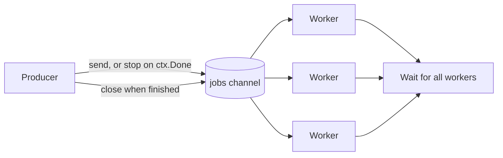

## Why bound concurrency

Starting a goroutine is cheap. The work it does usually is not: a database query holds a connection, an HTTP call holds a socket, a decode holds memory. A service that starts one goroutine per incoming job has no upper limit on any of those, so its capacity is decided by whichever downstream resource runs out first — typically during the traffic spike when it matters most.

A worker pool makes the limit explicit. A fixed number of goroutines read jobs from a channel; when all of them are busy, the producer waits. That waiting is backpressure, and it is the point of the pattern.

## A minimal pool

The pool below runs `workers` goroutines, each receiving from the same channel until it is closed.

```go
package pool

import "sync"

// Run processes every job from jobs using a fixed number of workers.
// It returns once jobs is closed and all in-flight work has finished.
func Run[T any](jobs <-chan T, workers int, handle func(T)) {
	var wg sync.WaitGroup
	wg.Add(workers)

	for range workers {
		go func() {
			defer wg.Done()
			for job := range jobs {
				handle(job)
			}
		}()
	}

	wg.Wait()
}
```

Three properties are worth noticing:

- **The producer owns the channel.** Only the sender closes it; closing is the signal that no more work is coming.
- **Workers exit by themselves.** A `range` over a channel ends when the channel is closed and drained.
- **The caller can wait.** `Run` does not return until every worker has finished, so nothing is left running in the background.

## Cancellation and errors

The minimal pool cannot stop early and cannot report failure. In a service both matter: a request may be cancelled, a deadline may pass, or one job may fail in a way that makes the rest pointless.

`errgroup` from `golang.org/x/sync` handles both. The first error cancels the shared context, and `Wait` returns that error after every worker has stopped.

```go
package pool

import (
	"context"

	"golang.org/x/sync/errgroup"
)

// RunContext processes jobs until the channel is closed, the context is
// cancelled, or a handler returns an error — whichever happens first.
func RunContext[T any](
	ctx context.Context,
	jobs <-chan T,
	workers int,
	handle func(context.Context, T) error,
) error {
	g, ctx := errgroup.WithContext(ctx)

	for range workers {
		g.Go(func() error {
			for {
				select {
				case <-ctx.Done():
					return ctx.Err()
				case job, ok := <-jobs:
					if !ok {
						return nil
					}
					if err := handle(ctx, job); err != nil {
						return err
					}
				}
			}
		})
	}

	return g.Wait()
}
```

The `select` is what makes shutdown prompt. A worker blocked waiting for a job wakes up as soon as the context is cancelled, instead of waiting for work that may never arrive.

<Details summary="What about the producer?">

Cancellation has to reach the sending side too. A producer doing `jobs <- job` blocks forever once the workers have gone. The send needs the same guard:

```go
select {
case jobs <- job:
case <-ctx.Done():
	return ctx.Err()
}
```

</Details>

## Lifecycle: every goroutine needs an exit

Most goroutine leaks come from one of three situations:

1. **A send with no receiver.** A worker writes a result to an unbuffered channel after the consumer has returned.
2. **A receive with no close.** Workers `range` over a channel that the producer never closes on its error path.
3. **A handler that ignores its context.** The pool cancels, but the work inside does not notice.

The rule that prevents all three: whoever starts a goroutine is responsible for knowing how it stops, and for waiting until it has.



## Sizing the pool

There is no universal number. The useful question is what the workers are waiting on.

| Workload | Limited by | Starting point |
| --- | --- | --- |
| CPU-bound | Cores | `runtime.GOMAXPROCS(0)` |
| I/O-bound, one downstream | That downstream’s capacity | Its connection or rate limit |
| Mixed | The scarcer of the two | Measure, then adjust |

For I/O-bound work the pool should not be larger than what it calls can absorb. Forty workers in front of a database pool of ten connections means thirty goroutines queueing for a connection — the bottleneck has only moved somewhere less visible.

The channel’s buffer is a separate decision. An unbuffered channel applies backpressure immediately. A buffer absorbs short bursts, at the cost of holding that many jobs in memory and losing them if the process dies.

## Measuring it

A pool size should be chosen from measurements, not intuition. The benchmark below runs the same workload at several sizes; substitute a handler that represents the real work.

```go
package pool

import (
	"fmt"
	"testing"
	"time"
)

func BenchmarkRun(b *testing.B) {
	handle := func(int) { time.Sleep(time.Millisecond) } // stand-in for real work

	for _, workers := range []int{1, 4, 16, 64} {
		b.Run(fmt.Sprintf("workers=%d", workers), func(b *testing.B) {
			jobs := make(chan int)
			go func() {
				defer close(jobs)
				for i := range b.N {
					jobs <- i
				}
			}()
			Run(jobs, workers, handle)
		})
	}
}
```

Running `go test -bench=Run -benchmem -benchtime=2s` with the 1 ms sleep handler gave:

| Workers | ns/op | Speed-up over one worker |
| ---: | ---: | ---: |
| 1 | 1,146,316 | 1.0x |
| 4 | 285,666 | 4.0x |
| 16 | 71,507 | 16.0x |
| 64 | 17,845 | 64.2x |

Measured on an Apple Silicon laptop (10 logical cores) with Go 1.27.3 on 2026-11-21; every size reported 0 B/op and 0 allocs/op.

The scaling is almost exactly linear, and that is a property of the handler rather than of the pool: a sleeping goroutine uses no CPU, so sixty-four of them wait as cheaply as one. Read it as the best case for I/O-shaped work with a downstream that never pushes back. It says nothing about CPU-bound work, where the gain stops at the core count, and nothing about a real dependency, where the curve flattens as soon as the connection pool or rate limit is reached. The one-worker figure also shows that a 1 ms sleep costs about 1.15 ms per job once timer granularity and the channel hand-off are included.

## When not to use one

- **The work is already bounded.** If a semaphore or the downstream client limits concurrency, a pool adds a second, redundant limit.
- **Jobs are few and short.** `errgroup.SetLimit` gives bounded concurrency without a channel or long-lived workers.
- **Ordering matters.** Workers finish in arbitrary order; preserving order needs extra machinery that may cost more than the parallelism gains.

## Takeaways

- A worker pool exists to apply backpressure. If the producer never waits, the pool is not limiting anything.
- The sender closes the channel; every goroutine has a known exit; the caller waits for all of them.
- Size the pool against the scarcest downstream resource, and confirm it with a benchmark.
