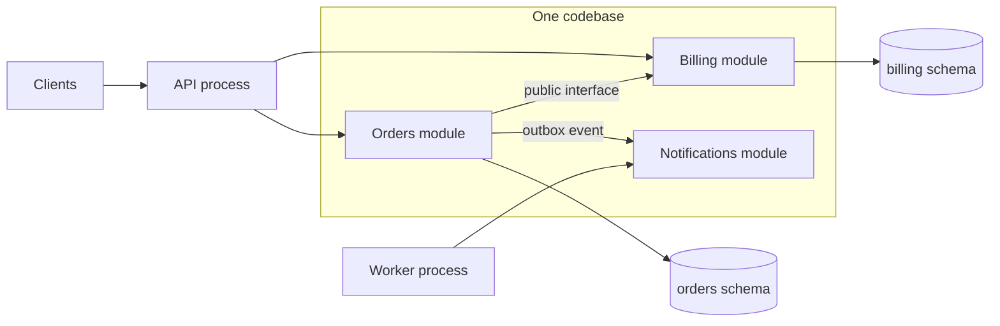

## Context

The question of where one service ends and the next begins rarely arrives on its own. It arrives attached to a pressure: deployments that queue behind each other, one workload starving another of resources, a table that several teams edit and nobody owns, or a codebase where every change touches everything.

Splitting into services is one answer to those pressures, and an expensive one. This note sets out how I decide where a boundary belongs, and separately, whether that boundary needs to be a network hop at all.

## Two decisions, usually made as one

A boundary is a statement about ownership: this part of the system owns this data and these rules, and everything else goes through its interface. A service is a deployment choice: this part runs in its own process and is reached over the network.

The two are independent. A well-drawn boundary can live inside one deployable as a module with its own schema and a narrow public interface. A badly drawn boundary does not improve by being deployed separately; it becomes a distributed version of the same tangle, with latency and partial failure added.

So the thesis is simple: **get the boundary right as a module first, and pay for the network only when something concrete requires it.** Moving a correct module into its own process is mechanical work. Redrawing a wrong boundary between two running services means migrating data and contracts under load.

## How I decide where the line goes

In rough order of weight:

**Data ownership.** Each piece of data should have exactly one writer. If two candidate services would both need to update the same rows in the same transaction, they are one service. The test I use is to list the invariants: things that must be true together, such as "a reservation never exceeds stock". An invariant that spans a proposed boundary either has to be relaxed to eventual consistency, with compensation logic, or the boundary is in the wrong place.

**Rate and reason of change.** Code that changes together belongs together. If most features require coordinated edits on both sides of a line, the line is cutting through a concept. Pricing rules that change weekly and a ledger that changes twice a year are good candidates for separation, because they change for different reasons.

**Failure isolation.** Ask what should keep working when this part is down. Sending notifications can fail without stopping checkout, so a boundary between them is useful. If the caller cannot do anything meaningful without the callee, separating them isolates nothing and the availability of the pair is lower than either alone.

**Workload shape.** A request-serving API and a batch of long-running jobs want different scaling, different timeouts and different deployment cadence. This is often the first legitimate reason to run a second process, and it does not require a second codebase.

**Team ownership.** A boundary that matches a team lets that team deploy without asking. This matters a great deal with many teams and hardly at all with one. Drawing service lines for an organisation that does not exist yet imports the coordination cost early and the benefit never.

Technical layers are notably absent from this list. Splitting into an "API service", a "business service" and a "data service" produces boundaries that every feature has to cross.

## The shape I start from

The default I reach for is a modular monolith: one codebase and one database server, with each module owning its own schema and exposing a small interface. Other modules call that interface and never read the tables directly. Work that has a different shape runs as a separate process built from the same code.

The rules that keep this honest are few. No cross-schema joins or foreign keys between modules. No module imports another module's internals; a lint rule or the package structure enforces it. Communication that can be asynchronous goes through events written in the same transaction as the change. With those rules held, extraction later is a deployment change. Without them, the monolith is only a monolith.

## What a network boundary costs

Every boundary that becomes a service adds the following, permanently:

- **A failure mode per call.** An in-process call succeeds or panics. A remote call can also time out, succeed without the caller learning of it, or succeed twice. Each one needs a timeout, a retry policy and idempotency on the receiving side.
- **The loss of transactions.** What was one commit becomes a saga or an outbox with compensation. That is more code and a weaker guarantee.
- **A contract to version.** Both sides can no longer change in one commit, so every change follows the expand, migrate, contract sequence.
- **An operational surface.** Another pipeline, another set of dashboards and alerts, another thing to patch, another identity to issue and authorise.
- **Harder debugging.** Following one request needs distributed tracing and correlated logs instead of a stack trace.
- **Slower local development and testing.** End-to-end confidence now needs several things running, or trustworthy contract tests in their place.

None of these is a reason never to split. They are the price, and the benefit has to exceed it.

## When I would extract, and when I would not

I extract a module into its own service when one of these is demonstrably true: it needs to scale or be deployed on a schedule that the rest of the system cannot follow; it needs stronger isolation for security or compliance, such as handling credentials or payment data; its failures need to be contained away from the core path; or a separate team owns it and is blocked by a shared release.

I would not extract because the codebase feels large, because a diagram with more boxes looks more scalable, or to enforce modularity that the team does not hold in a single repository. Discipline that fails inside one process will not appear when a network is added.

The opposite mistake is also real. Staying in one deployable too long, with many teams and a release train that everyone waits on, is its own cost. The signal to watch is coordination: when most of the delay in shipping a change comes from waiting on other people's changes, the boundary has become worth paying for.

## Takeaways

- A boundary is about ownership of data and rules; a service is about deployment. Decide them separately.
- Place boundaries where invariants do not cross, where the reasons for change differ and where a failure can be tolerated.
- Start with modules that own their schemas inside one deployable, and enforce the rules mechanically.
- Extract a service for a named pressure, and count the timeout, the lost transaction, the versioned contract and the extra pipeline before doing so.
