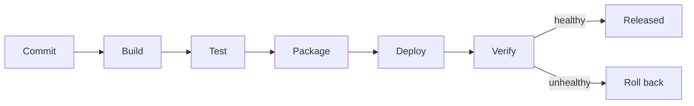

## Context

This note is about the common case for a backend service: a container image, a relational database with migrations, and one or more environments ending in production. The details of the tooling differ between teams. The questions the path has to answer do not.

A delivery pipeline is often described as a list of tools. I find it more useful to describe it as a chain of evidence. A commit is a claim that a change is correct and safe to run. Each stage either adds evidence for that claim or stops the change. Seen that way, two problems become easy to spot: stages that prove nothing, and claims that no stage proves.

## The path, and what each stage proves

**Build** proves the change compiles and is internally consistent. Formatting, linting, type checks and generated code that matches its source belong here. These checks are fast and deterministic, so they run first and fail first.

**Test** proves the behaviour is intended. Unit tests cover logic. Integration tests should run against the real dependencies, a real database engine of the production version in a container, because a mock of the database only proves that the code agrees with the mock. Contract tests prove that the API still matches its published specification.

**Package** proves that what was tested is what will run. The output is one immutable artifact: an image identified by digest, built once. Dependency and image scanning fit here, as does recording which commit produced it. The rule I hold firmly is that the artifact is never rebuilt per environment. Configuration changes between staging and production; the bytes do not.

**Deploy** proves the artifact can start in the target environment with its real configuration and the real schema. Rolling out gradually, to one instance or a small share of traffic first, limits how much a wrong answer costs.

**Verify** proves the change works for actual traffic. Readiness checks, a smoke test against the live endpoint, and a comparison of error rate and latency against the previous version over a fixed window. This stage has an automatic outcome either way: promote, or roll back.

Two separations make the whole path safer. Deploying is not releasing: a feature flag lets code reach production dark and be turned on later, by someone who is watching. And schema changes travel separately from code changes, which the next section explains.

## Failure modes

**The pipeline is too slow, so people route around it.** When feedback takes half an hour, changes get batched, and large batches are harder to review and to roll back. Detect it by tracking pipeline duration as a metric with a budget. Recover by caching dependencies, running stages in parallel and moving slow suites to a later gate.

**Flaky tests teach the team to ignore red.** A test that fails one run in twenty trains everyone to press retry, and a real failure eventually gets retried into production. Track the retry rate per test, quarantine offenders quickly, and treat fixing them as real work.

**The artifact differs between environments.** A rebuild at deploy time, a floating base image tag or a dependency without a lock file means production runs something nobody tested. Pin by digest and promote the same artifact.

**A migration that the previous version cannot live with.** During a rolling deploy, old and new code run against the same schema, and a rollback puts the old code back on the new schema. A migration that drops or renames a column breaks both. The remedy is expand and contract: add the new structure in one release, move reads and writes in the next, remove the old structure only after that. On large tables the migration also needs to avoid long locks, with a lock timeout so that it fails fast instead of queueing every query behind it.

**Rollback that has never been exercised.** A rollback procedure that exists only in a document will fail when it is first needed. Make it the same automated path as a deploy, pointed at the previous digest, and run it deliberately from time to time.

**Verification that only checks the process is alive.** A liveness probe passing says the binary started. It does not say the service can reach its database or return correct answers. A readiness check should exercise real dependencies, and the post-deploy check should look at user-facing signals.

**Configuration and secrets drift.** A value set by hand in one environment is a release that left no trace. Keep configuration in version control, inject secrets at runtime from a secret store, and validate configuration at startup so a missing value stops the rollout at the first instance.

## What I would simplify, and when I would not build all this

The mistake at the other end is building the full machinery too early. For a small service with one maintainer and modest traffic, I would not start with canary analysis, several long-lived environments and a GitOps controller. A pipeline that builds, tests against a real database, produces one image and deploys it with a health check and a one-command rollback covers most of the risk. Each additional stage should be added because a specific failure was observed or is clearly foreseeable, not because a reference architecture includes it.

Where I would spend effort early, even on a small system:

- **Expand and contract migrations as a habit.** It is cheap from the beginning and painful to retrofit.
- **One immutable artifact.** It removes a whole category of problems that cannot be reproduced.
- **A tested rollback.** It turns a bad release from an incident into an inconvenience.
- **Short-lived credentials for the pipeline itself.** The pipeline can write to production, which makes it a target. Workload identity federation is better than long-lived keys stored as CI secrets.

Where I would stay sceptical: a staging environment is useful but never equal to production in data or traffic, so it should not be the only evidence. Manual approval gates feel safe but mostly add delay unless the approver has something specific to check. Small changes released often, with good verification, are safer than large changes released carefully.

## Takeaways

- Treat the pipeline as a chain of evidence. For each stage, name the claim it proves; remove stages that prove nothing and add ones for unproven claims.
- Build one artifact, identify it by digest and promote it unchanged through every environment.
- Keep schema changes compatible with both the previous and the next version of the code, so rolling forward and rolling back are both possible.
- A release is finished when it has been verified against real traffic and could be reversed by an exercised, automated path.
