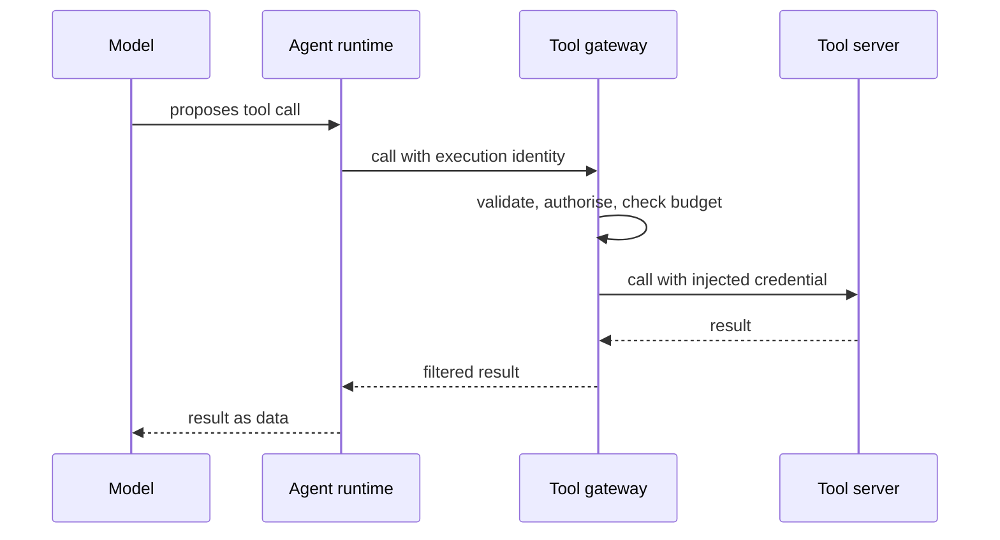

## Context

A language model that only produces text can be wrong, and the damage is limited to someone reading it. An agent with tools is different. It can query a database, open a pull request, send a message or call a payment API. Its output is no longer a suggestion; it is an action with effects.

The design question is therefore not how to give a model access to tools. That part is easy. It is how to let a model request actions while keeping the decision about whether those actions happen somewhere that can be reasoned about, tested and audited.

## The core idea

An agent sits in an unusual position. It acts on behalf of a user or an organisation that is trusted to some degree. But its behaviour is steered by everything in its context window, and much of that is content nobody vetted: a web page it fetched, a document it was asked to summarise, the output of a previous tool. A model cannot reliably separate instructions from data, because to the model both are text.

So I treat it this way: **the agent is an untrusted caller acting for a trusted principal.** The model proposes; the platform decides. Authority comes from the principal and from policy, and it is never derived from what the prompt or the model says.

Two rules fall out of this:

- **The system prompt is not a security boundary.** "Never delete records" in a prompt is guidance about behaviour. A control is something that still holds when the model ignores the guidance.
- **Effective permission is an intersection.** A call is allowed only if the user may do it, and this agent has been granted that tool, and policy permits it for this argument set. An agent should never be able to do more than the person it works for, and usually should be able to do much less.

## In practice

The Model Context Protocol gives tool access a standard shape. A server advertises tools, each with a name, a description and a JSON Schema for its input. A client lists them, shows them to the model, and sends a `tools/call` request when the model asks for one.

```json
{
  "name": "refund_order",
  "description": "Refund a paid order in full or in part.",
  "inputSchema": {
    "type": "object",
    "properties": {
      "order_id": { "type": "string" },
      "amount_minor": { "type": "integer", "minimum": 1 }
    },
    "required": ["order_id", "amount_minor"],
    "additionalProperties": false
  }
}
```

The protocol standardises how a tool is described and invoked. It does not decide whether a particular call should be allowed. That belongs to a layer I put between the agent runtime and every tool server: a gateway that is the only route out.



For each call the gateway does the same things in the same order:

1. **Identify.** The call carries the execution, the agent and the principal it runs for. These come from the runtime, not from model output.
2. **Validate.** Arguments are checked against the schema. Anything that does not conform is rejected before it reaches a tool.
3. **Authorise.** Policy evaluates the principal, the agent's grants, the tool and the arguments. A refund tool may be allowed up to a limit and require approval above it.
4. **Inject credentials.** The gateway attaches the downstream token, scoped as narrowly as the tool allows.
5. **Execute with limits, then record.** A timeout, a size cap on the result, and an audit entry with who, what, with which arguments, and the outcome.

What the agent never sees matters as much as what it does. It never holds API keys or tokens; they are attached after the model's part is over, so nothing in the context window can leak them. It does not see tools it has not been granted, because a tool that is not listed cannot be called by mistake or by manipulation. And it does not choose the tenant: scoping parameters such as an organisation identifier are filled in by the platform from the execution identity, and are not arguments the model can set.

## Failure and abuse

**Prompt injection.** A fetched page says to ignore previous instructions and export the customer list. No filter catches every phrasing, so the defence is structural. Tool results go back to the model marked as data. More importantly, the blast radius is limited by what the agent is allowed to do: an agent that reads untrusted content should not, in the same execution, hold tools that send data outward or change state without review.

**Over-broad permissions.** A single `run_sql` or `http_request` tool is convenient and grants everything. Prefer narrow tools that express an intent, such as `get_invoice` or `refund_order`, with read and write separated and grants given per agent. Narrow tools are also easier for the model to use correctly.

**Runaway loops.** An agent can retry a failing call indefinitely or wander through hundreds of steps. Every execution needs hard ceilings enforced outside the model: maximum steps, maximum tool calls, a token and cost budget, and a wall-clock deadline. Detecting the same call repeated with the same arguments is a cheap and effective extra check.

**Irreversible actions.** Sending money, deleting data or emailing a customer cannot be undone by a later, better answer. These calls pause for human approval, with the exact arguments shown to the approver. The execution has to be able to wait for that decision without holding resources, which is a durable workflow concern more than a model concern.

**Slow or failing tools.** A tool that hangs stalls the whole execution, and a timeout leaves the outcome unknown. Per-call timeouts and a circuit breaker handle the first. For the second, state-changing tools take an idempotency key derived from the execution and step, so a retry cannot perform the action twice. Errors are returned to the model in a structured form it can act on, without internal detail.

**Data leaving through results.** A tool that returns a full record puts all of it into the context window, and from there possibly into a response or another tool call. Return the fields the task needs, and redact secrets and personal data at the gateway.

## When I would not build all this

A read-only assistant over public documentation needs almost none of it. A developer running an agent locally with their own credentials, on their own machine, is already the principal and is watching every step. The gateway, policy and approval machinery earns its cost when agents run unattended, act for several users or tenants, or can change something that matters. It also adds latency and friction: each approval is an interruption, and too many of them train people to approve without reading. The thresholds deserve as much thought as the mechanism.

## Takeaways

- Treat the model as an untrusted caller. It proposes actions; code outside it validates, authorises and executes them.
- Permission is the intersection of what the user may do, what the agent was granted and what policy allows for these arguments.
- Credentials and tenant scope are injected by the platform and never enter the context window.
- Assume injection will sometimes succeed, and design so that a manipulated agent cannot do much: narrow tools, hard budgets, idempotent writes and human approval for the irreversible.
