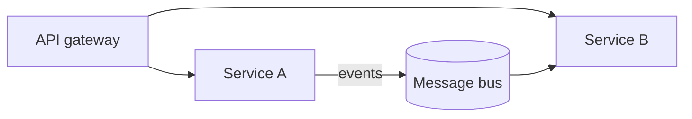

## Context

<Placeholder>
  Describe the system and the pressure that made its boundaries a question: team growth, scaling limits,
  deployment coupling, or unclear ownership.
</Placeholder>

## The shape of the system

<Placeholder label="Example diagram — replace">
  Fenced `mermaid` blocks render as diagrams that follow the site theme. Swap the generic example below for
  your own.
</Placeholder>

## How to decide

<Placeholder>
  Lay out the criteria you actually use: data ownership, rate of change, failure isolation, team
  boundaries. Explain which matter most and why.
</Placeholder>

## What it costs

<Placeholder>
  Every boundary adds a network call, a contract and an operational surface. Describe the costs honestly.
</Placeholder>

## Takeaways

<Placeholder>Close with the two or three points you want a reader to remember.</Placeholder>
