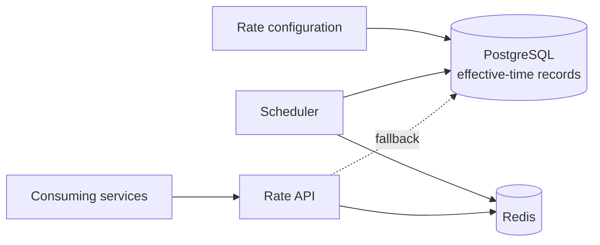

## Problem

<Placeholder>
  Describe why rates needed to be scheduled and propagated rather than simply stored: who sets them, who
  consumes them, and what goes wrong when a rate is late, early or inconsistent between consumers.
</Placeholder>

## Technical challenges

<Placeholder>
  Prompts: making a rate take effect at an exact time; keeping every consumer consistent at the moment of
  change; serving reads at high throughput; making scheduled jobs safe to retry; auditing who changed what.
</Placeholder>

## Architecture

<Placeholder label="Illustrative sketch">
  This diagram is a starting point inferred from the project summary. Replace it with the real data flow,
  including how the Go and Laravel components divide responsibility.
</Placeholder>

## Architecture decisions

<Placeholder>
  Record the key decisions — for example how effective time is modelled, where the source of truth lives,
  and how cache invalidation is handled — with the alternatives you considered.
</Placeholder>

## Implementation

<Placeholder>
  Explain the schema for effective-time configuration, how jobs are scheduled and made idempotent, and how
  the read path is kept fast.
</Placeholder>

## Outcomes

<Placeholder>
  State what changed once the system was in place. Only include verified results; no throughput or latency
  numbers until they can be sourced.
</Placeholder>
