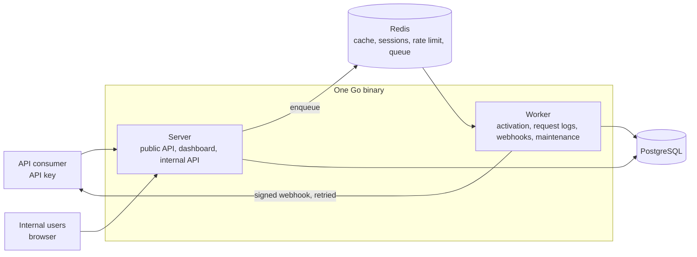

## Project Overview

FX is a currency rate scheduler: it stores rates with a validity period, activates each one at its effective time through a background worker, and answers current and historical lookups through an API. Every API call is tracked and every internal action is audited. I own its architecture and engineering end to end.

It ships as a single Go binary that runs either as the server or as the background worker, backed by PostgreSQL and Redis.

## Business Context

This is an internal platform, and its business details are intentionally not published. The case study focuses on the engineering.

## Problem Statement

A rate is not just a number; it is a number with a validity period. That raises problems a simple table of current rates does not solve:

- A new rate must take effect at an exact moment, for every consumer at once.
- A rate that is scheduled but not yet effective must never be visible to API consumers early.
- Looking up the rate "as of" a past moment must return the same answer forever, even if activation ran late.
- Two rates for the same pair must never be valid at the same time.
- Every change has to be attributable to a person, and the record of it must be tamper-resistant.

## Functional Requirements

- Schedule rates per currency pair with a validity period, moving through an explicit lifecycle: `draft → pending_review → scheduled → active → expired`.
- Optional two-person approval, where the approver must differ from the creator.
- A read-oriented API for current and as-of lookups and amount conversion.
- Signed webhooks when a rate takes effect, with retries.
- Tracking of every API call, linkable to the rate that was returned.
- An internal dashboard and internal JSON API sharing one session and one role-based permission model.

## Non-functional Requirements

- **Exactness.** Money and rates are decimals end to end and are serialised as strings; nothing passes through a float.
- **No overlap, enforced by the database** rather than by application checks.
- **No retroactive activation.** A schedule that was not approved before its start time is cancelled, never back-dated.
- **Auditability.** The audit log is append-only at the database level.
- **Bounded latency on every query.** Each query runs under a context timeout, backed by a server-side `statement_timeout`.

No availability or latency objective was formally set, so none is stated here.

## Technical Challenges

**Open-ended validity.** Most rates are valid until replaced. If such a rate occupied the whole future, the next one could never be scheduled.

**Exact-time activation with several workers.** Any number of workers may run. Each activation must happen once, close to the second it is due.

**Cache invalidation races.** A reader that fetched the old rate just before activation must not write it into the cache just after.

**Not losing notifications.** API consumers rely on the activation webhook. A queue outage at the wrong moment must not drop it.

**Late activation.** If activation runs a minute late, historical lookups for that minute must still be correct.

## Architecture Overview

| Layer | Responsibility |
| --- | --- |
| Domain | Pure rules with no I/O: state machine, as-of lookup, conversion, rounding |
| Services | Use cases; each writes its audit record in the same transaction as the change |
| Storage | Connection pool, per-query timeouts, transaction helper; SQL compiled to typed Go |
| Authentication | Single sign-on, server-side sessions, the guard (roles, CSRF, step-up), two-factor |
| HTTP | Public API, internal API and the dashboard, each as its own layer |
| Worker | Queue tasks, handlers and the scheduler |
| Shared packages | Standard error format; webhook signing and verification |

## Technology Stack

- **Go** with chi, pgx and sqlc, golang-migrate, go-redis, asynq, `slog` and the Prometheus client.
- **PostgreSQL 16**: `DECIMAL(24,12)`, an `EXCLUDE` constraint, monthly partitions.
- **Redis 7**: cache, sessions, rate limiting and the job queue.
- **Dashboard**: Go `html/template`, HTMX 2 and precompiled Tailwind CSS — no Node.js in the build.

The dashboard is server-rendered on purpose; the reasoning is under the trade-offs below.

## System Design

**The schedule state machine.** Only a `draft` can be edited. `active` and `expired` schedules are immutable, and a schedule can be cancelled from any state before `active`. When two-person approval is off, submitting schedules the rate directly.

**Activation.** Two mechanisms work together. A periodic task runs every minute, marked unique so several workers do not duplicate it. In addition, approving a schedule enqueues a task to run exactly at its effective time, so activation normally happens within the second.

Each pair is processed in one transaction that holds a PostgreSQL advisory lock keyed on that pair. Inside it, the activator marks the new schedule `active` and closes its predecessor: the old schedule's end is set to the **successor's start time**, not to the time the activator happened to run. That is what keeps historical lookups exact after a late activation.

**Notifications.** The activation event is written to an outbox table in the same transaction. A sweep every minute re-dispatches anything not yet sent, so a Redis interruption cannot lose a webhook.

## Database Design

**Overlap is prevented by an exclusion constraint.** For schedules in the states that occupy the timeline, the database rejects any two rows for the same pair whose validity ranges overlap. A schedule with an end time occupies `[from, to)`. A schedule with no end time occupies only its **start instant** — which is what allows the next rate to be scheduled while the current one is open-ended. Drafts and cancelled schedules occupy nothing, so conflicts surface when a schedule is submitted.

**Audit log is append-only in two layers.** The application's database role has only `INSERT` and `SELECT` on the table, and a trigger rejects `UPDATE`, `DELETE` and `TRUNCATE` for every role.

**Two database roles.** A migrator role owns the schema and runs migrations. The application role, used by the server and the worker, has no DDL rights.

**Request logs are partitioned by month**, with a default partition as a safety net and a daily job that creates upcoming partitions. A unique key on the request id makes the log writer idempotent under retries.

## API Design

The public API is a small, read-oriented REST interface: consumers can read the rate in effect now or at a past moment, and convert an amount. It is described by an OpenAPI contract.

The design principles matter more than the endpoints:

- **Minimal disclosure.** Consumers receive only what they need. Internal identifiers never leave the system, and a rate cannot be read before it takes effect.
- **Exact arithmetic.** Amounts and rates are exchanged as decimal strings, with explicit rounding rules.
- **Predictable errors.** Failures follow a standard problem format with a machine-readable code and a request identifier.
- **Fair use.** Each consumer is rate-limited and told when to retry.
- **Traceability.** Every call can be linked back to the rate that was served.

## Security Architecture

**Internal sign-in** uses OpenID Connect with PKCE, restricted to an allowed identity domain, followed by mandatory TOTP two-factor authentication. Only pre-registered accounts can sign in.

**Sessions** are server-side, behind a hardened cookie. The session id is rotated after sign-in and again after 2FA, and a role change, lock or 2FA reset revokes all of a user's sessions.

**Step-up authentication.** Sensitive actions — approving a schedule, creating or revoking an API key, rotating a webhook secret — require a recent TOTP code.

**Authorization** is role-based and checked on the server for every route. Hidden menu items are only a convenience. A denied request is audited.

**API keys** are high-entropy and stored only as a hash. Each consumer can also be restricted to a list of network ranges, and revocation takes effect immediately.

**Secrets at rest** are encrypted with authenticated encryption and bound to their owner, so a ciphertext cannot be moved between accounts.

**Webhooks** are signed, and a small verification library is provided to receivers.

## Scalability Strategy

- Both the server and the worker are stateless and can run as multiple instances.
- Concurrency control is per pair, through advisory locks, so unrelated pairs never wait on each other.
- Rate lookups are cached in Redis. The cache entry's lifetime never exceeds the validity window of the rate it holds.
- Request logs — the fastest-growing table — are partitioned by month.
- Consumers are limited by a token bucket per API key.

No load test has been run yet, so no throughput figure is claimed.

## Reliability Strategy

| Failure | Behaviour |
| --- | --- |
| Activation runs late | The predecessor is closed at the successor's start time, so history stays exact. |
| Redis unavailable during activation | The webhook event is already in the outbox; a sweep delivers it later. |
| Queue unavailable for request logs | The log is written directly to the database. |
| Webhook endpoint down | Retries with exponential backoff and jitter. |
| Two workers pick up the same pair | The advisory lock lets only one proceed. |
| A schedule is still awaiting approval at its start time | It is cancelled automatically, never activated retroactively. |

The worker exposes metrics for activator runs, webhook deliveries, rate lookups and schedule transitions. Activation can also be triggered manually; the lock makes that safe to run alongside the workers.

## Engineering Trade-offs

**Server-rendered dashboard over a single-page application.** Less interactivity, in exchange for one place to enforce permissions and CSRF, a strict content security policy with no inline scripts, tokens kept out of the browser, and no JavaScript build.

**A fast hash over a slow one for API keys.** A slow key-derivation function protects low-entropy secrets such as passwords. These keys are long and random, so a slow hash would add latency to every request without adding security.

**An open-ended rate occupies only its start instant.** This makes scheduling the next rate possible, and means that a rate with an explicit end and no successor leaves a gap, which the dashboard flags.

**One binary with several commands.** Simpler builds and deployments than separate services, with the server and worker still scaling independently as processes.

## Implementation Details

**Closing the cache race.** A reader notes the cache version *before* querying the database, and writes its result under that version. The activator bumps the version after it commits. A reader holding a pre-activation result therefore writes under a version that is already stale, and cannot overwrite fresh data.

**Money.** A rate entered with more precision than the column allows is rejected rather than rounded.

**Testing.** Unit tests cover the domain rules, TOTP with a controllable clock, and OIDC against a mock provider. Integration tests run against real PostgreSQL and Redis containers and cover migrations, the exclusion constraint, the activator — late activation, closing the predecessor, automatic cancellation, the outbox — the advisory lock under parallel workers, as-of lookups, cache invalidation, log partitioning and idempotency, the append-only audit log, and webhook signing and retries.

## Results and Business Impact

Engineering outcomes only:

- **Unattended, exact activation.** Scheduled rates take effect on their own at their start time, and consumers are notified by webhook instead of polling.
- **Reproducible history.** An as-of lookup for a past moment returns the rate that applied then, including after a late activation.
- **Invariants held by the database.** Non-overlap and the append-only audit log are enforced below the application, and both are covered by integration tests against real PostgreSQL and Redis.
- **Traceability.** Every change is attributable, and every API call can be traced to the rate it was served.

Business results and usage figures are not published.
