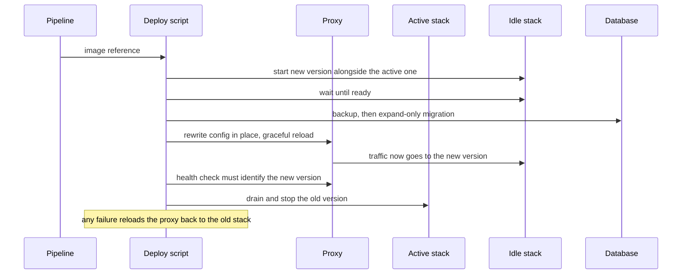

## Project Overview

This case study covers the production infrastructure practice I have designed and operated: containerised deployments on Linux hosts and on managed Kubernetes, CI/CD pipelines on GitHub Actions, Nginx and Cloudflare at the edge, and production monitoring.

It describes patterns I apply across systems rather than the estate of any one organisation.

## Business Context

These are internal platforms, and their business details are intentionally not published. The case study focuses on the engineering.

## Problem Statement

I was responsible for the path from a merged commit to a running service, and for keeping that service reachable afterwards. The workloads fell into two shapes:

- **A microservice platform on managed Kubernetes** — many services, several environments, traffic that varies.
- **Individual applications on Linux hosts** — a web tier, queue workers and a scheduler per application, each with its own database and cache.

For both, "reliable" had to mean the same things:

- A release does not interrupt users.
- A bad release is detected automatically and undone automatically.
- What is running can always be named exactly.
- The data survives a failed deployment.

## Functional Requirements

- Build one container image per commit, behind quality gates: static analysis, tests and secret scanning.
- Deploy to development automatically; deploy to production only on an explicit, approved release.
- Apply database migrations as part of the release, in a defined order relative to the code, with a backup beforehand.
- Verify the new version with a health check before it receives all traffic, and roll back automatically on failure.
- Terminate TLS and expose exactly one public entry point per application.
- Provide logs and resource metrics sufficient to diagnose an incident.

## Non-functional Requirements

No contractual availability or latency targets are published for these systems. The design goals were:

| Quality | Goal |
|---|---|
| Availability | No refused connections during a deployment; no single node on the request path where the platform allows it |
| Reproducibility | The same image runs in every environment; a deployed version never changes underneath its name |
| Reversibility | Rollback is a traffic switch, not a rebuild |
| Safety | Schema changes must be compatible with the version already serving traffic |
| Security | Minimal public surface, least-privilege deploy access, secrets outside images and repositories |
| Operability | A release can be run, understood and recovered by any engineer on the team from a written runbook |
| Cost | Infrastructure proportionate to the workload, including the choice not to use an orchestrator |

## Technical Challenges

- **From hand-managed servers to repeatable deployments.** The starting point was deployments that depended on what was on a server. The target was a server holding only a container runtime, configuration and state, with everything else arriving as an image.
- **Zero-downtime releases without an orchestrator.** On a single host there is no rolling update to lean on. Two versions have to run side by side and traffic has to move between them without dropping a connection.
- **Migrations while the old version is still serving.** During the overlap both versions use the same database. A migration that is correct for the new code can break the old code that is still answering requests.
- **Silent failure modes in the switch itself.** A proxy reload can report success while nothing has changed — because a mounted configuration file was replaced rather than rewritten, or because an upstream name was resolved once at start-up. These fail without an error message.
- **Securing the edge.** Keeping databases, caches and internal endpoints off the public network, and making sure the application sees the real client address behind two layers of proxy.
- **Diagnosing across layers.** A gateway error at the edge may originate in DNS, the proxy, the runtime, the application or the database. Diagnosis has to narrow the layer first, then the cause.

## Architecture Overview

<InteractiveDiagram id="production-infrastructure" />

The diagram is a simplified model of the delivery and request paths, not an inventory of any one environment.

## Technology Stack

| Technology | Why it was chosen |
|---|---|
| Docker | One artefact for every environment. Multi-stage builds keep build tooling out of the runtime image |
| Docker Compose | Enough orchestration for a single host: dependency ordering, health checks, restart policy. No control plane to operate |
| Kubernetes on Google Cloud | For the microservice platform, where many services, autoscaling and multi-node failure tolerance justify an orchestrator |
| Helm | One chart shape with a values file per environment, so services differ in configuration rather than in manifests |
| Nginx | Reverse proxy, static file server and the traffic switch for blue/green releases; graceful reload is what makes the switch connection-safe |
| Cloudflare | TLS, caching, filtering and traffic management in front of every origin |
| GitHub Actions | Pipelines live beside the code, with protected environments and required approval for production |
| PostgreSQL and Redis | The primary datastore and the cache/queue backend for the single-host applications |
| Linux | The host for everything; deploy users, file ownership and process signals are part of the design, not an afterthought |

## System Design

**Delivery path.** A push triggers quality gates, then a single image build tagged with the commit identifier. The pipeline copies the deployment scripts to the target and invokes one orchestrating script, which owns the whole release and exits non-zero on any failure.

**Blue/green on a single host.** Each application runs two identical stacks — "blue" and "green" — behind one shared proxy. Only one receives traffic.

Nothing the public reaches is stopped or recreated during a release. A graceful reload starts new proxy workers on the new configuration and lets the old ones finish their in-flight requests.

**Shared and per-colour components.**

| Component | Instances | Reason |
|---|---|---|
| Web application | One per colour | The unit being switched |
| Queue workers | One per colour, both running during the overlap | Jobs are claimed exactly once by the queue backend; the retiring worker finishes its current job before exiting |
| Scheduler | One, colour-agnostic | Two schedulers would run every scheduled task twice |
| Proxy, cache, database | One, shared | State must not be duplicated or switched |

**Request path.** Client traffic reaches Cloudflare, then a host-level reverse proxy that terminates TLS, then the application's own proxy container bound to the loopback interface, then the active application stack. Static assets are served by the proxy directly; dynamic requests go to the application runtime.

**Synchronous and asynchronous work.** Requests are synchronous. Anything slow or retryable — outbound notifications, processing of inbound events, scheduled maintenance — is queued and handled by workers that share the application image but not its request lifecycle.

**Kubernetes platform.** On the microservice platform the same principles map onto native objects: replicated deployments instead of colours, ingress controllers as the entry point, node pools separated by purpose, and Helm values per environment.

## Database Design

Infrastructure does not own the application schema, but it owns the rules under which the schema changes.

**Expand, then contract.** During a release two versions of the code run against one database, so every migration must be compatible with the version still serving.

| Allowed in a release | Not allowed in the same release |
|---|---|
| Add a nullable column or one with a default | Drop a column |
| Add a table or an index | Rename a column or table |
| Backfill data | Change a type incompatibly |

Removing a column takes two releases: one that stops using it, and a later one that drops it.

**Rollback switches code, not data.** Returning to the previous colour does not undo a migration. This is exactly why the expand-only rule is mandatory rather than advisory: the old code must still run against the new schema.

**Backups around change.** A database dump is taken before migrations run, with a bounded number of dumps retained, in addition to scheduled backups. Database data lives on volumes or hosts whose lifecycle is separate from application deployments, so replacing an application never touches its data.

**Tracking what has been applied.** Where the framework does not track this itself, the pipeline computes which migrations a release adds relative to the last successfully deployed commit and applies only those. The marker for that commit is written only after the health check passes, so a failed release does not move the baseline.

## API Design

The infrastructure exposes a small operational contract rather than an application API. I describe it in general terms only.

- **Health.** Every application provides a health endpoint that checks its real dependencies — database, cache, storage — and reports which version and which colour is answering. The deploy script requires both a healthy status and the expected colour; a healthy response alone proves nothing, because the old version is healthy too.
- **Readiness versus liveness.** Start-up is given a realistic time budget before a failure is declared. A budget that is too short causes rollbacks of perfectly good releases.
- **Deploy interface.** A release is one script with a small set of inputs: the image reference, the target location and the health location. A rollback is a second script with no required inputs.
- **Internal endpoints stay internal.** Health and administrative routes are reachable from the host and the pipeline, not from the public internet.

## Security Architecture

- **One public entry point.** Only the reverse proxy publishes ports. Databases and caches publish none; application containers are reachable only through the proxy.
- **TLS at the edge and at the origin.** Cloudflare fronts each origin, and the host proxy terminates TLS with automatically renewed certificates. Production configurations add strict transport security and rate limiting.
- **Allow-list routing.** Where a platform exposes several hostnames, the entry proxy forwards only explicitly listed route groups. Internal and administrative paths are not routed at all.
- **Secrets outside artefacts.** Images contain no secrets. Application configuration lives in a file on the host with restrictive permissions, never committed; pipeline credentials are scoped to protected environments.
- **Least-privilege deployment.** Releases run as a dedicated unprivileged user. Containers run as a non-root user whose identifiers match the ownership of mounted volumes.
- **Environment separation.** Development and production use separate pipeline files, separate hosts and separate credentials, so a change to one cannot reach the other by accident. Production additionally requires a published release and a reviewer's approval.
- **Pre-flight refusals.** The production deploy script inspects the target configuration and refuses to proceed if safety-critical settings are in a development state — debug output enabled, a non-production environment mode, or a non-HTTPS base address.
- **Secret scanning** runs as a pipeline gate before any image is built.
- **Network segmentation.** Where a platform separates trust levels, components that need no outbound access are placed on an internal-only network.

The trust boundaries are the edge, the host proxy, and the container network. Each one narrows what the next can be reached with.

## Scalability Strategy

**On Kubernetes.** Stateless services scale by replica count, and node pools autoscale between a minimum and a maximum. Capacity is prepared ahead of known traffic increases by raising the minimum. Workloads with special requirements get dedicated pools, isolated with labels and taints. Ingress controllers are replicated across nodes so the entry layer grows with the traffic.

**On single hosts.** Scaling is vertical: more worker processes, tuned runtime pools, a larger machine. Resource limits are set per container so one component cannot starve the others. This is a deliberate ceiling, and the design keeps the exit open.

**Keeping the exit open.** Stateful components are optional parts of the stack. Pointing the application at an external or managed database or cache is a configuration change, not a code change, so the first scaling step — moving state off the host — does not require a redesign.

**First bottleneck.** On both platforms it is the primary database, not the application tier. That shapes the surrounding choices: static assets served by the proxy, long cache lifetimes for hashed assets, and deferrable work moved to queues.

## Reliability Strategy

**Automatic rollback.** The deploy script installs a failure handler before it changes anything. If any step fails before the release is committed, the proxy is reloaded back to the previous colour, the new stack is stopped, and diagnostics — container status and recent logs — are written to the pipeline output. The pipeline run fails and the previous version keeps serving.

**Health-gated promotion.** The new version receives traffic, then must pass repeated health checks within a fixed budget. Only after that is the old version drained.

**Graceful draining.** The retiring stack is given a stop timeout longer than the longest job a worker may run, so a deployment never kills a job mid-flight.

**Dependency ordering.** Components start in a defined order and wait on health checks, not on timers: datastore first, then migrations, then workers, then the web tier. This removes cold-start races where an application connects before its dependency is listening.

**Restart policies and log rotation.** Containers restart on failure, and logs are size-capped so a noisy service cannot fill a disk.

**Verified, not assumed.** I wrote a zero-downtime test as a runbook: a probe requests the health endpoint several times per second for the whole deploy window while a release runs, counting successes, failed responses and connection errors. In the most recent recorded run on a staging environment the probe saw no connection-level errors. The test is repeated whenever the deploy script, the proxy template or the container start-up changes.

**On Kubernetes.** The entry layer runs on standard rather than preemptible nodes, spread across zones, with ingress controllers distributed over them. This followed a stability review that traced intermittent traffic interruptions to ingress controllers scheduled on preemptible nodes.

**Observability.** Resource dashboards per node and per pod, centralised application logs, and structured proxy access logs. The health endpoint's per-dependency output turns "the site is down" into "the cache is unreachable" in one request.

## Engineering Trade-offs

**Kubernetes where it earns its keep, Compose where it does not.**
For a platform of many services with variable load, an orchestrator pays for itself. For a single application on one host it adds a control plane to learn, operate and pay for. I recorded this as an architecture decision, with the alternatives considered: a single-node Kubernetes distribution, a clustered Docker mode, and managed services. The accepted cost is that one host is a single point of failure, and that the decision must be revisited when multi-node availability is required.

**Blue/green instead of in-place restart.**
Two stacks cost roughly double the application memory during the overlap and make the deploy script more intricate. In return, the release is a reversible switch and the previous version stays warm.

**One image for every role.**
Web, worker and scheduler run the same image with different commands. The image is larger than a purpose-built one, but there is one build to cache, one artefact to scan, and no version skew between roles.

**The same Dockerfile for development and production servers.**
A production-only build would be a build nobody rehearses. Using the shared one means the production image has been built many times before the day it matters.

**Immutable references over convenient tags.**
Deploying by commit identifier, or by content digest in production, means a name can never silently point at different code. The cost is that "latest" is not a thing you can deploy, and tooling has to carry the exact reference around.

**Duplicated pipeline files per environment.**
Development and production pipelines are separate copies rather than one parameterised file. A fix to a shared mechanism must be applied twice by hand. In exchange, no change to the development pipeline can reach production unintentionally.

**Human-triggered production releases.**
Production deploys on a published, approved release rather than on merge. It is slower, and it makes every production change a decision with a version number attached.

**Preemptible versus standard nodes.**
Preemptible capacity is cheaper and disappears without notice. Application pods that tolerate rescheduling can use it; the entry layer and stateful components cannot.

## Implementation Details

**Three details that make the traffic switch actually work.** Each one fails silently if done wrong.

1. *Rewrite the proxy configuration in place.* A configuration file mounted into a container is pinned by inode. Replacing the file with a move creates a new inode, the container keeps reading the old one, and the reload reports success while changing nothing. The script overwrites the file's contents instead.
2. *Resolve the upstream per request.* If the proxy resolves the application's name once at load time, a reload that changes only the name still dials the address of the old container. The upstream is held in a variable and resolved through the container network's DNS on each request.
3. *Serve static assets from the host, for both colours.* Each stack copies its built assets to its own shared directory on start-up, and the proxy mounts both read-only. The new version's hashed bundles are on disk before any traffic moves, so the switch can never serve a page that references a bundle the proxy cannot find.

**Image builds.** Multi-stage builds: one stage resolves backend dependencies, one builds frontend assets, and a minimal runtime stage receives only their outputs. Layers are ordered so that a change to application code does not invalidate the dependency layers, and the pipeline reuses the build cache between runs.

**Container entrypoint.** Start-up prepares writable directories, publishes static assets to the shared volume, warms framework caches, then drops privileges before starting the main process.

**File ownership.** The user inside the container is given the same numeric identifiers as the deploy user on the host. Mismatches here produce permission errors that only appear on the server.

**Colour as state.** Which colour is live is recorded in a small file on the server, not in the repository. It is state, not configuration: it depends on how many times that host has deployed.

**Diagnosing by layer.** The pipeline maps a failed health check to a likely layer and prints a hint with it:

| Symptom at the proxy | Likely layer |
|---|---|
| Gateway error or no response | The application runtime did not start |
| Service unavailable | The application is up but a dependency check failed |
| Internal error | The application booted and threw; read its log |

**Kubernetes right-sizing.** I reviewed per-pool resource use against what was provisioned, moved monitoring and cluster-management workloads off application nodes, consolidated pools, and removed unused resources.

**Runbooks.** First-time host setup, routine deployment, rollback, backup and restore, the zero-downtime test, and a table of common failures with their recovery steps are written down beside the code they describe.

## Results and Business Impact

Engineering outcomes only; business results are not published, and I do not quote uptime or cost numbers that I cannot source.

- **Releases became routine.** A deployment is a pipeline run with automatic verification and automatic rollback, not a maintenance window.
- **Zero-downtime is tested rather than claimed.** The release mechanism has a repeatable test, and it is re-run whenever the mechanism changes.
- **Rollback is one command.** The previous version stays available as the other colour, and every deployed image can be named exactly.
- **The same pattern, reused.** The blue/green design started on one application and was carried to others, each time with its decisions and pitfalls documented.
- **A leaner, steadier cluster.** On the Kubernetes platform, right-sizing consolidated node pools while moving the entry layer onto stable, zone-spread capacity.
- **Operational knowledge is written down.** Runbooks and decision records mean the infrastructure can be operated by the team, not only by the person who built it.
