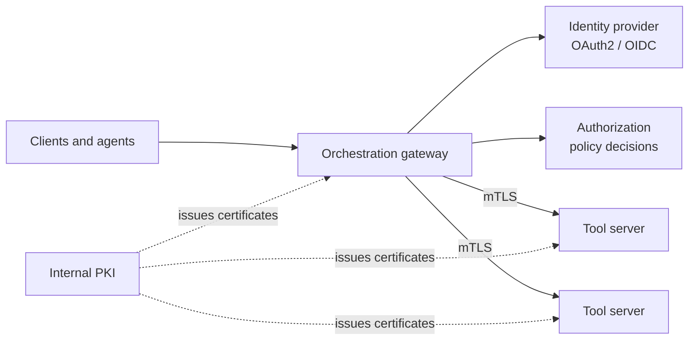

## Problem

<Placeholder>
  Describe the problem this platform exists to solve. Who needed agents to call tools across services, what
  was missing or unsafe before, and which constraints (security, tenancy, latency, team size) shaped the answer.
</Placeholder>

## Technical challenges

<Placeholder>
  List the hard parts in concrete terms. Prompts: establishing identity for agents and tools; authorising a
  tool call on behalf of a user; securing service-to-service traffic; executing tools that live in different
  processes or networks; handling partial failure and retries.
</Placeholder>

## Architecture

<Placeholder label="Illustrative sketch">
  This diagram is a starting point inferred from the project summary, not a record of the real topology.
  Replace it with the actual components and trust boundaries.
</Placeholder>

## Architecture decisions

<Placeholder>
  Record the decisions that mattered and the alternatives you rejected. A useful shape per decision:
  context, options considered, the choice, and the trade-off you accepted.
</Placeholder>

## Implementation

<Placeholder>
  Explain how it is built: service layout, how tools are registered and discovered, how tokens and
  certificates are issued and rotated, and what the request lifecycle looks like end to end.
</Placeholder>

## Outcomes

<Placeholder>
  State what the platform made possible. Only include results you can stand behind — leave metrics out
  until they can be sourced.
</Placeholder>
