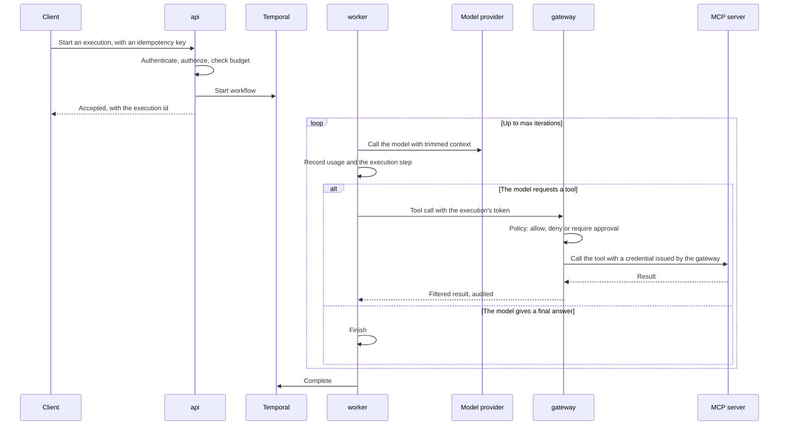

## Project Overview

MCP Platform runs and governs many AI agents. Its defining rule is that every action an agent takes on an external system goes through an MCP tool — the Model Context Protocol — where the platform checks permission, records an audit entry and accounts for cost. I am its architect and lead engineer.

It is built in Go as one repository producing three processes: a management API, an MCP gateway and an execution worker. It is being implemented in phases and has not been deployed; the first two phases run end to end on a local machine, and what is described here is the working design, not a finished product.

## Business Context

This is an internal platform, and its business details are intentionally not published. The case study focuses on the engineering.

## Problem Statement

Giving a language model direct access to credentials and APIs puts the model in charge of authorization. A prompt injection or a bad plan then has the same reach as the credential. The problem is to let agents do real work while keeping three things outside the model: the decision to allow an action, the credentials needed to perform it, and the record of what happened.

## Functional Requirements

- Define agents as immutable versions, separate from their executions.
- Run single-agent executions, planned multi-step executions and multi-agent delegation, plus a direct-tool path with no language model involved.
- A registry of MCP servers and tools, with discovery and health.
- A policy decision on every tool call: allow, deny or require approval.
- A usage ledger, budgets and a model router.
- Multi-tenancy, an immutable audit trail and end-to-end tracing.

## Non-functional Requirements

| Requirement | Mechanism |
| --- | --- |
| Fault tolerance and recovery after restart | Execution state lives in Temporal; activities are idempotent by step id |
| Idempotent execution | An idempotency key on the REST API; a key derived from execution and step for tool calls with side effects |
| Cancellation | Cancelling a parent workflow propagates to child workflows and to the context of each activity |
| Backpressure | Concurrency limits per organisation; callers are told when to retry |
| Graceful shutdown | API and gateway drain to a deadline; the worker stops polling and lets Temporal reassign |
| Resource limits | Per execution: iterations, tool calls, wall-clock time, tokens, cost, tool result size |
| Retries | Declared per activity type; errors classified as retryable or not; the gateway reserves each step, so a retried tool call with side effects is not executed twice |
| Observability | One trace id end to end; execution, organisation and agent ids on every span, log and metric |

No service level or throughput is committed at this stage; objectives will be set from load tests against simulated models and MCP servers.

## Technical Challenges

- **Authorization outside the model**, on every path, including delegation between agents.
- **Durable agent loops.** An execution may run for a long time, wait on a human approval, and must survive a process restart without repeating side effects.
- **Tenant isolation in a shared database.** A missed filter in one query must not expose another organisation's data.
- **Cost that cannot be backfilled.** Usage has to be recorded from the first execution, because it cannot be reconstructed later.

## Architecture Overview

<InteractiveDiagram id="mcp-platform" />

Five principles settle conflicts between requirements:

1. **Deterministic first, language model second.** Anything code or an API can do is not sent to a model.
2. **The model proposes, the platform decides.** A model is never where a permission is enforced.
3. **One route to the outside world.** Agents hold no credentials and call external systems only through the MCP gateway.
4. **Record first, optimise later.** Usage, audit and execution steps are written from the first phase.
5. **Add infrastructure when there is evidence for it.** Every new component needs a decision record naming the problem the existing ones cannot solve.

## Technology Stack

| Component | Role |
| --- | --- |
| PostgreSQL | The single source of truth for platform data |
| Redis | Rate limits, live budget counters, discovery cache — nothing that cannot be rebuilt |
| Temporal | Durable execution for the agent loop, orchestration, workflows, approvals and schedules |
| KMS | Envelope encryption for secrets |
| Keycloak | Self-hosted identity provider; membership and permissions stay in the platform |
| OpenTelemetry, Prometheus, Grafana, Loki | Tracing across API, worker, gateway and MCP server |
| React and TypeScript | Web console, built to static files embedded in the API binary |

A message broker and Kubernetes are both deliberately deferred; see the trade-offs below.

## System Design

**Three processes, one codebase.**

| Process | Role | Scales with |
| --- | --- | --- |
| `api` | REST management, starting executions, queries | Management requests |
| `gateway` | The MCP endpoint, for external clients and for internal agents | Tool calls |
| `worker` | Runs the Temporal workflows and activities of an execution: agent loop, plans, model calls, tool calls | Concurrent executions |

All three are stateless; state lives in Temporal and PostgreSQL. The gateway is separated from the API from the start, even inside a modular monolith, because the two have different attack surfaces, load profiles and deployment cadences. The gateway receives traffic from untrusted MCP clients and can reach credentials; the API has no need for that access.

**A single-agent execution.**

**The direct-tool path.** When a request names the tool and its parameters explicitly, the API creates an execution that skips the agent loop. It still passes through policy, approval and audit. This applies the first principle without opening a route around the controls.

**Multi-agent.** The orchestrator is a parent Temporal workflow, and each agent task is a child workflow. Delegation is a call to the orchestrator, never one agent calling another directly.

**Bounded contexts.** The codebase is divided into Identity and Tenancy, Authorization and Policy, Agent Catalog, Execution, MCP Platform, Workflow, AI Provider, Cost, Secrets, and Audit and Observability. A context calls another only through a Go interface declared on the consuming side, and never imports another context's storage code. A linter enforces this in CI, because it is the condition for splitting out a service later without a rewrite.

## Database Design

**Multi-tenancy** uses a shared database and shared schema, with an organisation id on every tenant-owned table and Row-Level Security as a second line of defence behind the application's own filtering.

**Hierarchy.** Organisation, then project, then resources such as agents, MCP server bindings and workflows. Budgets and permissions can attach at either level.

**Tenant context** is established exactly once, in middleware, carried through the request context, and attached to every span, log line, audit record and Temporal workflow.

Each bounded context owns its tables. Cross-context SQL joins are allowed only for the reporting queries of Cost and Audit.

## API Design

The platform has two interfaces. A REST management API, described by an OpenAPI contract from which the web console's types are generated, is used to manage agents and start executions. The gateway speaks the Model Context Protocol to both external clients and the platform's own agents.

- Starting an execution is asynchronous: the caller gets an identifier immediately and follows progress by polling or by an event stream.
- State-changing requests are idempotent by key, so a retry never starts the same work twice.

## Security Architecture

**The gateway is the only egress to tools, and it does not forward tokens.** An agent presents a token scoped to its execution. The gateway decides, then calls the tool using a credential it issues itself. The agent never sees a credential for the target system.

**Policy is decided in-process, in Go**, combining role-based access with attribute conditions and a risk classification. The outcome is allow, deny, or require approval.

**Secrets** use envelope encryption with a key management service. A local key provider is used first, with a cloud KMS required before any production credential is stored.

**Identity** comes from a self-hosted Keycloak over standard OIDC. Membership and permissions are kept in the platform rather than in the identity provider.

**Audit** is immutable, and every context writes to it.

## Scalability Strategy

- All three processes are stateless and scale on different signals: management requests, tool calls, concurrent executions.
- Per-organisation concurrency is counted in the database when an execution is created, under an advisory lock for that organisation.
- A tenant that needs stronger isolation moves to an isolated runtime — its own task queue and namespace — rather than its own database.
- Kubernetes is needed only for isolated runtimes or multi-node availability.

## Reliability Strategy

The mechanisms in the non-functional table carry most of this. Three points are worth restating:

- Execution state is held by Temporal, so a worker restart resumes rather than restarts an execution.
- A tool-call outcome that cannot be established stops the task instead of being guessed.
- Events that must not be lost use a transactional outbox on PostgreSQL.

## Engineering Trade-offs

The project keeps a decision record for every significant choice. The ones that shaped it most:

| Decision | What was chosen | What it costs |
| --- | --- | --- |
| Modular monolith | One repository, three processes, boundaries enforced by a linter | Discipline instead of network boundaries; services are split later |
| Temporal for durable execution | Brought in at phase 2, earlier than first planned | A significant component to operate |
| Defer the message broker | Temporal plus a transactional outbox | Revisit when there is a need those two cannot meet |
| Gateway as single egress | No token forwarding to tools | Every integration goes through one component |
| Tenant isolation | Shared schema with Row-Level Security | Weaker isolation than a database per tenant |
| In-process policy engine | Written in Go; a dedicated policy engine deferred | Policies are code, not a separate policy language |
| Single-host deployment | Docker Compose, no Kubernetes for now | No multi-node availability until later phases |

## Implementation Details

The source tree mirrors the bounded contexts. Cost is kept separate from the AI provider code because cost covers MCP tool usage as well as tokens. Policy lives with authorization, so there is exactly one place where a permission is decided. Scheduled runs use Temporal Schedules, which removes the need to implement leader election.

**The agent loop as a Temporal workflow.** Each task runs as one workflow. The loop itself is deterministic code — check the limits, call the model, authorize and run each requested tool, update the context — and every piece of I/O is an activity. The conversation does not travel through Temporal: each model turn rebuilds it from the execution steps stored in PostgreSQL, so the workflow history holds only references. When the gateway asks for an approval, the workflow parks the task, sleeps on a signal with a timer as a safety net, and then calls the same step again; the gateway remains the place where the decision is evaluated. A tool call that may already have been sent is never recorded as failed: if its outcome cannot be established, the step is marked unknown and the task stops for a person to resolve.

**What is implemented.** Everything in the implemented column runs on a local machine, including a full rehearsal of the single-host deployment. No staging or production server has been set up yet.

| Area | Implemented | Still designed |
| --- | --- | --- |
| Core platform | Identity and tenancy, immutable agent versions, registry, gateway pipeline, secrets, Row-Level Security with cross-tenant tests, usage and audit records | A cloud KMS provider |
| Durable execution | Agent loop as workflow and activities, planned executions with child workflows, delegation, pause and resume, cancellation, approvals, budgets with reserve and settle, the rule-based router | Model-written summaries and session memory |
| Workflows | User-defined workflows compiled to planned executions; schedules | Per-step compensation |
| Integrations | A shared contract test suite and read-only MCP integrations | Write tools, isolated runtimes |
| Hardening | Audit hash-chain verification; single-host deployment tooling | Penetration testing, high availability, restore drills, load tests |
| Web console | Read-oriented views over executions, approvals, cost and audit | Configuration screens; browser end-to-end tests |

Automated tests against a real Temporal server cover the cases the design depends on: killing the worker mid-execution without any write tool running twice, cancellation reaching every child task within a bounded time, an execution stopping when its budget is exceeded, and delegation fan-out being held to its ceiling.

## Results and Business Impact

The platform has not been deployed and no agent is running a real workload, so no business result is claimed, and business details are not published.

What exists today is delivery, not impact: the scope of the first two phases and parts of the later ones run end to end locally, backed by seventeen decision records and automated tests for the failure cases above. The one measurement taken so far is a single-machine local baseline with every component in one process, where the gateway adds about 14 ms at the median to a tool call, most of it database transactions. It is a processing cost, not a production latency, and it excludes network hops.
