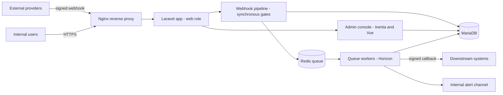
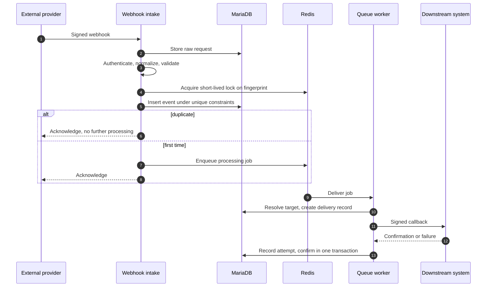

## Project Overview

PayIn is an event gateway. External providers notify it by webhook; it authenticates each notification, normalizes it into one internal shape, records it exactly once, and delivers a signed callback to a downstream system. An admin console covers configuration, manual handling and audit. It is a rebuild of an older system.

I was the only engineer: I defined the architecture, the module boundaries and the data model, built the backend and the admin frontend, set up the CI/CD pipeline and the blue/green deployment, and handled troubleshooting. The stack is PHP 8.4 and Laravel 13, Inertia.js with Vue 3 and TypeScript, MariaDB as the primary store and Redis for queues, cache and locks.

## Business Context

PayIn is an internal platform, and its business details are intentionally not published. This case study focuses on the engineering.

## Problem Statement

The system being replaced had concrete technical failure modes that defined the work:

- **Duplicate processing.** Two notifications for the same event arriving close together could both be processed, because of a check-then-act race.
- **Missing input validation**, so a malformed event could corrupt state.
- **Blocking delivery.** The downstream callback ran inside the provider's request, so a slow consumer made the provider wait and retry, which made the duplicate problem worse.
- **No audit trail** of who changed what, or of what a provider had actually sent.
- **Weak access control**, found in a security review of the old code.

Correctness therefore meant: every real event is recorded once and only once, every state change is attributable, and a downstream system is never notified twice by accident.

## Functional Requirements

- Receive webhooks from multiple external providers through one unified intake, regardless of payload format.
- Authenticate every webhook per provider, with an optional source-address allowlist.
- Normalize and validate payloads into a single internal event model.
- De-duplicate events across retries, across providers and across formats.
- Deliver a signed callback to the matching downstream system, with automatic retries and a manual path for the remainder.
- Audit everything: raw inbound requests, delivery attempts, authentication events and administrative actions, with alerts on failures and abuse.

## Non-functional Requirements

| Quality | Requirement |
| --- | --- |
| Consistency | An inbound event produces at most one record and at most one confirmed delivery, even under concurrent duplicates. |
| Responsiveness | Intake does only what must be durable, then acknowledges. Delivery never runs inside the provider's request. |
| Durability | Every inbound request is stored as received before any decision is made. Queue state survives a Redis restart. |
| Security | Mandatory 2FA, least-privilege RBAC, encrypted secrets at rest, signed outbound callbacks, SSRF protection on callback targets. |
| Maintainability | Domain rules are isolated from the framework and testable without booting it. |

I am not publishing latency or throughput figures here.

## Technical Challenges

**Exactly-once effects from at-least-once delivery.** Providers retry, and two providers can report the same underlying event in different formats. A single provider-assigned id cannot detect that, so de-duplication needed more than one independent key.

**Concurrent duplicates.** Checking for an existing record and then inserting is not safe under concurrency; the guarantee has to come from the database, with a lock only as an optimization in front of it.

**Slow or failing downstream endpoints.** Their latency must not affect intake, and their failures must be classified correctly: a timeout is retryable, a definitive rejection is not.

**Configuration drift during retries.** If a callback target is edited mid-retry, a retry could go to a different destination than the original attempt. Each event has to carry the target it was created with.

**Deploying without losing events.** A restart that returns gateway errors causes missed webhooks and retry storms, so the deploy process had to keep serving throughout.

## Architecture Overview

PayIn is a modular monolith. One codebase produces one immutable container image, which runs in two roles: a web role serving both the admin console and the webhook intake, and a queue-worker role. Nginx sits in front, MariaDB holds all durable state, and Redis provides queues, cache, rate limiting and short-lived locks.



Inside the application the code follows four layers with a strict inward dependency rule:

| Layer | Contains | May depend on |
| --- | --- | --- |
| Domain | Entities, value objects, domain services, domain events, repository ports | Nothing outside the domain. No framework classes. |
| Application | Use cases, query handlers, DTOs, application ports, event listeners | Domain |
| Infrastructure | Persistence, HTTP clients, queue jobs, cache and lock adapters | Domain, Application, framework |
| Interfaces | Controllers, form requests, middleware, console commands | Application |

Each layer is split by bounded context: source configuration, consumer configuration, the core event lifecycle and intake, fallback and recovery, identity, two-factor, access control, security, activity log and read models. Modules talk to each other only through application ports for synchronous lookups or through domain events dispatched after commit.

## Technology Stack

| Area | Choice | Why |
| --- | --- | --- |
| Language and framework | PHP 8.4, Laravel 13 | Queue, scheduler, auth and migration tooling cover most of the operational surface; Clean Architecture keeps the domain independent of it. |
| Frontend | Inertia.js, Vue 3, TypeScript, Tailwind CSS | A single-page internal console without a separate public API to design and secure. |
| Database | MariaDB 11.4 | One engine for local, staging and production removes engine drift. |
| Queue, cache, locks | Redis 7 with Laravel Horizon | One dependency for the queue, cache, rate limiting and locks, with append-only persistence so queued work survives a restart. |
| Packaging and delivery | Docker, Docker Compose, GitHub Actions | Multi-stage build to one immutable image tagged by commit. |
| Edge | Nginx | Reverse proxy, TLS termination, rate limiting, and the switch point for blue/green. |
| Quality tooling | PHPUnit, PHPStan with Larastan, Pint, ESLint, Prettier, Vitest, a secret scanner | All run as CI gates before an image is built. |

## System Design

Processing is split at a hard synchronous/asynchronous boundary.

**Phase 1, synchronous, inside the provider's request.** A fixed sequence of gates runs, and each gate records where a request stopped:

1. Persist the raw request exactly as received.
2. Authenticate the provider.
3. Normalize the payload into one internal event model.
4. Validate the normalized event.
5. De-duplicate and persist the event.
6. Enqueue a processing job and acknowledge.

**Phase 2, asynchronous, on queue workers.** The worker loads the event, resolves the downstream target, creates a delivery record, sends the signed callback, records the response, and only then marks the event as confirmed.



**Lifecycle as a state machine.** Each record moves through explicit states grouped by pipeline stage (intake, target resolution, delivery, terminal), so it is always visible where something stopped. Failures at each gate are distinct states rather than one generic error, and transitions are domain methods that enforce their own invariants.

**Isolating providers from the core.** Provider differences stop at the normalizer; everything after that gate is provider-agnostic. Authentication settings are data rather than code. Adding a provider with a new format means adding one normalizer class behind an existing port, without touching the use cases.

## Database Design

MariaDB holds all durable state and is the single source of truth. Storage is organized into configuration data, the core event and delivery records, append-only logs, and identity and access data. Numeric amounts are stored as integers; there is no floating point in the write path.

**Recording an event exactly once.** The event record carries three independent unique constraints, each catching a different kind of duplicate:

| Layer | Key | Catches |
| --- | --- | --- |
| Provider id | Source plus the provider's own event id | The same provider re-sending the same notification |
| Fingerprint | A hash of normalized fields, scoped by date | The same event reported by a different provider or in a different format |
| External reference | Scope plus an upstream reference, when present | Duplicates that share a reference but differ elsewhere |

A violation of any of the three marks the event as a duplicate and stops processing. The event also records which layer caught it.

Other schema decisions:

- The callback destination is snapshotted onto the event at intake time.
- The raw request log stores a processing status and the gate at which a request failed.
- Migrations follow an expand, migrate, contract discipline so that two application versions can run against the same schema during a deploy.

## API Design

Contract details are deliberately not published. In general terms:

- **Inbound webhook intake** is a small, versioned, stateless HTTP surface with one unified entry point. Each provider is authenticated with its own shared secret and optionally restricted by source address. It is rate limited and authenticated by credential, not by session.
- **Acknowledgement semantics.** Intake acknowledges as soon as the event is durable. Duplicates are acknowledged as successful so that a provider does not keep retrying something already recorded.
- **Outbound callbacks** are HTTPS requests signed with an HMAC over the payload using a per-consumer secret. Delivery is at-least-once; receivers are expected to treat the callback as idempotent.
- **Idempotent writes.** Sensitive state-changing admin requests carry a client-generated idempotency key. Replaying the same key returns the stored result instead of executing again.

## Security Architecture

There are three trust boundaries: providers calling in, internal users on the console, and PayIn calling out.

**Inbound**

- Per-provider credential check, with the stored secret encrypted at rest, plus an optional source-address allowlist.
- Authentication failures are counted per provider. Past a threshold the provider is disabled temporarily and an alert is raised.

**Internal users**

- Password login or an external OAuth identity provider, which only matches identities an admin has pre-registered. There is no self-registration.
- Two-factor authentication is mandatory for every role, with TOTP secrets encrypted at rest and passkeys as an additional factor.
- Sensitive actions require a fresh second-factor confirmation. Use cases assert this themselves, so the rule also holds for callers that do not come through HTTP.
- Role-based access control with fine-grained permissions. An actor can only grant roles strictly below their own.

**Outbound**

- Callbacks are signed, and TLS verification is enforced.
- A callback-target guard accepts only HTTPS destinations and rejects private, loopback and link-local address ranges after DNS resolution, to prevent server-side request forgery through configuration.

**Data protection and audit**

- Secrets are never committed, and CI runs a secret scanner on every change.
- The activity log is append-only, and a sanitizer redacts secrets and signatures before anything is stored.

## Scalability Strategy

**What scales horizontally.** Webhook intake is stateless, and queue workers are separate processes from the same image, so both scale independently.

**What does not.** MariaDB and Redis are single instances. The connection budget is sized for the blue/green overlap, not for steady state.

**The first bottleneck.** I wrote a capacity review of the pipeline. Its conclusion is that ingestion is not the limit; processing is. A worker sends the callback synchronously, so throughput is roughly the number of workers divided by downstream response time, and one slow endpoint can build a backlog for everyone.

The review produced a staged plan rather than a rewrite:

| Stage | Change |
| --- | --- |
| Configuration | Separate connect and read timeouts on callbacks. A dedicated worker pool for the core queue so audit-log jobs cannot starve it. A Redis memory cap with a no-eviction policy, so a full queue rejects writes instead of silently dropping jobs. Rate limits calibrated per provider. |
| Structure | A per-endpoint circuit breaker. A separate slow queue for retries so first attempts take priority. More web nodes for ingestion. |
| Architecture | Decoupling confirmation from callback delivery, with a periodic consistency check. This changes the system's guarantees, so it is a separate decision and not an optimization. |

## Reliability Strategy

**Idempotent intake.** De-duplication is enforced by unique constraints, so a retry or a concurrent duplicate cannot create a second event. A short-lived Redis lock sits in front of the insert to reduce contention, but correctness does not depend on it.

**Durability before logic.** The raw request is stored first. If authentication, normalization or validation fails, the record still exists with the gate where it stopped.

**Fallback when the database is unavailable.** Intake appends the request to a local on-disk file, and a background job replays it once the database is back. A scheduled job also picks up events that were persisted but never fully processed.

**Callback delivery**

- Runs on a queue, never inline, with a bounded timeout.
- Retries with increasing delays. Timeouts, connection failures and throttling are retryable; definitive rejections are terminal.
- Each attempt is logged with its outcome. After retries are exhausted the record is flagged for manual handling and an alert is sent; every manual path is permission-gated and audited.
- Retries always use the destination snapshotted at intake.

**Unknown outcomes.** If a callback times out, PayIn cannot know whether the receiver processed it. The design accepts at-least-once delivery: the callback is retried, the receiver de-duplicates, and the event is confirmed only after a positive acknowledgement.

**Consistency of confirmation.** Confirmation and its log entry are written in a single transaction under a row lock, so two workers cannot confirm the same record. Queue jobs are unique per event.

**Deploys.** Blue/green on a single host: two application stacks share Nginx, MariaDB and Redis. A deploy starts the idle colour, runs backward-compatible migrations, warms caches and reloads Nginx gracefully so in-flight requests finish on the old workers. A health probe gates the switch, and any failure rolls back automatically by pointing the proxy at the previous colour. A scripted test on staging, run during a deploy, recorded no connection errors.

## Engineering Trade-offs

**Clean Architecture and DDD instead of fat controllers.** Framework-free domain code, one use case per write action, and ports for all I/O. The cost is real: a feature touches five to seven files, and the pattern is overkill for simple CRUD. In return, domain tests run without booting the framework and every mutation has one entry point.

**Modular monolith instead of services.** One deployable, one database, in-process events. It fits a one-person team and a single host. Module boundaries are kept honest by the dependency rule, but I did not pay the operational cost of distribution up front.

**Blue/green on one host instead of an orchestrator.** Zero-downtime deploys and rollback in seconds without extra infrastructure. The costs are double resource usage during the deploy window, an orchestration script to maintain, and a hard rule that every migration is backward compatible.

**Confirmation depends on downstream acknowledgement.** This keeps both sides consistent by construction, but it couples throughput to the slowest endpoint. It is the main scaling limit and a decision to revisit, not a tuning knob.

**Acknowledging duplicates and rate-limited webhooks as successful.** Providers stop retrying, which protects the system. The cost is that a rate-limited webhook is dropped, so limits set too low lose real events.

## Implementation Details

### Why the lock is not the guarantee

The original duplicate-processing bug came from a check-then-act race. The fix has two parts with different jobs:

- A short-lived Redis lock keyed by the event fingerprint, acquired with an atomic set-if-absent. It turns most duplicates away cheaply.
- Unique constraints on the event record. These are the actual guarantee. If the lock expires or is lost in a Redis restart, the second insert still fails and is recorded as a duplicate.

A Redis failure therefore degrades performance, not correctness.

### Use case shape

Every write goes through one use case class with a single entry method. The shape is always the same: check the idempotency key, open a transaction through a port, load the aggregate, call a domain method that enforces the invariants and records domain events, save through a repository port, commit, then dispatch the recorded events.

```php
final readonly class RetryCallbackUseCase
{
    public function __construct(
        private OrderRepository $orders,
        private CallbackDispatcher $callbacks,
        private IdempotencyStore $idempotency,
        private TransactionManager $tx,
        private EventDispatcher $events,
    ) {}

    public function execute(RetryCallbackInput $input): RetryCallbackOutput
    {
        if ($cached = $this->idempotency->get($input->idempotencyKey)) {
            return RetryCallbackOutput::fromJson($cached);
        }

        $order = $this->tx->run(function () use ($input) {
            $order = $this->orders->getForUpdate($input->orderId);
            $order->markCallbackPending();
            $this->orders->save($order);

            return $order;
        });

        $this->events->dispatchAll($order->pullEvents());
        // Always the destination captured at intake, never current settings.
        $this->callbacks->dispatch($order, $order->callbackTargetSnapshot());

        return RetryCallbackOutput::from($order);
    }
}
```

This is an illustrative sketch of the pattern, not a copy of the production class.

### Testing and delivery

| Tier | Scope | Runtime |
| --- | --- | --- |
| Unit | Domain code and use cases against hand-written fakes | No framework boot, no database |
| Integration | Use cases with real repositories | In-memory database; asserts stored state, events and rollback |
| Feature | HTTP wiring, authentication, authorization | Simulated HTTP |

I use hand-written fakes that implement the ports instead of mocking libraries, so tests assert on state and survive refactoring. Architecture tests fail the build if a framework class leaks into the domain layer. Static analysis, tests with a coverage gate, a dependency audit and a secret scan run in parallel in CI; only then is one image built and tagged with the commit hash, so a rollback targets an exact commit.

## Results and Business Impact

What the rebuild delivered, in engineering terms:

- **Duplicate processing is closed by design**, by database constraints across three independent keys rather than by timing.
- **Intake is decoupled from delivery**, with bounded timeouts, retries and a manual path for the remainder.
- **Every event is traceable**: raw requests, per-attempt callback results, state changes and administrative actions.
- **Providers are configuration, not forks**, absorbed by normalizers behind one intake.
- **Zero-downtime releases** with a health gate and automatic rollback.
- **Documented architecture**: C4 diagrams, sequence flows, decision records, runbooks, a testing guide and a capacity plan.

Business results are not published.
