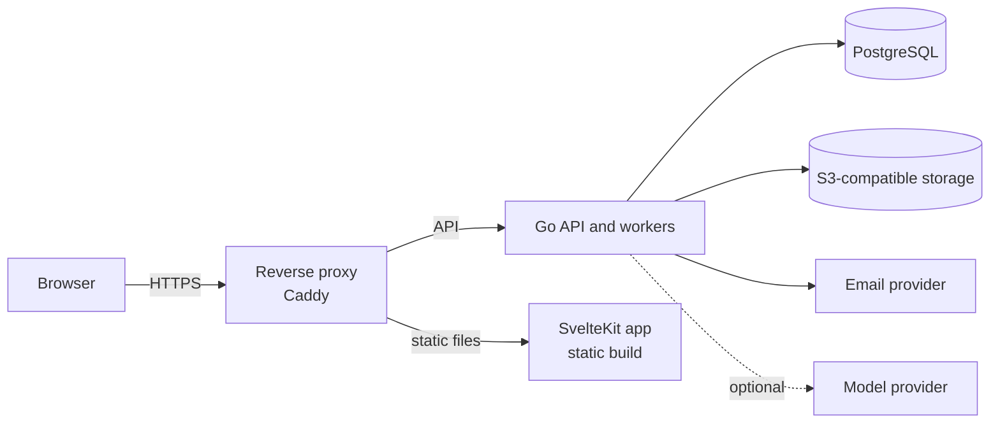

## Project Overview

ReefCare is a reef tank management and intelligence platform. It treats every aquarium as a structured, evolving dataset: measurements, dosing, water changes, equipment changes, livestock changes and observed symptoms all live on one chronological timeline.

It is a modular monolith — one Go binary serving a REST API and running background workers, one PostgreSQL database, and a SvelteKit web application.

The project is in development. The foundation and the reef-management layer are implemented — accounts, tanks and sharing, water tests, dosing, water changes, equipment, livestock, the timeline and notifications, with their web screens; the intelligence and community layers follow the roadmap described below.

## Business Context

Reef keepers track water chemistry, dosing, water changes, equipment and livestock across notebooks, spreadsheets, controller apps and forum threads. The product is planned in three layers:

1. **Reef management** — reliable record keeping, schedules and reminders.
2. **Reef Intelligence** — deterministic metrics and rule-based, evidence-linked provisional assessments grounded in a curated knowledge base.
3. **Reef Clinic** — community diagnostic cases that carry an immutable snapshot of the tank's context.

It launches Vietnamese-first, with English supported in the localisation layer from the start.

## Problem Statement

When something goes wrong in a reef tank — coral recession, algae, fish loss — the relevant history is scattered. Both the owner and the people they ask for help end up reasoning from isolated numbers. Advice in forums is unstructured, hard to verify, and rarely followed up with an outcome.

## Functional Requirements

The first release is scoped as a reliable reef log with honest insights:

- **Accounts:** registration, email verification, sign-in, password reset, profile, language, time zone and unit preferences.
- **Tanks:** several per user, private by default, shareable read-only with specific users, archived rather than deleted once they have history.
- **Water parameters:** multi-parameter test entry, original value and unit preserved, physically impossible values rejected, corrections that supersede rather than overwrite.
- **Targets:** per tank and parameter, versioned so historical comparisons use the target valid at the time.
- **Dosing and water changes:** plans with schedules and time zones, occurrences generated idempotently, planned versus actual amounts.
- **Equipment and livestock:** configuration history; quantities derived from events, with nothing hard-deleted.
- **Timeline:** every domain event, with time, category, source and actor.
- **Notifications:** reminders generated by persistent, idempotent jobs.
- **Intelligence:** assessments that store their input snapshot, rule version and knowledge references.

Explicitly out of scope: automatic control of dosing pumps or any equipment, and definitive diagnosis of disease or livestock death.

## Non-functional Requirements

| Category | Requirement |
| --- | --- |
| Security | Aligned with OWASP ASVS level 2 |
| Privacy | Tanks private by default; explicit sharing; account deletion within 30 days |
| Availability | Single region; a target of 99.5% monthly for the first release |
| Performance | A target of p95 under 300 ms for dashboard, list and trend endpoints, to be verified by load tests |
| Data integrity | Invariants enforced by the database; no silent rewriting of history |
| Accessibility | WCAG 2.2 AA where practical; status never conveyed by colour alone |
| Portability | Docker-based; no lock-in to a single model, storage or device vendor |

These are design targets. None has been measured yet.

## Technical Challenges

**History that is never rewritten.** A corrected reading must not erase the original, and a changed target must not alter how past readings were judged.

**Schedules across time zones.** A dose planned for 08:00 has to stay at 08:00 local time across daylight-saving changes.

**Durable background work without a broker.** Reminders, emails and account erasure must happen even if a process crashes mid-job.

**Honest assessments.** The intelligence layer has to be explainable and reproducible, which rules out leaning on a language model for the first release.

**Authorization on every path.** Every piece of tank data belongs to an owner and may be shared; every read and write has to check that.

## Architecture Overview

Serving the web application and the API from the same origin, through the proxy, keeps cookie authentication simple and avoids cross-origin configuration for the first-party client.

## Technology Stack

| Concern | Decision | Rationale |
| --- | --- | --- |
| Language | Go | Simple deployment |
| Router | chi | Small, idiomatic, compatible with `net/http` |
| Database access | pgx with sqlc | Type-safe, and the SQL stays visible |
| Migrations | Goose, SQL files embedded in the binary | Runnable from the binary and the command line |
| Database | PostgreSQL 18 | Native `uuidv7()` |
| Decimals | A decimal type mapped through sqlc | Exact round-trip of `NUMERIC` |
| Validation | Explicit functions per command, no reflection tags | Domain-specific rules and clear errors |
| Passwords | Argon2id | OWASP recommendation |
| Jobs | In-house table claimed with `FOR UPDATE SKIP LOCKED` | Few dependencies, fully under control |
| API contract | OpenAPI 3.1, hand-written, with contract tests | Design-first |
| Frontend | SvelteKit 3, Svelte 5 and TypeScript, built as a static single-page application | No Node server to run or secure; a strict content security policy is simpler without server rendering |
| Localisation | Paraglide on the frontend; message keys in API errors | Type-safe and small |

## System Design

**Module anatomy.** Each domain module has the same shape: a file of types, invariants and pure functions with no I/O; an application service handling authorization, transactions and timeline events; HTTP handlers; and the job handlers the module owns.

**Dependency rules.** Domain code imports only the standard library and small value types. A service depends on other modules' service interfaces, never on their tables. There is no global state; everything is constructed in the entry point.

**Transactions.** One helper is the only way to open a transaction. The timeline recorder and the job enqueuer both accept the query handle bound to that transaction, so a domain write, its timeline event and its follow-up jobs commit atomically — a transactional outbox without a separate broker.

**Errors.** Services return typed errors, and a single mapper converts them to the HTTP error envelope. Unknown errors become a generic server error carrying only a request id; details stay in the logs.

## Database Design

- Invariants are enforced in the database, not only in application code.
- Corrections create a new reading that supersedes the old one; targets are versioned; livestock quantity is derived from events.
- Nothing with history is hard-deleted: tanks are archived, and account erasure anonymises the user row after module-specific erasers have run.
- All timestamps are stored in UTC and displayed in the user's time zone.
- A module owns its tables. It may read a few stable columns of another module's tables through its own queries, but writes always go through the owning module's service.
- The design assumes up to roughly ten thousand users, twenty thousand tanks and five million readings in the first year — a planning assumption, not a measurement.

## API Design

A versioned REST API described by a hand-written OpenAPI 3.1 contract. The contract comes first: a test fails whenever the contract and the router disagree.

- Requests are validated strictly, and unknown fields are rejected rather than ignored.
- Errors use one envelope across the whole API, with message keys so the client can localise them.
- Liveness and readiness are reported separately; readiness also confirms the database schema matches what the binary expects.
- Implemented so far: authentication, profile and preferences, tanks with sharing, and the reef-management modules — water tests and targets, dosing, water changes, equipment and maintenance, livestock, the timeline and notifications. Schedule previews come from the server, so the web application never reimplements recurrence rules.

## Security Architecture

- Session cookies with CSRF protection; verified email required before community writes.
- Passwords hashed with Argon2id, with a configurable cap on concurrent hashes because each one uses 64 MiB of memory.
- **Enumeration-safe responses.** Failed sign-ins and reset requests for unknown addresses are processed with uniform timing, so a response does not reveal whether an account exists.
- **Authorization on every service method** that touches tank data. A failed read returns "not found" rather than "forbidden", so the existence of someone else's tank is not disclosed.
- Forwarded headers are trusted only from configured proxy address ranges, and overly broad ranges are rejected at startup.
- No secrets or email addresses in job payloads: an email job carries a user id and a template, and tokens are created when the job runs.
- The metrics endpoint listens on a separate address that is not exposed publicly.

## Scalability Strategy

The first release targets a single region on one virtual machine or a managed container service, with managed PostgreSQL. The API and its workers are one stateless binary, so more instances can be added: the job runner is built for that, with leases and deduplication keys ensuring each job and each periodic run happens once regardless of how many instances are scheduling.

No load test has been run yet, so the planning assumptions and the latency target are unverified and no throughput figure is claimed. Load tests for the dashboard, trend, timeline and water-test entry paths are scheduled in the production-readiness phase, alongside query tuning on realistic data volumes.

## Reliability Strategy

Background work runs on an in-house job table:

- **Enqueued inside the transaction of the change**, so a rolled-back change never leaves a job, and a committed one always has its job.
- **Claimed with `FOR UPDATE SKIP LOCKED`** under a lease. A scheduler re-queues jobs whose lease has expired because a worker crashed or stalled.
- **Fenced outcomes.** A result is accepted only from the worker and attempt that hold the current claim, so a late run cannot overwrite a newer one.
- **Retried with exponential backoff** — from fifteen seconds, doubling to a cap of one hour, with jitter. Permanent errors and exhausted attempts are kept as dead jobs for inspection.
- **At-least-once**, with idempotent handlers.
- **Periodic tasks** are enqueued once per time bucket using the bucket as a deduplication key. In-memory timers only enqueue; the work itself is durable.

On shutdown the process stops accepting requests, drains HTTP, lets running jobs finish, and re-queues anything still running past the deadline.

## Engineering Trade-offs

**A modular monolith over services.** One binary and one database, with module boundaries enforced by dependency rules. Operationally simple; the cost is discipline rather than network isolation.

**An in-house job runner over a queue library or a broker.** Fewer dependencies and transactional enqueueing, in exchange for owning the lease, retry and fencing logic.

**An in-house subset of recurrence rules over a library.** The supported subset is small, and wall-clock and daylight-saving behaviour is pinned by the project's own tests.

**No language model in the first release.** Assessments are deterministic and rule-based so they can be explained and reproduced. A model-assisted narrative is planned later, behind an interface, defaulting to off.

**Same origin for web and API.** Simpler cookie authentication and no cross-origin rules, at the cost of requiring the reverse proxy in every environment.

## Implementation Details

**Configuration** is read from environment variables and validated at startup. Every problem is reported at once rather than one per restart.

**Continuous integration** runs on every push and pull request: formatting, a check that generated query code is up to date, static analysis and linting, unit tests with the race detector, integration tests against a PostgreSQL service, a vulnerability scan, the web checks — types, lint, unit and component tests, build, dependency audit — Playwright end-to-end tests against the real API, and a Docker image build.

**Delivery** follows vertical slices. Each milestone goes from migration through queries, domain, service, API, contract and tests to a minimal interface, and is verified before the next begins.

## Results and Business Impact

The product has not launched, so there are no users and no results to report.

The state of delivery is that the first two phases are complete: the foundation — accounts, profiles, tanks and sharing, the API contract, the web shell and CI — and reef management — water tests with corrections and versioned targets, dosing, water changes, equipment and maintenance, livestock, the timeline, notifications and the corresponding web screens. Reef Intelligence is the next phase and has not been started.

The success metrics defined for the first release, to be measured after launch:

- **Activation** — the share of new users who create a tank and log at least one water test within seven days.
- **Retention** — the share of active tanks with at least four water tests in the last thirty days.
- **Reminder effectiveness** — the share of scheduled dosing and water-change occurrences that get recorded.
- **Assessment usefulness** — the share of assessments rated useful, and how quickly those reported as wrong are reviewed.
