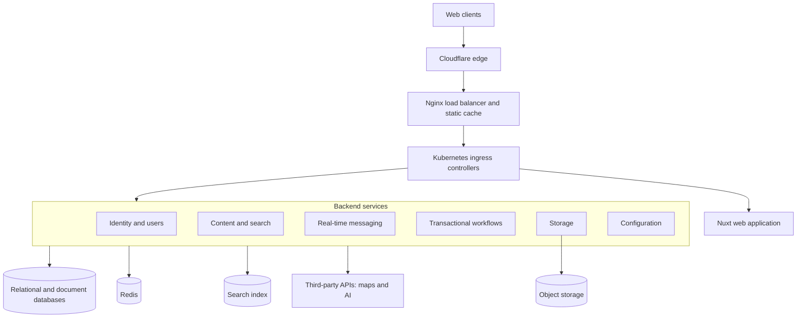

## Project Overview

tabtab.me is a real estate social platform. Technically it is a set of domain services in three backend runtimes behind a Nuxt web application, combining read-heavy content and real-time messaging with transactional record-keeping workflows, all running on Kubernetes.

I led the project as Team Leader of a cross-functional team. I defined the system architecture and backend service structure, designed the database schema and API contracts, and led development, code review and deployment.

## Business Context

This is a product platform, and its business details are intentionally not published. The case study focuses on the engineering.

## Problem Statement

The engineering problem was to run two kinds of workload on one platform: a content and messaging product with read-heavy, bursty traffic, next to transactional workflows where correctness matters more than speed — and to do it with one team, on infrastructure that team could operate itself.

## Functional Requirements

- **Identity and accounts** — sign-in, profiles and role-based permissions shared by every service.
- **Content** — publishing with full-text search and map-based discovery.
- **Real-time messaging** over persistent connections.
- **Transactional workflows** — records whose lifecycle is validated and audited.
- **Media handling** — direct uploads from web clients to object storage.
- **Central configuration and third-party integrations** — shared settings, plus map and AI providers behind adapters.

## Non-functional Requirements

No formal availability or latency targets were published for this project, so I list the qualities the architecture was designed for rather than numbers.

| Quality | What it meant in practice |
|---|---|
| Scalability | Stateless services that scale by adding replicas; node capacity that grows automatically under load |
| Reliability | No single node whose loss interrupts incoming traffic; tolerance of a zone failure at the entry layer |
| Maintainability | The same layering, conventions and delivery pipeline in every service, whatever its runtime |
| Security | One identity provider, verified tokens on every request, and service-to-service identity |
| Operability | Dashboards and centralised logs good enough that a small team can run it |

## Technical Challenges

- **Two workloads in one product.** Service boundaries had to keep a content feed and a transactional workflow, with different consistency and scaling needs, from constraining each other.
- **Three backend runtimes.** Go, PHP and Node.js services had to look alike from the outside: the same authentication, the same error conventions, the same build and deploy path. Without that, every cross-service change costs three times as much.
- **Consistent identity across services.** Every service needs to answer "who is this and what may they do" without calling the identity service on every request and without re-implementing the rules.
- **Operating Kubernetes without a platform team.** Cluster sizing, ingress, monitoring and release pipelines were part of the same team's work, so the setup had to stay simple enough to reason about.

## Architecture Overview

Requests enter through Cloudflare, pass a load-balancing tier that also caches static assets, and reach ingress controllers inside the cluster. From there they are routed either to the Nuxt application or to the backend service that owns the domain.

## Technology Stack

The backend spans three runtimes because each was chosen for a kind of workload, not by habit:

| Runtime | Used for | Why |
|---|---|---|
| PHP (Lumen and Laravel) | Request/response services: identity, content, storage, configuration | Fast to build CRUD-heavy domains with mature tooling for migrations, queues and validation |
| NestJS | Real-time and event-driven services such as messaging | Long-lived WebSocket connections and an event loop suit this workload; a module system that maps cleanly onto Clean Architecture layers |
| Go | Services where throughput and a small resource footprint matter | Low memory per replica and simple concurrency, which matters when every replica is paid for |

Around them: **Nuxt** on the frontend with the Google Maps API, **Google Cloud Platform** and **Kubernetes** with Docker-based CI/CD pipelines, **Cloudflare** at the edge, and the **OpenAI API** among the third-party integrations. Supporting pieces are relational databases for transactional data, a document store for message history, Redis for caching and real-time fan-out, a search engine for content discovery, object storage for media, and a metrics and dashboard stack for monitoring.

## System Design

Backend services follow Clean Architecture and modular design principles.

**Service boundaries** follow domains, one deployable per domain:

| Service | Responsibility |
|---|---|
| Identity and users | Accounts, sign-in, token issuance, roles and permissions |
| Content | Published content and its search index |
| Messaging | Real-time conversations over WebSockets |
| Transactional workflows | Records with an explicit, validated lifecycle |
| Storage | Media uploads and file metadata |
| Configuration | Shared settings and reference data |

**Communication.** Client-facing traffic is synchronous HTTP through the ingress layer. Services call each other over HTTP inside the cluster, authenticated with their own service identity. Work that does not need to finish inside a request — notifications, indexing, log shipping — is pushed to queues and processed by workers. Real-time delivery uses WebSockets, with Redis coordinating between replicas.

**Shared concerns live in a library, not a service.** Token verification and permission checks are packaged once and included by each PHP service, so a request is authorised locally instead of making a network call for every check.

**Media bypasses the application tier.** A client asks the storage service for a short-lived signed upload location and then uploads straight to object storage. Application pods never carry file bytes, which keeps their memory profile flat.

**Third-party integrations** — maps and the OpenAI API — sit behind adapters at the outer layer of the services that use them. Domain code depends on an interface, so a provider can be replaced or mocked in tests without touching domain rules.

## Database Design

Each service owns its data and its migrations; no service reads another service's tables. That is what makes the service boundaries real rather than cosmetic.

- **Relational databases** hold the transactional record: users and roles, content, and workflow data.
- **A document store** holds message history, where the shape is append-heavy and read by conversation.
- **A search index** is a derived view of content. It is rebuilt from the relational source and is never the source of truth.
- **Redis** holds cache entries and short-lived coordination state only.

Two rules shaped the transactional schema. State changes are explicit transitions rather than free edits, so a record's lifecycle can be validated and audited. And indexes follow the access paths — by owner, by state, by recency — because the dominant queries are filtered lists far more often than single-record lookups.

## API Design

I describe the API in general terms only; the contracts themselves are not published.

- **Style.** Resource-oriented JSON over HTTPS for request/response work, and a WebSocket channel for real-time messaging.
- **Consistency.** All services share one response envelope, one error convention and one pagination style, regardless of runtime. A frontend developer should not be able to tell which language answered.
- **Authentication.** Every call carries a token issued by the identity service; internal calls carry a service identity in addition.
- **Contract-first.** I defined contracts before implementation so that frontend and backend work could proceed in parallel, and reviewed contract changes as carefully as schema changes.

## Security Architecture

- **A single identity provider.** One service issues tokens using standard OAuth 2.0 flows. Every other service verifies tokens locally and trusts no caller by network position alone.
- **Role-based authorisation.** Permissions are defined centrally and enforced inside each service through the shared library, at the use-case boundary rather than only at the route.
- **Service-to-service identity.** Internal callers authenticate as services, with credentials separate from any user's.
- **Edge protection.** Cloudflare sits in front of the origin for TLS, filtering and traffic management. The origin enforces HTTPS and sends strict transport security.
- **Scoped access to storage.** Clients receive short-lived, single-purpose upload grants instead of storage credentials, and cross-origin rules on the bucket restrict which sites may upload.
- **Secrets stay out of images and repositories.** Configuration is injected per environment at deploy time, and build pipelines run under a dedicated, limited service account.

## Scalability Strategy

**What scales horizontally.** The web application and the backend services are stateless and run as replicated deployments; adding capacity is a replica count. Ingress controllers are replicated as well, so the entry layer scales with traffic rather than being a fixed funnel.

**Node capacity.** Node pools autoscale between a minimum and a maximum. The minimum is raised ahead of an expected traffic increase, and a dedicated pool, isolated with labels and taints, is added when a service needs guaranteed resources.

**First bottleneck.** In a system shaped like this the stateful tier — the primary database — saturates before the stateless services do. That is why uploads bypass the application, search runs on its own index, and anything deferrable goes to a queue.

## Reliability Strategy

The most instructive reliability work on this project came from a stability review I wrote up for the team.

**The problem.** The ingress controllers had been scheduled on preemptible nodes. Those nodes are cheaper precisely because the cloud provider may reclaim them at any time, and each reclaim interrupted incoming traffic while the controllers were rescheduled.

**The fix.**

- Created a dedicated system node pool on standard, non-preemptible instances.
- Spread that pool across zones, so the loss of one zone does not take the entry layer down.
- Scaled the ingress controllers to multiple replicas distributed evenly over those nodes.

After the change the entry layer tolerates the loss of a node, and the load is shared across several controller replicas.

**Beyond the entry layer:**

- Replicated service deployments, so a single pod failure is absorbed by the rest.
- Queued background work with retries, so a transient downstream failure delays a job rather than losing it.
- Resource dashboards and centralised logs, used for incident diagnosis and capacity decisions.
- Separate development, staging and production environments, so a change is exercised twice before it reaches users.

## Engineering Trade-offs

**Three runtimes instead of one.**
Each workload gets a runtime that suits it. The cost is real: three sets of tooling, three dependency ecosystems, and shared libraries that have to be written per language. I accepted that cost and contained it with identical layering, a single API convention and one delivery pipeline shape for every service.

**Microservices with a small team.**
Separate services give independent deployment and clear ownership, at the price of operational overhead and cross-service consistency being harder than a database transaction. I kept services coarse — one per domain, not one per entity — to keep that overhead proportionate.

**Preemptible versus standard nodes.**
Stateless workloads that tolerate rescheduling may use preemptible capacity; anything on the request entry path, and anything stateful, runs on standard nodes.

**Zones: resilience against node count.**
A node pool's size is multiplied by the number of zones it spans. I spread only the pools that need zone tolerance — the entry layer — and kept general workloads in a single zone, accepting that a zone outage would affect them.

**Caching at the load balancer.**
Caching static assets in front of the cluster removes load from the application, but cached content can be stale. This is safe only because asset filenames are content-hashed by the frontend build; dynamic routes are never cached at that tier.

**A shared authorisation library instead of a central check.**
Local verification removes a network hop and a single point of failure from every request. The cost is that a change to the rules requires each service to adopt the new library version.

## Implementation Details

**Resource right-sizing.** I reviewed actual CPU and memory use per node pool against what had been provisioned, using the cluster's resource dashboards. It found over-provisioned application nodes, monitoring and cluster-management workloads sharing nodes with application pods, and unused resources. I moved non-application workloads onto the system pool, consolidated pools and removed what was unused.

**Delivery pipeline.** Every service carries the same delivery layout: a Dockerfile, a build definition, and one set of deployment values per environment. A push builds a container image, tags it by branch or release tag, pushes it to a private registry, and the release is rolled out to the matching environment through Helm values. Because the layout is identical in PHP, Node.js and Go services, moving between them requires no relearning.

**Edge configuration.** The load-balancing tier redirects plain HTTP to HTTPS, caches static asset paths with a bounded lifetime, and forwards everything else to the ingress controllers. Cache status is exposed so a miss can be told apart from a bypass.

**Engineering practice.** Clean Architecture layering — domain, use cases, adapters — applied in every service; linting and formatting enforced by tooling rather than by reviewers; review checklists per stack; and architecture decisions written down so that the reasoning outlives the conversation.

## Results and Business Impact

Engineering outcomes only:

- **One platform in production**, with content, messaging and transactional services running across development, staging and production environments.
- **A leaner cluster.** The right-sizing review consolidated node pools against measured usage.
- **A more stable entry path.** Moving ingress onto dedicated, zone-spread standard nodes removed the traffic interruptions caused by node preemption.
- **A repeatable way of working.** Shared conventions across three runtimes, one pipeline shape for every service, and written runbooks for scaling and capacity.

Business results are not published.
