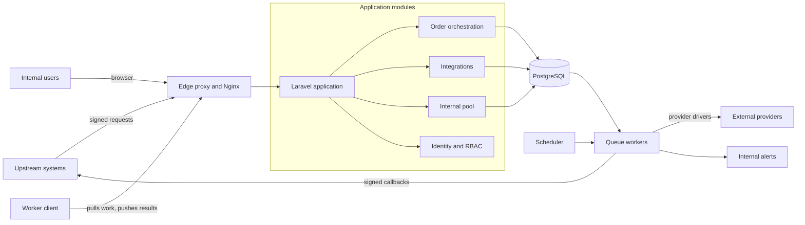
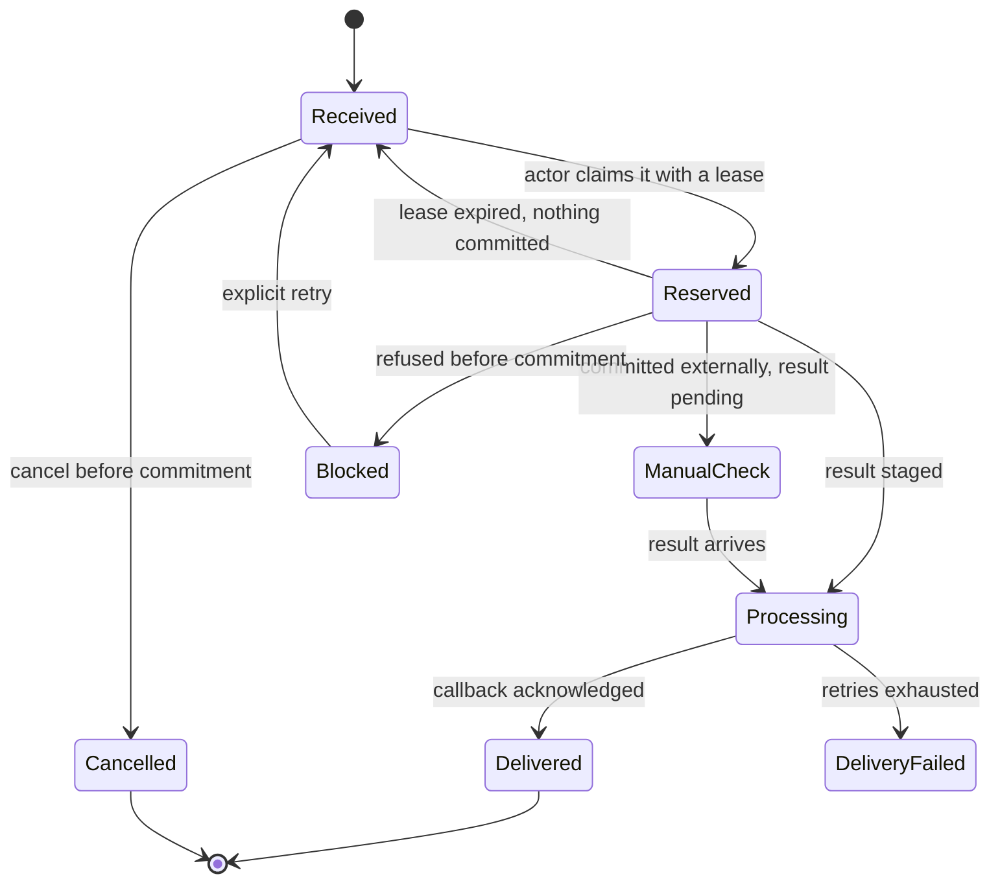

## Project Overview

X-Purchase is an order orchestration platform. Upstream systems push orders in over a signed API; the platform routes each order to a fulfilment channel, tracks it through a strict lifecycle while unreliable external providers do their part, and returns the result by signed callback. It is a single Laravel application: a versioned JSON API for machine clients, and an Inertia and Vue admin console for internal users.

I am the only engineer on the project. I defined the architecture and module boundaries, designed the schema, the integration contracts and the provider driver model, built the admin console, and I own the delivery pipeline, deployments and production troubleshooting.

## Business Context

X-Purchase is an internal platform, and its business details are intentionally not published. This case study focuses on the engineering.

## Problem Statement

Between "an order arrived" and "the result was delivered" there are several independent parties, each of which can be slow, fail, or answer ambiguously:

- An upstream system may resend an order, cancel it late, or lose my response.
- An external provider may complete a request long after accepting it, time out mid-request, or report success without returning a result.
- Two actors, human or automated, may pick up the same order at the same moment.

Handled naively, each of these ends in one of two irreversible failures: the same order is executed twice at an external provider, or its result is delivered twice. The platform exists to make the process explicit: one order record with a strict lifecycle, one ledger of external attempts, and a queue that shows what needs a person and why.

## Functional Requirements

- Receive orders from upstream systems over an authenticated, idempotent API, with query, cancel and retry.
- Route each order to a fulfilment channel: manual handling, an external worker client that pulls work, or a direct provider API driver. Routing is data, changeable without a release.
- Let a worker client reserve an order with a time-limited lease, submit results and report failures.
- Place orders at external providers, then poll or receive callbacks for their status.
- Deliver results upstream by signed callback, with retries and a recorded trail of every exchange.
- Audit every action, and control internal access with single sign-on, a second factor, roles and permissions.

## Non-functional Requirements

| Quality | Requirement |
|---|---|
| Correctness | An order is never executed twice at an external provider and its result is never delivered twice, including under retries, crashes and concurrent actors. |
| Idempotency | Every write an external party can retry is safe to repeat and answers the repeat as a success. |
| Confidentiality | Sensitive payloads and credentials are encrypted at rest, masked in every log, and never shown without a permission check and an audit record. |
| Auditability | Critical state changes are recorded append-only, in the same transaction as the change. |
| Availability | Releases must not interrupt traffic; a bad release must be reversible in seconds. |
| Maintainability | Layer boundaries and naming rules are enforced by automated architecture tests, not by convention. |

## Technical Challenges

**Ambiguous external outcomes.** A timeout, a server error or an undocumented response from a provider does not mean the request failed. I model a placement with separate "provably rejected" and "unknown" outcomes. Only a provable rejection puts the order back in front of a person; everything else is treated as "the side effect may have happened" until a status lookup says otherwise.

**Preventing double execution.** Three independent defences: a row-locked claim on the order, a rule of at most one open external attempt per order checked inside the same transaction, and a stable reference sent to the provider as its own idempotency key.

**Crashes in the middle of a call.** The attempt record is committed before the provider is called, together with the time of its first follow-up lookup. A worker killed mid-call therefore leaves evidence that a poller will pick up.

**Leases that outlive their purpose.** A reservation expires so that a dead worker does not park an order forever. But an external request can stay pending longer than the lease, so every poll renews it, and an order with an open attempt is never released back to the queue.

**Callbacks that must not repeat.** If bookkeeping throws after a successful delivery, a naive retry delivers again. Side-channel writes therefore fail open, while the core audit trail fails closed inside the transaction.

## Architecture Overview

One deployable application, organised as a modular monolith with layer-first Clean Architecture. Background work runs in separate worker and scheduler processes built from the same image.

Inside the application the dependency rule is one-way:

| Layer | Contains | May depend on |
|---|---|---|
| Domain | Entities, value objects, enums, domain services, repository interfaces. No framework imports. | Nothing |
| Application | Use cases (write side), query handlers (read side), DTOs, ports | Domain |
| Infrastructure | Adapters that implement ports: persistence, HTTP clients, queue, cache | Application, Domain |
| Interfaces | Thin controllers, request validation, middleware, console commands | Application |

Modules do not reach into each other's domain. They talk through application ports bound in the container, or through domain events.

## Technology Stack

| Area | Choice | Why |
|---|---|---|
| Backend | Laravel 13 on PHP 8.5 | Mature queue, scheduler and validation, used as infrastructure only; the domain is free of framework code. |
| Admin console | Inertia.js with Vue 3, TypeScript and Tailwind CSS | No second API to design and secure just for internal screens. |
| Database | PostgreSQL 17 | Transactional integrity and row locking with skip-locked for concurrent allocation. |
| Queue | Laravel database queue on PostgreSQL | A job is enqueued in the same database as the state change that caused it. No extra broker to operate. |
| Auth | Single sign-on, TOTP, passkeys (WebAuthn), role and permission package | No passwords to store; a strong second factor. |
| Edge and delivery | CDN edge proxy, Nginx, Docker, GitHub Actions | One image for app, worker and scheduler; blue/green switch by Nginx reload. |
| Observability | Error tracking, structured log files, alerts to an internal channel | Errors, a per-integration call trail, and notice of orders that need a person. |

## System Design

### Order lifecycle

An order is an aggregate with no setters; every change is a named transition, executed under a row lock. The states separate cases that look alike but need opposite work. A simplified view:

- **Execution failure and delivery failure are different states.** One means there is no result; the other means I hold a result the upstream system never received.
- **"Committed externally but no result yet" is its own state.** It is excluded from automated retry, because a retry would repeat the side effect.
- **Nothing re-enters the queue on its own after a failure.** Only an explicit retry does that.
- The internal state set is richer than the coarse states published upstream. The mapping happens at the edge, so I can add an internal state without renegotiating a contract.

### Provider drivers

1. **A driver is an automation that runs in my process.** It claims an order and reports results through the same use cases the external worker client calls over HTTP, so delivery, audit and alerts never learn how an order was fulfilled.
2. **A placement is never repeated; a lookup always may be.** Every recovery path is a status lookup.
3. **A driver is code, a route is data, and how the driver talks is also data.** Signature recipe, status vocabulary, timeouts and polling schedule are stored configuration.

Each driver implements one port. Adding a provider is one adapter plus configuration; nothing downstream changes.

### Late or repeated messages

- A provider callback is a **signal, never data**: it only triggers an authenticated lookup, so a forged or replayed callback cannot inject or alter a result.
- A repeated submission of the same result is recognised and answered as success.
- "Not found" from a provider is believed only on a second, spaced-out lookup.
- An unresolved attempt keeps being polled on a backoff schedule and is surfaced in the consistency view after a threshold.

### Pool-first path

Multi-line orders use a separate aggregate with per-line state. Each line is allocated from an internal pool inside one transaction, and any shortfall is sourced asynchronously through an internal order that runs through the same orchestration pipeline. State changes on a line write an outbox record in the same transaction; a worker turns the outbox into signed webhooks in sequence order.

## Database Design

PostgreSQL 17 is the single source of truth: it holds the order aggregates, the ledger of external attempts, exchange trails, configuration, the queue and sessions.

- **One open attempt per order**, checked inside the same transaction that claims the order.
- **Idempotency keys** supplied by clients are stored with the outcome of the first request, so a repeat returns that outcome.
- **Statuses** are strings backed by application enums rather than native database enums, so adding a state is a code change and not a table rewrite.
- **Secrets** use application-level encryption. Duplicate sensitive values are detected with a keyed fingerprint under a separate key, so uniqueness is enforced without decrypting.
- **Migrations are expand-only** within a release, because the previous application version is still serving traffic while the migration runs.
- **Indexes are measured, not guessed.** I seeded a synthetic dataset in a throwaway database, read the query plans, and kept only the indexes the planner actually used.

## API Design

The platform exposes a versioned JSON API to machine clients only; internal screens use Inertia props. Contract details are deliberately not published. The design principles are:

- **Two directions, two contracts.** Upstream systems push orders in and receive results by callback. The worker client pulls work and pushes results.
- **Authenticated by HMAC, per client**, with separate keys for each direction and a signature over content and timestamp.
- **Idempotent writes.** Order creation accepts a client-supplied idempotency key; a repeat returns the original outcome and triggers no second execution. Cancel and submit answer a repeat consistently with the first response.
- **Reservation is explicit.** Reading the work feed does not take an order; a separate claim does, and only the holder may submit against it.
- **Uniform rejection.** Every authentication failure looks the same to the caller; the real reason is only in my logs.
- **Stable contract, free internals.** Published states are a coarse projection of the internal state machine, and a breaking change means a new API version.

## Security Architecture

**Machine clients**

- HMAC-SHA256 request signatures with per-client, per-direction keys, a freshness window on the timestamp, and a single-use nonce ledger implemented as an atomic set-if-absent. If the ledger is unreachable the request is refused.
- Optional per-client address allowlist. The client address is derived at the proxy from a trusted proxy chain only, so a caller cannot forge it.
- A production deploy is refused if signature verification, session encryption or HTTPS is disabled.

**Internal users**

- Single sign-on through an external identity provider is the only way in. A sign-in only matches an account an administrator provisioned; it never creates one.
- Second factor with TOTP and passkeys, and step-up confirmation before sensitive actions.
- Role-based access control with permissions defined in one enum. Authority over accounts is limited to lifecycle and roles, and only towards accounts of lower rank.

**Secrets and sensitive payloads**

- Encrypted at rest. Revealing one requires a dedicated permission and leaves an audit record.
- Masking is allowlist-based: logs, the call trail and alerts mask every field not explicitly declared safe.
- Security and proxy-trust rules are covered by architecture tests, so regressions fail the build.

## Scalability Strategy

This is a single-host modular monolith, sized for the current workload, and I have not needed to scale it out yet.

- **What scales horizontally today.** Web processes are stateless, and queue workers can be added freely because each job is taken under a row lock. Pool allocation uses skip-locked selection, so concurrent orders do not block each other.
- **First expected bottleneck.** The database: it carries transactions, the queue and sessions. The first options are moving the queue to Redis, which is already in the stack, and a read replica; neither has been needed so far.
- **External limits.** Throughput is bounded by provider APIs and their rate limits, which is why polling uses per-driver backoff schedules stored as configuration.

## Reliability Strategy

**Failure handling**

- Transactions commit before any outbound HTTP call, so a slow provider cannot exhaust database connections.
- Unknown outcomes are resolved by polling with backoff; attempts are never abandoned, and long-unresolved ones are raised in the consistency view.
- Expired reservations are swept back to the queue, except where an open attempt says the side effect may have happened.
- Callback delivery retries on a schedule; after exhaustion the order moves to a visible failed-delivery state and can be resent manually.
- Webhooks for the pool-first path go through a transactional outbox; undeliverable events are marked dead and alerted.

**Fail open versus fail closed, chosen per mechanism**

| Mechanism | On failure | Reason |
|---|---|---|
| Activity log, call trail, alerts | Fail open | They record or announce; they must never turn a successful delivery into a retry. |
| Core audit trail | Fail closed, rolls back with the change | It exists to be provably complete, and the retried operation is idempotent. |
| Replay ledger | Fail closed | Admitting a request when the ledger is down reopens the replay window. |

**Releases**

- Blue/green on one host: the new stack starts beside the live one, the database is dumped and migrated, Nginx is reloaded to the new colour, and a health check must return both success and the expected colour marker before the old stack is drained. Any failure switches back automatically.
- Production deploys require an approval, and the image is pinned by digest so a rollback gets exactly the image that ran before.

## Engineering Trade-offs

**Modular monolith over services.** One deployable keeps transactions local, which matters when the core problem is consistency. The cost is one shared database and one release cadence.

**Database queue over a broker.** Enqueueing in the same database as the state change removes a class of "committed but never queued" bugs and one piece of infrastructure. The cost is queue load on the primary database.

**Treating unknown as "it may have happened".** This occasionally delays an order that had in fact failed cleanly. I accept slower recovery in exchange for never repeating an irreversible external action.

**Reusing the orchestration pipeline for pool refills.** An internal refill is modelled as an ordinary order from an internal client. That reuses every double-execution safeguard, at the price of an order concept that serves two purposes.

**SQLite for tests, PostgreSQL in production.** The suite is fast, but PostgreSQL-only behaviour such as locking cannot be relied on as tested.

## Implementation Details

**Writing the attempt before the call.** The use case runs in three steps: inside a transaction it claims the order, checks that no attempt is open, and inserts an attempt in a "placing" state with its first lookup already scheduled; it commits; only then does it call the provider. The result is settled with a conditional update that only applies to an attempt that is still open, so a concurrent poll or a manual decision cannot be overwritten by a stale snapshot.

**Classifying provider answers.** Each adapter maps the provider's response into a small closed set of outcomes. Transport errors, server errors, unparseable bodies and undocumented responses all map to unknown. Only authentication refusals and explicitly understood rejections map to rejected. The mapping tables are configuration, so learning a new provider response in production is an edit, not a release.

**Blueprints for integrations.** What an integration needs is declared as an immutable value object in code, while values live in the database. The console renders its form from the blueprint, so adding an integration requires no schema or front-end change.

**Architecture as tests.** Dedicated suites assert layer boundaries, naming, security rules and proxy trust configuration. A separate test fails loudly if the test environment could ever point at a real database or a real external provider.

**The blue/green switch.** Static assets for both colours are present on disk before traffic moves, the proxy config is rewritten in place so the bind mount keeps following it, and the upstream is resolved per request so a reload really targets the new containers.

## Results and Business Impact

What is in place, in engineering terms:

- A production system covering the full path from order intake to result delivery across three fulfilment channels, with provider drivers built on one adapter model.
- A state machine, an attempt ledger and per-mechanism fail-open or fail-closed choices, designed around the two worst outcomes: double execution and double delivery.
- An admin console with role-based access and strong authentication, an append-only audit trail and a consistency view.
- Architecture, security and proxy-trust rules enforced as tests in the build.
- Zero-downtime blue/green releases with rollback by switching colour.

Business results are not published.
