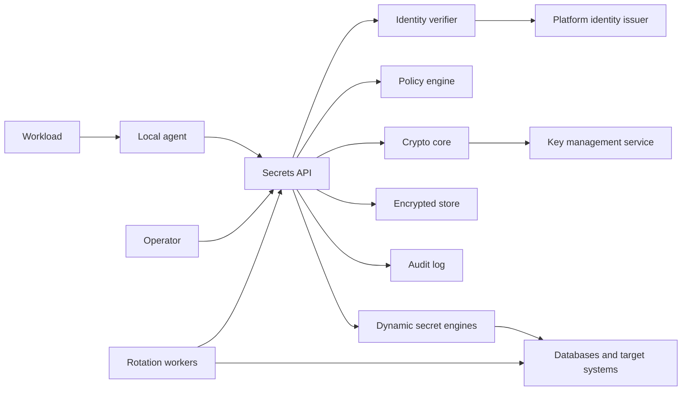
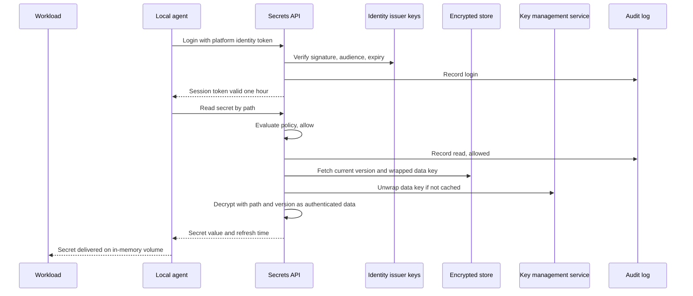
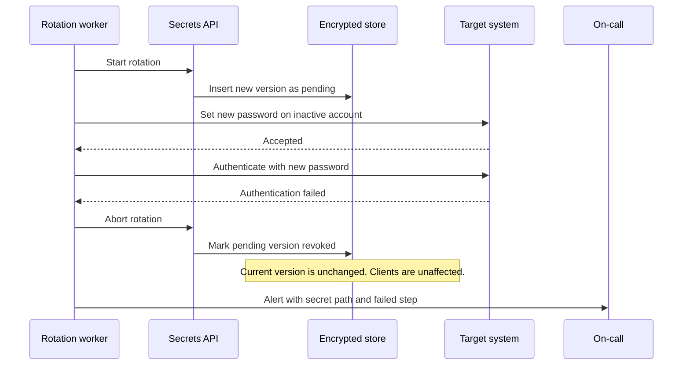

## Problem Statement

Every service needs secrets: database passwords, API keys, signing keys, tokens for other services. Left alone, they spread — into environment files, deployment manifests, container images, chat messages and build logs. Once spread, three questions become unanswerable: who can read this secret, who did read it, and how is it changed without an outage.

The task is one service that holds secrets and hands them to workloads. A workload proves what it is, receives only what its policy allows, and receives it for a limited time. Secrets are encrypted so that a copy of the database is useless on its own. Every access is recorded. Rotation is a routine operation, not an incident.

The design has to solve its own bootstrap problem: a service that needs a secret in order to fetch its secrets has only moved the problem. And it has to accept that it becomes a dependency of every other system, so its availability and its blast radius are design inputs, not afterthoughts.

## Requirements

**Functional**

- Store versioned static secrets organised by path, and read a specific or the current version.
- Authenticate workloads by platform identity and people by single sign-on; no long-lived shared credential.
- Authorise each request against path-based policies with a default of deny.
- Issue dynamic secrets — for example a database account created on request — under a lease that can be renewed and revoked.
- Rotate static secrets on a schedule or on demand, including the change in the target system.
- Record every request, allowed or denied, in an audit log.
- Provide an emergency access procedure that requires more than one person.

**Non-functional**

- **Confidentiality at rest.** Stored data, backups and replicas are ciphertext; the key that opens them is not in the same place.
- **Availability.** The read path survives the loss of a node or zone. Workloads tolerate a short outage of the service itself.
- **Fail closed.** No identity, no policy, or no audit record means no secret.
- **Bounded exposure.** A leaked credential expires on its own within hours at most.
- **Low latency.** A read completes in a few milliseconds, without a call to the key management service on every request.
- **Tamper evidence.** Removing or altering audit records is detectable.

## Capacity Estimation

**The figures below are illustrative assumptions chosen to exercise the design, not measurements from a real system.**

| Assumption | Value |
| --- | --- |
| Services | 2,000 |
| Running workload instances | 20,000 |
| Stored secrets | 50,000 |
| Versions retained per secret | 10 |
| Average secret size | about 2 KB |
| Session token lifetime | 1 hour |
| Secrets used per instance, refresh interval | 5, every 30 minutes |
| Audit record size, retention | about 1 KB, 1 year |

From these:

- **Stored data:** 50,000 × 10 × 2 KB = 1 GB.
- **Steady reads:** 20,000 instances × 5 secrets × 2 refreshes per hour = 200,000 reads per hour, about 56 per second.
- **Steady logins:** 20,000 per hour, about 5.6 per second.
- **Restart storm:** if all 20,000 instances restart within 10 minutes, each making 1 login and 5 reads, that is 120,000 requests in 600 seconds, or 200 per second.
- **Audit volume:** 220,000 requests per hour × 24 = 5.28 million per day; × 1 KB ≈ 5.3 GB per day; × 365 ≈ 1.9 TB per year.

The numbers say where the difficulty is not. One gigabyte of data and a few hundred requests per second need no exotic storage or caching tier. The audit log is roughly two thousand times larger than the secrets it describes and is the only part that needs a retention plan. Everything hard about this system is qualitative: it must be up when everything else is starting, it concentrates risk, and its own keys have to live somewhere. The one figure that shapes the design is the restart storm, because it arrives exactly when the platform is recovering from something else.

## High-level Architecture



The secrets API is a stateless service in front of a replicated relational store. Each request passes through the same four steps in the same order: verify identity, evaluate policy, write the audit record, then perform the operation. The crypto core encrypts and decrypts with data keys it holds only in memory; the key that protects those data keys lives in a key management service backed by hardware and never leaves it.

Workloads do not talk to the API directly. A small local agent runs beside each workload, authenticates with the workload’s platform identity, fetches the secrets the workload is entitled to, keeps them in memory, and refreshes them before they expire. Dynamic secret engines create and delete short-lived accounts in target systems. Rotation workers change static secrets in both the store and the system that checks them.

## Low-level Design

**Key hierarchy.** Encryption is layered so that each key protects little and the most valuable key does the least work.

| Level | Key | Where it lives | Protects |
| --- | --- | --- | --- |
| 1 | Key-encryption key (KEK) | Key management service, non-exportable | Data-encryption keys |
| 2 | Data-encryption key (DEK), one per namespace | Stored wrapped; plaintext only in server memory | Secret versions in that namespace |
| 3 | Secret version | Stored as ciphertext | The secret value |

Each secret version is encrypted with AES-256-GCM under its namespace’s DEK, with a fresh nonce. The path and version number are bound in as additional authenticated data, so a ciphertext copied onto another row fails to decrypt. A server unwraps a DEK through the key management service the first time it is needed and caches the plaintext key in memory for a bounded time; reads therefore cost one local decryption, not a remote call.

**Key rotation.** Rotating the KEK means re-wrapping the DEKs, one per namespace — small, fast, and no secret is touched. Rotating a DEK creates a new key for new writes; existing versions are re-encrypted in the background and the old DEK is retired when none reference it. Neither rotation is visible to clients.

**Workload authentication without a bootstrap secret.** The platform already gives each workload a signed, short-lived identity token naming its namespace and service account, with this service as the audience. The agent presents that token; the verifier checks the signature against the issuer’s published keys, the audience and the expiry, then maps the identity to a role. The response is a session token valid for one hour and bound to that role’s policies. Nothing has to be placed in the workload beforehand.

**Authorisation.** A policy grants capabilities — read, write, list, rotate, issue — on path patterns. A role is a set of policies. With no matching grant the answer is deny, and an explicit deny overrides any grant. Policies are evaluated in memory from a cache refreshed on change.

**Writing a version.** Versions are immutable and numbered per secret. The next number is taken inside the insert, and the primary key arbitrates concurrent writers: one succeeds and the other retries.

```sql
INSERT INTO secret_versions (secret_id, version, dek_id, nonce, ciphertext, state)
SELECT $1, COALESCE(MAX(version), 0) + 1, $2, $3, $4, 'pending'
FROM secret_versions
WHERE secret_id = $1;
```

**Rotating a static secret.** Rotation is a small state machine, because the secret must change in two places that cannot share a transaction.

1. Generate a new value and store it as a `pending` version.
2. Apply it in the target system.
3. Verify by authenticating to the target with the new value.
4. Promote the version to `current`; the previous one becomes `previous` and remains valid for a grace period.
5. After the grace period, revoke the previous value in the target and mark the version `revoked`.

Where the target supports it, two accounts alternate: the inactive account’s password is changed while the active one keeps serving, so no client ever holds a credential that has stopped working. If step 2 or 3 fails, the pending version is discarded and `current` is untouched.

**Dynamic secrets and leases.** For a dynamic secret, the engine creates an account in the target with a random name, a random password and an expiry, and returns it with a lease. The lease records the identity, the account and the expiry. Renewal extends it up to a maximum lifetime; revocation, or expiry, deletes the account. A sweeper claims expired leases with `FOR UPDATE SKIP LOCKED` and retries revocation until the target confirms.

**The agent.** The agent refreshes each secret at about half its lifetime, with random jitter so that 20,000 instances do not synchronise. It exposes secrets to the workload as files on an in-memory volume or over a local socket. If the service is unreachable, it keeps serving what it holds until the lease expires, and it retries with backoff.

**Audit.** The audit record is written before the response leaves. It contains the identity, the operation, the path and version, the decision and the request origin — never the secret value. Each record includes the hash of the previous record in its stream, and the latest hash is periodically anchored in a separate system.

## Component Responsibilities

| Component | Owns | Must never |
| --- | --- | --- |
| Local agent | Authenticating as the workload, caching, refreshing with jitter | Write secrets to disk or logs, or serve them past lease expiry |
| Secrets API | Request ordering: identity, policy, audit, operation | Return a secret when the audit write failed |
| Identity verifier | Validating platform tokens and mapping them to roles | Accept a token with the wrong audience or issue a long-lived session |
| Policy engine | The allow or deny decision | Default to allow |
| Crypto core | Encrypting and decrypting with in-memory data keys | Persist a plaintext key, or log key material |
| Key management service | The key-encryption key and wrap or unwrap operations | Export the key-encryption key |
| Encrypted store | Ciphertext, wrapped keys, leases, policies | Hold any plaintext secret |
| Dynamic engines | Creating and deleting short-lived accounts in targets | Create an account without a lease |
| Rotation workers | The rotation state machine | Promote a version that was not verified against the target |
| Audit log | Append-only, hash-chained record of every request | Contain secret values, or accept updates |

## API Contracts

Exchange a platform identity for a session:

```http
POST /v1/auth/workload
Content-Type: application/json

{ "role": "orders-api", "identity_token": "eyJhbGciOi..." }
```

```http
HTTP/1.1 200 OK

{ "session_token": "s.8fK2...", "expires_in": 3600, "policies": ["orders-api-read"] }
```

Read a static secret:

```http
GET /v1/secrets/prod/orders/payment-gateway
Authorization: Bearer s.8fK2...
```

```http
HTTP/1.1 200 OK

{
  "version": 7,
  "data": { "api_key": "..." },
  "refresh_after": 1800
}
```

Other operations follow the same style: `PUT /v1/secrets/{path}` writes a new version and accepts a `cas` parameter naming the expected current version, so two writers cannot silently overwrite each other; `POST /v1/secrets/{path}/rotate` starts a rotation; `POST /v1/dynamic/{engine}/{role}` issues a credential with a `lease_id` and `ttl`; `POST /v1/leases/{id}/renew` and `POST /v1/leases/{id}/revoke` manage it.

Errors are deliberately uninformative to the caller and detailed in the audit log: `401` for a failed identity check, `403` for a policy denial, and the same `403` whether a path is forbidden or does not exist, so paths cannot be enumerated. `503` means the service could not complete a required step, such as the audit write, and is safe to retry.

## Database Schema

```sql
CREATE TABLE data_keys (
  id           uuid PRIMARY KEY,
  namespace    text        NOT NULL,
  wrapped_key  bytea       NOT NULL,          -- DEK encrypted by the KEK
  kek_version  int         NOT NULL,
  state        text        NOT NULL DEFAULT 'active',   -- active | decrypt_only | retired
  created_at   timestamptz NOT NULL DEFAULT now()
);

-- Exactly one key per namespace accepts new writes.
CREATE UNIQUE INDEX data_keys_active ON data_keys (namespace) WHERE state = 'active';

CREATE TABLE secrets (
  id          uuid PRIMARY KEY,
  namespace   text        NOT NULL,
  path        text        NOT NULL,
  rotation    jsonb,                          -- schedule and target, null if not rotated
  created_at  timestamptz NOT NULL DEFAULT now(),
  UNIQUE (namespace, path)
);

CREATE TABLE secret_versions (
  secret_id   uuid        NOT NULL REFERENCES secrets (id),
  version     int         NOT NULL,
  dek_id      uuid        NOT NULL REFERENCES data_keys (id),
  nonce       bytea       NOT NULL,
  ciphertext  bytea       NOT NULL,
  state       text        NOT NULL,           -- pending | current | previous | revoked
  created_by  text        NOT NULL,
  created_at  timestamptz NOT NULL DEFAULT now(),
  PRIMARY KEY (secret_id, version)
);

-- At most one current version per secret; the read path uses this index.
CREATE UNIQUE INDEX secret_versions_current ON secret_versions (secret_id) WHERE state = 'current';

-- Background re-encryption finds versions still under an old key.
CREATE INDEX secret_versions_dek ON secret_versions (dek_id);

CREATE TABLE leases (
  id          uuid PRIMARY KEY,
  identity    text        NOT NULL,
  engine      text        NOT NULL,
  target_ref  text        NOT NULL,           -- the account created in the target system
  expires_at  timestamptz NOT NULL,
  max_until   timestamptz NOT NULL,
  revoked_at  timestamptz
);

-- The sweeper reads only leases that are still live.
CREATE INDEX leases_expiring ON leases (expires_at) WHERE revoked_at IS NULL;

CREATE TABLE audit_log (
  seq        bigint      NOT NULL,
  at         timestamptz NOT NULL DEFAULT now(),
  identity   text        NOT NULL,
  operation  text        NOT NULL,
  path       text,
  version    int,
  decision   text        NOT NULL,            -- allowed | denied | error
  origin     inet,
  prev_hash  bytea       NOT NULL,
  hash       bytea       NOT NULL,
  PRIMARY KEY (at, seq)
) PARTITION BY RANGE (at);
```

The two partial unique indexes turn invariants into constraints: one writable key per namespace and one current version per secret. Promotion in a rotation is therefore a single transaction that demotes the old current version and promotes the pending one, and the database rejects any interleaving that would leave two. The audit log is partitioned by month; the application role may insert into it and nothing else.

## Sequence Diagrams

A workload starts and reads a secret:



A rotation whose verification fails:



## Failure Scenarios

| Failure | Behaviour |
| --- | --- |
| Secrets API unavailable | Agents keep serving cached secrets until their leases expire and retry with backoff. Running workloads continue; only new starts wait. |
| Key management service unavailable | Servers that already hold unwrapped data keys keep serving until the cache lifetime ends. A restarted server cannot serve until the service returns. |
| Audit log unwritable | Requests fail with `503`. No secret is released without a record. |
| Store primary fails | A synchronous replica is promoted. Reads continue from replicas during the switch; writes and rotations pause. |
| Restart storm | Agent jitter spreads the load; the API rate-limits per identity and the estimated 200 requests per second is within one node’s capacity. |
| Rotation fails midway | The pending version is discarded and the current one stays valid. Rotation is retried; repeated failure raises an alert before the old credential’s deadline. |
| Lease revocation fails at the target | The lease stays in the sweeper’s queue and is retried. The account also carries its own expiry in the target, so it dies even if revocation never succeeds. |
| A secret leaks | The owner triggers rotation; the audit log lists every identity that read the affected version, which bounds the investigation. |
| A session token leaks | It expires within the hour, carries only one role’s policies, and can be revoked by identity. |
| A database backup is stolen | It contains ciphertext and wrapped keys only. Without the key management service it cannot be opened. |
| The key-encryption key is lost | Unrecoverable by design, so the key management service must replicate it across regions and deletion requires a waiting period. |

## Security Considerations

- **Trust boundaries.** The workload trusts its agent; the agent trusts the API over mutually authenticated TLS; the API trusts the platform’s identity issuer and the key management service. The store and its backups are treated as untrusted.
- **No long-lived credentials.** Workloads authenticate with platform identity, sessions last an hour, dynamic credentials last minutes to hours. The only standing secrets are the static ones being managed, and those are rotated.
- **Least privilege.** Policies are per service and per environment. No role can read across namespaces, and listing paths is a separate capability from reading them.
- **Separation of duties.** Those who write policies cannot approve their own changes; operators of the service cannot read tenant secrets, because server access does not include a session with read policy, and every decryption is audited.
- **Emergency access.** A break-glass role exists but is sealed: activating it needs approval from several people, it expires quickly, and its use raises an alert.
- **Memory hygiene.** Plaintext keys and secrets exist only in memory, core dumps are disabled, and swap is off for the server and the agent.
- **Delivery to the workload.** Files on an in-memory volume are preferred over environment variables, which leak into process listings, crash reports and child processes.
- **Audit integrity.** The hash chain makes gaps evident; the periodic external anchor means an attacker who controls the database still cannot rewrite history unnoticed.

## Scalability Strategy

- **API nodes** are stateless and scale horizontally behind a load balancer. Each holds its own in-memory cache of policies and unwrapped data keys.
- **Reads dominate** and can be served from store replicas. A read after a write within the same session goes to the primary so that a client never sees an older version than the one it just wrote.
- **The agent is the main scaling device.** Caching at the edge cuts request volume and, more importantly, removes the service from the hot path of every application request.
- **Key management service calls** scale with the number of namespaces and server restarts, not with reads, because data keys are cached.
- **Dynamic secrets** are limited by the target systems: creating accounts is far heavier for a database than a read is for this service. Lease lifetimes are tuned so issuance stays at a few per second per target.
- **Regions.** Each region runs its own cluster with a replicated store, so a region can start workloads while cut off from the others. Writes go to one primary region.
- **The audit log** is the only large dataset. It is partitioned by time and shipped to cheaper storage after the active window.

## Trade-offs

- **A central service over secrets distributed in configuration.** It becomes a critical dependency and a high-value target. The alternative is the same secrets in many places with no record of access, which is a larger risk with less visibility.
- **Fail closed on audit over availability.** An audit outage stops secret reads. Agent caching makes this survivable for running workloads; the design accepts blocked startups in exchange for a complete record.
- **Cached data keys over a remote call per read.** A compromised server process exposes the namespaces whose keys it has loaded. Calling the key management service on every read would narrow that and add latency, cost and a hard dependency to every request.
- **Short-lived credentials over convenience.** Applications must reload credentials while running, and connection pools must cope with accounts that expire. Long-lived credentials are simpler and turn every leak into a standing breach.
- **Dynamic secrets over static where possible.** Unique per-instance credentials make a leak attributable and self-expiring, at the cost of load on the target and a dependency on it at issue time. Static secrets with rotation remain for systems that cannot create accounts on demand.
- **An agent beside each workload over a client library.** One more process per instance to run and patch. It keeps secret handling out of application code and gives every language the same behaviour.
