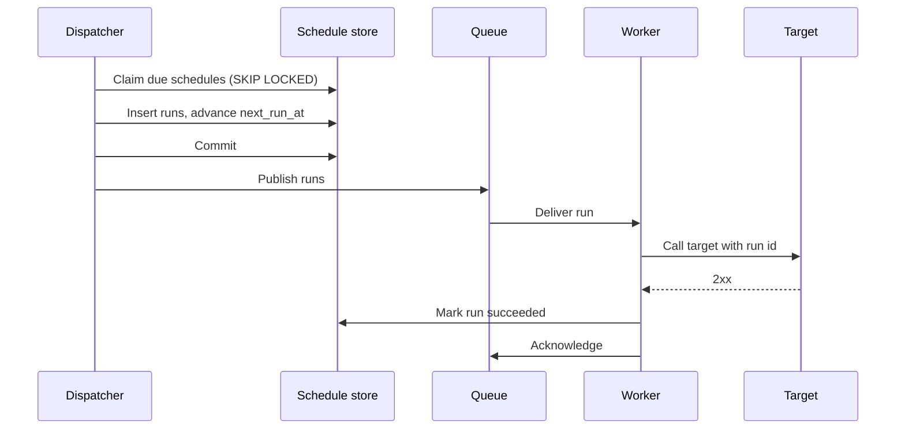
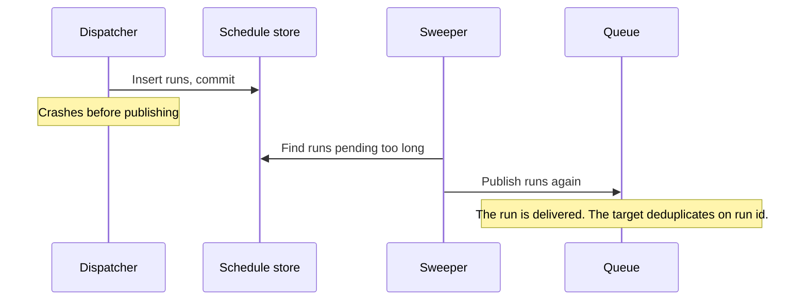

## Problem Statement

Many services need work to happen later: send a reminder in three days, recalculate a report every night, retry a webhook in thirty seconds. Running a timer inside each service works until the process restarts, a second replica fires the same job, or nobody can say what was supposed to run and whether it did.

The task is a shared scheduler: it accepts one-off and recurring schedules, fires each one at its due time, and keeps doing so when individual nodes fail.

## Requirements

**Functional**

- Create, update, pause and delete schedules, either one-off (`run_at`) or recurring (cron expression with a time zone).
- When a schedule is due, deliver a job to its target — an HTTP endpoint or a queue topic.
- Retry failed deliveries with backoff, up to a limit, then park the run for inspection.
- Expose the history of runs for each schedule.

**Non-functional**

- **No missed firings.** A node failure must not cause a due schedule to be skipped.
- **At-least-once delivery.** A job may be delivered more than once; it is never silently dropped.
- **Timeliness.** A job starts within a few seconds of its due time under normal load.
- **Horizontal scale.** Capacity grows by adding nodes, with no single coordinator.
- **Tenant isolation.** One tenant’s schedules are invisible to another, and cannot starve them.

## Capacity Estimation

**The figures below are illustrative assumptions chosen to exercise the design, not measurements from a real system.**

| Assumption | Value |
| --- | --- |
| Active schedules | 10 million |
| Share due in the busiest minute | 1% |
| Stored size of one run record | about 300 bytes |
| Run history retention | 14 days |

From these:

- **Peak firing rate:** 1% of 10 million is 100,000 firings per minute, about 1,700 per second.
- **Run records per day**, if that peak were sustained all day (an upper bound): 100,000 × 1,440 = 144 million.
- **Storage per day:** 144 million × 300 bytes ≈ 43 GB.
- **Retained history:** 43 GB × 14 ≈ 600 GB, before indexes.

Two conclusions follow. The firing rate is well within what a relational database can claim in batches, so a specialised store is not required to start. The run history, however, is the dominant cost and must be partitioned by time so that old data can be dropped cheaply.

## High-level Architecture

<InteractiveDiagram id="job-scheduler" />

The schedule store is the single source of truth. Dispatchers are stateless and identical: each one repeatedly claims a batch of due schedules, records a run for each, and hands the runs to a queue. Workers take runs from the queue and call the target. No component needs to know how many others exist.

## Low-level Design

**Claiming due schedules.** Every dispatcher runs the same loop. Inside one transaction it selects due schedules with `FOR UPDATE SKIP LOCKED`, so concurrent dispatchers receive disjoint batches without waiting on each other:

```sql
SELECT id, cron_expr, timezone, next_run_at
FROM schedules
WHERE status = 'active'
  AND next_run_at <= now()
ORDER BY next_run_at
LIMIT 500
FOR UPDATE SKIP LOCKED;
```

For each claimed schedule, still inside the transaction, the dispatcher:

1. Inserts a row into `runs` for the claimed `next_run_at`. A unique constraint on `(schedule_id, scheduled_for)` makes this insert idempotent.
2. Advances `next_run_at` to the next occurrence, or marks a one-off schedule `completed`.

Then it commits, and only after the commit publishes the new runs to the queue.

**The gap between commit and publish.** A dispatcher can crash after committing and before publishing. The `runs` table therefore doubles as an outbox: a sweeper periodically re-publishes runs that have been `pending` for longer than a threshold. This is why delivery is at-least-once rather than exactly-once.

**Time.** Due-ness is evaluated with the database’s `now()`, not each node’s clock, so clock differences between dispatchers cannot cause early or duplicate claims.

**Misfire policy.** If dispatch is stopped for an hour, a schedule that fires every minute has sixty occurrences overdue. Each schedule declares what to do: fire once and skip the rest (the default), or fire every missed occurrence.

## Component Responsibilities

| Component | Owns | Must never |
| --- | --- | --- |
| API service | Validation, tenant scoping, computing the first `next_run_at` | Fire jobs itself |
| Schedule store | Schedules, runs, and the ordering of claims | Be bypassed by a cache for due-ness |
| Dispatcher | Claiming due schedules and creating runs | Call targets directly |
| Queue | Buffering runs and redelivering unacknowledged ones | Be treated as the record of what ran |
| Workers | Calling the target, retries, recording the outcome | Decide whether a schedule is due |

## API Contracts

Create a schedule:

```http
POST /v1/schedules
Idempotency-Key: 7c1e6f0a-2f4b-4a53-9f43-0d6a1b1c9e77
Content-Type: application/json

{
  "name": "nightly-report",
  "cron": "0 2 * * *",
  "timezone": "Asia/Ho_Chi_Minh",
  "target": { "type": "http", "url": "https://reports.internal/run" },
  "retry": { "max_attempts": 5, "backoff": "exponential" },
  "misfire_policy": "fire_once"
}
```

```http
HTTP/1.1 201 Created

{
  "id": "sch_01HZX3",
  "status": "active",
  "next_run_at": "2026-01-16T19:00:00Z"
}
```

Other endpoints follow the same resource: `GET /v1/schedules/{id}`, `PATCH /v1/schedules/{id}`, `POST /v1/schedules/{id}/pause`, `POST /v1/schedules/{id}/resume`, `DELETE /v1/schedules/{id}` and `GET /v1/schedules/{id}/runs`.

The job delivered to an HTTP target carries the run identifier, which the target uses as its idempotency key:

```http
POST /run
X-Run-Id: run_01HZX9
X-Scheduled-For: 2026-01-16T19:00:00Z
X-Attempt: 1
X-Signature: sha256=...
```

## Database Schema

```sql
CREATE TABLE schedules (
  id           uuid PRIMARY KEY,
  tenant_id    uuid        NOT NULL,
  name         text        NOT NULL,
  cron_expr    text,                  -- null for one-off schedules
  run_at       timestamptz,           -- null for recurring schedules
  timezone     text        NOT NULL DEFAULT 'UTC',
  target       jsonb       NOT NULL,
  retry        jsonb       NOT NULL,
  misfire      text        NOT NULL DEFAULT 'fire_once',
  status       text        NOT NULL DEFAULT 'active',
  next_run_at  timestamptz,
  created_at   timestamptz NOT NULL DEFAULT now(),
  CHECK ((cron_expr IS NULL) <> (run_at IS NULL)),
  UNIQUE (tenant_id, name)
);

-- The dispatcher's claim query reads only this index.
CREATE INDEX schedules_due ON schedules (next_run_at) WHERE status = 'active';

CREATE TABLE runs (
  id             uuid        NOT NULL,
  schedule_id    uuid        NOT NULL,
  scheduled_for  timestamptz NOT NULL,
  status         text        NOT NULL DEFAULT 'pending',
  attempt        int         NOT NULL DEFAULT 0,
  started_at     timestamptz,
  finished_at    timestamptz,
  error          text,
  PRIMARY KEY (schedule_id, scheduled_for)
) PARTITION BY RANGE (scheduled_for);
```

The partial index keeps the claim query fast regardless of how many paused or completed schedules exist. Partitioning `runs` by day turns retention into dropping a partition instead of deleting hundreds of millions of rows.

## Sequence Diagrams

Normal firing:



Dispatcher crash between commit and publish:



## Failure Scenarios

| Failure | Behaviour |
| --- | --- |
| Dispatcher crashes mid-batch | The transaction rolls back and the row locks are released; another dispatcher claims the same schedules. |
| Dispatcher crashes after commit, before publish | The sweeper re-publishes runs left `pending`. |
| Worker crashes mid-job | The queue redelivers the unacknowledged run; the target deduplicates on the run identifier. |
| Target is down | The worker retries with exponential backoff, then marks the run `failed` and routes it to a dead-letter queue. |
| Database failover | Dispatch pauses. On recovery, overdue schedules are claimed and the misfire policy decides how many occurrences fire. |
| Top-of-the-hour spike | The queue absorbs the burst; optional per-schedule jitter spreads `0 * * * *` schedules across the first seconds. |

## Security Considerations

- **Tenant scoping.** Every query filters by `tenant_id`, derived from the caller’s credentials, never from the request body.
- **Outbound targets.** HTTP targets are a server-side request forgery risk. URLs are validated against an allow-list and resolved addresses are checked so they cannot reach internal ranges.
- **Signed deliveries.** Each delivery carries an HMAC signature over the run identifier and body, so a target can verify the scheduler sent it.
- **No secrets in payloads.** Targets reference credentials by name; the worker resolves them at call time from a secrets service.
- **Audit.** Changes to schedules are recorded with the actor and the previous value.

## Scalability Strategy

- **Dispatchers** scale horizontally. `SKIP LOCKED` means adding one increases claim throughput without coordination.
- **Workers** scale with the queue depth and are the first thing to add under load.
- **The schedule store** is the eventual bottleneck, on writes. The first step is time-partitioned `runs`; the next is sharding schedules by tenant hash across databases, with dispatchers assigned per shard.
- **Fairness.** Per-tenant concurrency limits at the worker stop one tenant’s burst from delaying everyone else.

## Trade-offs

- **At-least-once over exactly-once.** Exactly-once delivery to an arbitrary external target is not achievable; the design pushes deduplication to the target and gives it a stable key to do it with.
- **Polling the database over in-memory timers.** Polling adds up to one interval of delay and a constant query load. In exchange, no schedule lives only in a process’s memory, and any dispatcher can be killed at any time.
- **A relational store over a purpose-built one.** PostgreSQL gives transactions across schedules and runs, which is what makes the claim-and-record step safe. It will need sharding earlier than a distributed store would.
- **A queue between dispatcher and worker.** One more component to operate, but it decouples how fast schedules become due from how fast targets can be called.
