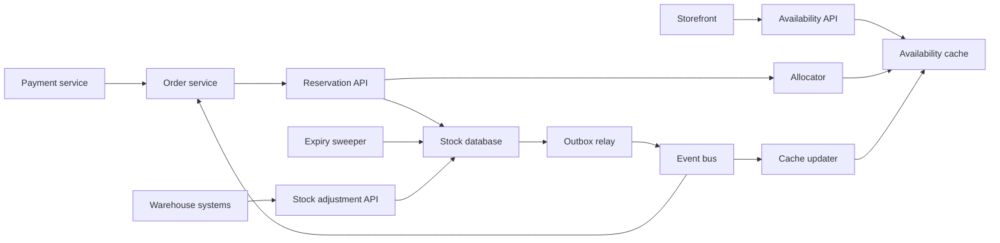
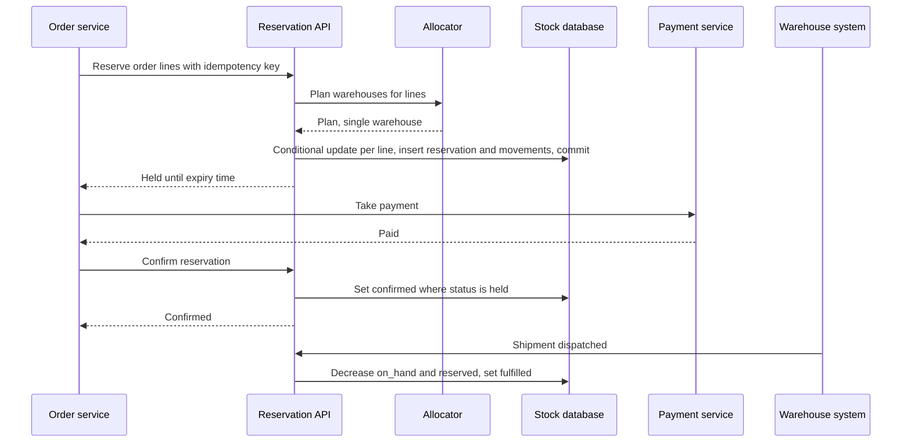
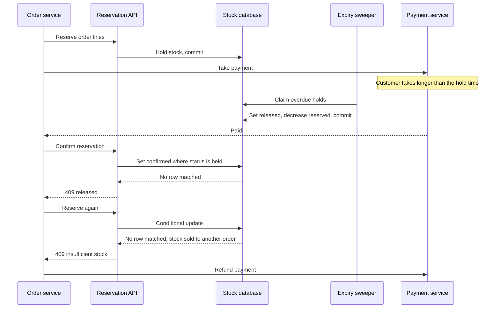

## Problem Statement

A shop has a finite number of each item, spread over several warehouses. Customers browse, add to a basket, and pay; payment takes anywhere from a second to several minutes, and sometimes never completes. Many customers do this at once, and during a sale thousands of them want the same item in the same second.

The task is the system that answers two questions correctly under that concurrency: how many can be sold, and has this order secured its items. It must never promise the same unit to two orders. It must not lock stock away indefinitely for baskets that will never be paid. And it must decide which warehouse each item ships from.

The difficulty is that the natural implementation — read the quantity, check it, write the new quantity — is wrong the moment two requests overlap, and that the purchase spans a payment step far too long to hold a database lock across.

## Requirements

**Functional**

- Report availability for a product, in total and per region.
- Reserve stock for an order for a limited time while payment is in progress.
- Confirm a reservation when payment succeeds; release it on cancellation, payment failure or expiry.
- Allocate each order line to a warehouse, splitting an order across warehouses only when necessary.
- Record receipts, shipments, returns and manual adjustments from warehouse systems.
- Keep a complete history of every change to stock.

**Non-functional**

- **No oversell.** The quantity reserved plus sold never exceeds what is physically on hand, under any interleaving.
- **Strong consistency for writes, eventual for display.** A reservation is decided against the authoritative record. The number shown on a product page may be a few seconds old.
- **Idempotent operations.** Reserve, confirm and release may each be delivered more than once.
- **Self-healing holds.** Stock held by an abandoned checkout returns to sale without manual action.
- **Latency.** A reservation completes in tens of milliseconds, including for multi-line orders.
- **Graceful contention.** A sale on one item must not degrade ordering of other items.

## Capacity Estimation

**The figures below are illustrative assumptions chosen to exercise the design, not measurements from a real system.**

| Assumption | Value |
| --- | --- |
| Products (SKUs) | 2 million |
| Warehouses stocking a typical SKU | 5 of 20 |
| Orders per day | 5 million |
| Lines per order | 3 |
| Peak-to-average ratio | 10 |
| Availability reads per order | 200 |
| Reservation hold time | 15 minutes |
| Stock movement record size, retention | about 150 bytes, 1 year |

From these:

- **Stock rows:** 2 million × 5 = 10 million rows; at about 100 bytes each, 1 GB.
- **Order rate:** 5,000,000 / 86,400 ≈ 58 per second on average, about 580 per second at peak.
- **Line reservations:** 58 × 3 ≈ 174 per second on average, about 1,740 per second at peak.
- **Availability reads:** 58 × 200 = 11,600 per second on average, about 116,000 per second at peak.
- **Live holds, upper bound:** 580 orders per second × 900 seconds = 522,000 orders, or about 1.57 million lines, if the peak were sustained for a full hold period and nobody paid early.
- **Movement history:** about 2 movements per line (reserve, then confirm or release) × 15 million lines = 30 million per day; × 150 bytes = 4.5 GB per day; × 365 ≈ 1.6 TB per year.

The numbers point away from the obvious worry. The stock table is 1 GB and fits in memory; fewer than two thousand reservation writes per second, spread over 10 million rows, is a light load for one relational primary. The pressure is elsewhere. Reads outnumber writes by roughly 67 to 1 (200 reads for every 3 line reservations), so availability must be served from a cache and not from the table that takes the writes. And load is not spread evenly: a sale can direct thousands of requests per second at a single row, which no amount of average-case headroom addresses.

## High-level Architecture



There are two paths with different consistency. The read path — storefront to availability API to cache — is fast, heavily replicated and allowed to be slightly stale. The write path — order service to reservation API to stock database — is authoritative: every reservation is decided by the database row itself, whatever the cache said.

The allocator plans which warehouse serves each line. The expiry sweeper returns unpaid holds to sale. Warehouse systems report physical changes through an adjustment API. Every change to stock emits an event through an outbox, which keeps the cache and downstream services current.

## Low-level Design

**The stock row.** Each row is one SKU in one warehouse with two counters: `on_hand`, the physical units in the building, and `reserved`, the units promised to orders that have not yet shipped. What can be sold is `on_hand - reserved`. Reserving does not change `on_hand`; only a shipment, receipt or adjustment does.

**Reserving without a race.** The check and the write are one statement:

```sql
UPDATE stock
SET reserved = reserved + $3
WHERE sku_id = $1
  AND warehouse_id = $2
  AND on_hand - reserved >= $3
RETURNING on_hand - reserved AS available_after;
```

The database takes the row lock, evaluates the condition against the latest committed values, and either updates or matches nothing. A result of zero rows means insufficient stock. Two concurrent requests for the last unit are serialised by the row lock; the second re-evaluates the condition after the first commits and finds it false. There is no window between reading and writing because the application never reads.

**Choosing a locking style.** Three approaches are available, and the design uses each where it fits.

| Approach | How | Fits | Cost |
| --- | --- | --- | --- |
| Pessimistic | `SELECT ... FOR UPDATE`, then decide, then write | Logic that must inspect the row before deciding | Lock held across application round trips |
| Optimistic | Read a `version`, write with `WHERE version = n`, retry on mismatch | Rare conflicts, such as manual adjustments | Retries multiply under contention |
| Conditional update | Put the rule in the `WHERE` clause | Reserve, release, confirm | The rule must be expressible in one statement |

Reservations use the conditional update: it holds the lock for the shortest time and never retries. Stock adjustments from a cycle count, where a person reviewed a specific value, use the version check so a stale correction is rejected.

**Multi-line orders.** All lines of an order are reserved in one transaction, so the order gets everything or nothing. Lines are processed in a fixed order, sorted by SKU then warehouse, so two orders that share items always lock rows in the same sequence and cannot deadlock. If any line matches zero rows, the transaction rolls back and nothing is held.

**Reservation lifecycle.** A reservation is `held` with an `expires_at`, then becomes `confirmed` when payment succeeds, then `fulfilled` when the warehouse ships; from `held` it may instead become `released`. Each transition is a conditional update on the status, so a duplicate or late message changes nothing. The counters move with it:

| Transition | on_hand | reserved |
| --- | --- | --- |
| Reserve | unchanged | plus quantity |
| Release or expire | unchanged | minus quantity |
| Confirm | unchanged | unchanged |
| Fulfil | minus quantity | minus quantity |

**Expiry.** A sweeper claims overdue holds in batches with `FOR UPDATE SKIP LOCKED`, sets them `released` and decrements `reserved`. Expiry takes effect when the sweeper releases, not when the clock passes `expires_at`: a payment that arrives a moment late still finds the reservation `held` and confirms normally. Only if the hold has already been released does the late payment need a new reservation, and if stock has gone in the meantime the order is refunded or back-ordered.

**Multi-warehouse allocation.** The allocator builds a plan from cached availability: first any single warehouse that can fill every line, ranked by shipping cost to the destination; failing that, the smallest number of warehouses that together cover the order. The plan is then attempted in the reservation transaction. The cache may be stale, so a line can fail; the allocator then re-plans from a fresh read of the affected rows and tries again, a bounded number of times. The plan is advisory; the conditional update is the decision.

**Hot items.** For a flash sale, thousands of requests per second contend for one row, and nearly all of them will fail. A gate in front of the database holds a counter per sale item in an in-memory store, initialised from available stock and decremented atomically. Requests that find the counter at zero are rejected immediately; those that pass proceed to the real reservation. The gate may be wrong in either direction — a lost counter, a released hold not yet returned — and that is acceptable, because it only limits how many requests reach the database. It cannot cause an oversell.

**History.** Every change appends a row to a movement table in the same transaction: SKU, warehouse, change to each counter, reason and reference. A periodic check confirms that each row’s `reserved` equals the sum of its held and confirmed reservation lines, and that counters equal the sum of their movements.

## Component Responsibilities

| Component | Owns | Must never |
| --- | --- | --- |
| Availability API | Fast, approximate answers for browsing | Be used to decide whether an order succeeds |
| Availability cache | Derived availability per SKU and region | Be written by anything except stock events and periodic refresh |
| Reservation API | Idempotency, the reservation state machine, the transaction | Hold a database transaction open across a call to another service |
| Allocator | Ranking warehouses and proposing a plan | Assume its plan will succeed |
| Stock database | The counters, reservations, movements, and their atomic update | Accept a counter change without a movement row |
| Sale gate | Shedding excess demand for hot items | Be treated as the stock count |
| Expiry sweeper | Releasing overdue holds | Release a reservation that is no longer `held` |
| Adjustment API | Receipts, shipments, returns, counts from warehouses | Overwrite `reserved` |
| Outbox relay | Publishing committed stock events | Publish a change that was rolled back |
| Order service | The order and payment flow, calling confirm or release | Change stock by any route other than the reservation API |

## API Contracts

Reserve stock for an order:

```http
POST /v1/reservations
Idempotency-Key: order-88213
Content-Type: application/json

{
  "order_id": "88213",
  "ship_to": { "country": "VN", "postal_code": "700000" },
  "lines": [
    { "sku": "SKU-1001", "quantity": 2 },
    { "sku": "SKU-2040", "quantity": 1 }
  ],
  "hold_seconds": 900
}
```

```http
HTTP/1.1 201 Created

{
  "id": "rsv_01JC4T",
  "status": "held",
  "expires_at": "2026-01-16T10:15:00Z",
  "allocations": [
    { "sku": "SKU-1001", "warehouse": "WH-SGN", "quantity": 2 },
    { "sku": "SKU-2040", "warehouse": "WH-SGN", "quantity": 1 }
  ]
}
```

When stock is short the response is `409` with the lines that could not be filled and what is available, so the caller can offer a smaller quantity:

```http
HTTP/1.1 409 Conflict

{
  "error": "insufficient_stock",
  "lines": [ { "sku": "SKU-1001", "requested": 2, "available": 1 } ]
}
```

`POST /v1/reservations/{id}/confirm` and `POST /v1/reservations/{id}/release` are idempotent: repeating either returns the current state. Confirming a released reservation returns `409` with status `released`, which tells the order service to reserve again or refund. `GET /v1/availability?sku=SKU-1001&region=south` serves the read path and states its freshness in a response header.

## Database Schema

```sql
CREATE TABLE stock (
  sku_id        bigint  NOT NULL,
  warehouse_id  int     NOT NULL,
  on_hand       int     NOT NULL DEFAULT 0 CHECK (on_hand >= 0),
  reserved      int     NOT NULL DEFAULT 0 CHECK (reserved >= 0),
  version       bigint  NOT NULL DEFAULT 0,
  updated_at    timestamptz NOT NULL DEFAULT now(),
  PRIMARY KEY (sku_id, warehouse_id)
);

CREATE TABLE reservations (
  id          uuid PRIMARY KEY,
  order_id    text        NOT NULL UNIQUE,      -- one reservation per order: idempotency
  status      text        NOT NULL DEFAULT 'held',  -- held | confirmed | fulfilled | released
  expires_at  timestamptz NOT NULL,
  created_at  timestamptz NOT NULL DEFAULT now()
);

-- The sweeper reads only holds that can still expire.
CREATE INDEX reservations_expiring ON reservations (expires_at) WHERE status = 'held';

CREATE TABLE reservation_lines (
  reservation_id  uuid    NOT NULL REFERENCES reservations (id),
  sku_id          bigint  NOT NULL,
  warehouse_id    int     NOT NULL,
  quantity        int     NOT NULL CHECK (quantity > 0),
  PRIMARY KEY (reservation_id, sku_id, warehouse_id)
);

-- Used by the consistency check and by shortfall handling for one stock row.
CREATE INDEX reservation_lines_stock ON reservation_lines (sku_id, warehouse_id);

CREATE TABLE stock_movements (
  id              bigint GENERATED ALWAYS AS IDENTITY,
  sku_id          bigint      NOT NULL,
  warehouse_id    int         NOT NULL,
  on_hand_delta   int         NOT NULL DEFAULT 0,
  reserved_delta  int         NOT NULL DEFAULT 0,
  reason          text        NOT NULL,   -- reserve | release | expire | fulfil | receipt | return | adjustment
  reference       text        NOT NULL,   -- reservation, shipment or count identifier
  created_at      timestamptz NOT NULL DEFAULT now(),
  PRIMARY KEY (id, created_at)
) PARTITION BY RANGE (created_at);

CREATE INDEX stock_movements_row ON stock_movements (sku_id, warehouse_id, created_at);
```

The primary key of `stock` is exactly the predicate of the reserve statement, so each reservation line is one index lookup and one row lock. The unique `order_id` makes a repeated reserve request find the existing reservation instead of holding stock twice. The schema deliberately has no constraint that `reserved` stays at or below `on_hand`: a cycle count can legitimately discover fewer units than were promised. In that case available stock is negative, the reserve condition is false for everyone, and a shortfall job reallocates or back-orders the newest holds on that row. Movements are partitioned by month and archived after a year.

## Sequence Diagrams

Checkout that completes:



Hold expires and payment arrives late:



## Failure Scenarios

| Failure | Behaviour |
| --- | --- |
| Two orders want the last unit | The row lock serialises the two updates; the second finds the condition false and receives `409`. |
| Order service retries a reserve request | The unique `order_id` returns the existing reservation. Stock is held once. |
| Reservation API crashes mid-transaction | The transaction rolls back; no counters changed and nothing is held. |
| Order service crashes after reserving | The hold expires and the sweeper returns the stock to sale. |
| Payment succeeds after the hold was released | Confirm returns `409`; the order service reserves again, and refunds or back-orders if that fails. |
| Sweeper and confirm race on one reservation | Both are conditional on `status = 'held'`; exactly one matches. |
| Cache shows stock that is gone | The reservation fails at the database and the customer is told at checkout. The cache corrects itself from the event. |
| Cache updater falls behind or stops | Displayed availability goes stale; orders remain correct. A periodic full refresh from the database bounds the drift. |
| Sale gate loses its counters | Counters are rebuilt from the database. Meanwhile more requests reach the database, which still rejects the excess. |
| Warehouse count finds fewer units than recorded | The adjustment lowers `on_hand`; if it drops below `reserved`, the shortfall job reallocates the newest holds to another warehouse or back-orders them. |
| Shipment message delivered twice | Fulfil is conditional on `status = 'confirmed'`; the second delivery matches nothing. |
| Database failover | Reservations fail briefly and callers retry with the same keys. Synchronous replication preserves every committed hold. |

## Security Considerations

- **Service authentication.** Only the order service may reserve, confirm and release; only warehouse systems may post receipts and shipments. Each is authenticated by workload identity and authorised per operation.
- **Adjustments are privileged.** Manual changes to `on_hand` require a role, a reason and a reference, and are recorded in the movement history with the actor. Large adjustments require a second approver.
- **Inventory hoarding.** Holds are a denial-of-inventory vector: a script can reserve a whole stock and never pay. Defences are per-customer and per-address limits on held quantity, shorter holds for unauthenticated sessions, reserving at payment start instead of at add-to-basket, and bot controls at the storefront.
- **Availability disclosure.** Exact stock levels are commercially sensitive. The public read path returns bands such as in stock, low or out of stock, and exact numbers only to internal callers.
- **Input validation.** Quantities are positive integers with an upper bound per line; warehouse and SKU identifiers are validated against reference data before any update.
- **Audit.** The movement table is append-only for the application role, so the history of a stock row cannot be rewritten by the service that changes it.

## Scalability Strategy

- **The read path** scales independently: the availability cache is replicated and partitioned by SKU, and absorbs the 116,000 reads per second without touching the stock database.
- **The reservation API and allocator** are stateless and scale horizontally.
- **The stock database** starts as a single primary with synchronous replicas, which the estimated write rate allows. The next step is sharding by SKU, which keeps all warehouses of an item together. An order whose lines fall on different shards is reserved shard by shard; if a later shard fails, the earlier holds are released. Holds make that compensation cheap and safe.
- **Hot rows** are the real limit: one row accepts only as many updates per second as transactions can commit in sequence. The sale gate caps what reaches the row, and the reserve transaction is kept to a few statements with no external calls. If a single item must sell faster than one row allows, its stock is split into several bucket rows and requests are spread across them.
- **Sweeping** scales by adding sweeper instances; `SKIP LOCKED` gives them disjoint batches.
- **History** grows without bound and is partitioned by time from the first day.

## Trade-offs

- **Reservations with expiry over deducting stock at payment.** Stock is unavailable to others while a customer who may never pay holds it, and the hold time has to be tuned. Without holds, customers pay for items that sold out a moment earlier, and every such case is a refund.
- **A conditional update over optimistic versioning for reservations.** The rule has to fit in one statement, and the failure response needs a second read to explain what is available. Version checks would turn a hot item into a storm of retries.
- **The database as the authority over an in-memory counter.** Throughput on one hot item is bounded by row commits. An in-memory counter as the source of truth would be faster and would oversell or lose stock on failover.
- **Stale availability on display over reading the truth.** Some customers see an item as available and are refused at checkout. Serving every page view from the write database would trade that occasional disappointment for a system that falls over during the sale.
- **Allocating a warehouse at reservation time over reserving against a pooled quantity.** Early allocation is simple and makes the promise concrete, but can lock in a poor choice when a better warehouse is restocked. Deferred allocation optimises shipping cost and requires a second, harder allocation step before fulfilment.
- **All-or-nothing orders over partial reservation.** An order fails when one line is short even though the others could be held. The caller gets the shortfall detail and can retry with a changed basket, which keeps partial-fulfilment policy out of the inventory system.
