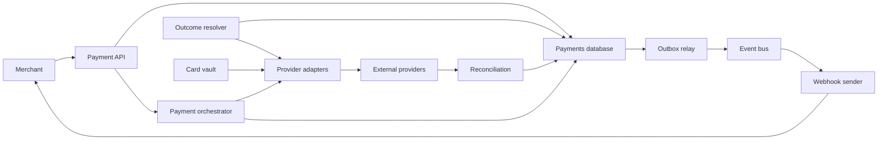
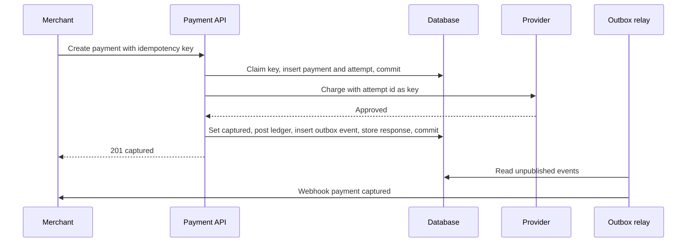
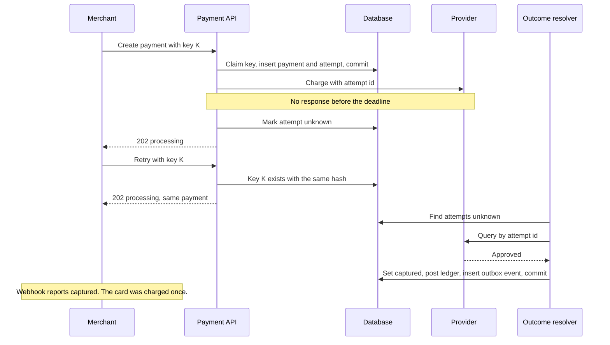

## Problem Statement

A payment system sits between merchants who want to charge customers and external providers — card networks, banks, wallets — that actually move the money. Its job sounds simple: accept a payment request, have a provider authorise it, capture the funds, and later settle with the merchant.

The difficulty is that nothing on the path is reliable. A merchant’s request may arrive twice because their client timed out and retried. A provider call may time out after the provider has charged the card, leaving the outcome unknown. A process may crash between learning the result and recording it. Each of these, handled naively, either charges a customer twice or loses track of money that moved.

The task is a system that stays correct through all of it: every payment takes effect exactly once, every movement of money is recorded in a ledger that always balances, and any disagreement with a provider is detected and repaired.

## Requirements

**Functional**

- Create a payment, authorise it with a provider, and capture it either immediately or later.
- Refund a captured payment, fully or partially.
- Record every movement of money in a double-entry ledger and expose merchant balances.
- Notify merchants of state changes by webhook.
- Reconcile internal records against provider settlement reports and flag differences.

**Non-functional**

- **Exactly-once effects.** However many times a request is delivered, the customer is charged at most once and the ledger is posted once.
- **No lost outcomes.** A payment never stays in an unknown state indefinitely; it is driven to a final state.
- **Consistency over availability for money.** The ledger is strongly consistent. If the database is unavailable, payments are refused, not queued in memory.
- **Durability.** An acknowledged payment survives the loss of any single node or zone.
- **Latency.** The system adds a few tens of milliseconds on top of the provider’s own response time.
- **Auditability.** Ledger entries are immutable; corrections are new entries.

## Capacity Estimation

**The figures below are illustrative assumptions chosen to exercise the design, not measurements from a real system.**

| Assumption | Value |
| --- | --- |
| Payments per day | 50 million |
| Peak-to-average ratio | 5 |
| Provider response time, typical | 400 ms |
| Provider calls ending in a timeout | 0.5% |
| Ledger lines per payment | 4 |
| Size of one ledger line | about 200 bytes |
| Ledger retention | 7 years |
| Idempotency record size, retention | about 500 bytes, 24 hours |

From these:

- **Request rate:** 50,000,000 / 86,400 ≈ 579 payments per second on average, about 2,900 per second at peak.
- **In-flight provider calls at peak:** 2,900 × 0.4 seconds ≈ 1,160 open calls.
- **Unknown outcomes:** 0.5% of 50 million = 250,000 payments per day that time out and must be resolved.
- **Ledger growth:** 50 million × 4 = 200 million lines per day; × 200 bytes = 40 GB per day; × 365 ≈ 14.6 TB per year; × 7 ≈ 102 TB retained.
- **Idempotency records:** 50 million × 500 bytes = 25 GB held at any time.

Three conclusions follow. A quarter of a million unknown outcomes a day means the timeout path is not an edge case; it needs its own component, not an operator. The ledger at roughly 100 TB cannot live in one unpartitioned table: it must be partitioned by time and archived by age. And each payment is two transactions and roughly ten row writes, so the peak is near 30,000 row writes per second: more than a single primary should be planned to carry with headroom, so the design must have a sharding key from the start.

## High-level Architecture



The payment API terminates the merchant’s request, enforces idempotency and writes the payment’s intent. The orchestrator drives each payment through its state machine and is the only component that calls providers, through adapters that hide each provider’s protocol. The payments database holds payments, attempts, the ledger and an outbox in one transactional store, so a state change, its ledger posting and its event commit together or not at all.

Three background components close the gaps. The outbox relay publishes committed events to a bus, from which the webhook sender notifies merchants. The outcome resolver finds payments stuck in an unknown state and asks the provider what happened. Reconciliation compares the ledger with provider settlement reports every day. Card numbers never enter this system: a separate vault exchanges them for tokens.

## Low-level Design

**Idempotency keys.** Every mutating request carries an `Idempotency-Key`. The first statement of the first transaction claims it:

```sql
INSERT INTO idempotency_keys (merchant_id, key, request_hash, status, locked_until)
VALUES ($1, $2, $3, 'in_progress', now() + interval '60 seconds')
ON CONFLICT (merchant_id, key) DO NOTHING
RETURNING key;
```

If a row comes back, this request owns the key. If not, the existing row decides: a completed key with the same request hash replays the stored response; the same key with a different hash is a client error; a key still in progress and locked returns a conflict telling the client to retry shortly. A key in progress whose lock has expired means the previous handler died, and the new request resumes from the payment’s recorded state.

**Two transactions around one external call.** A database transaction cannot include a provider. The design brackets the call instead:

1. **Before.** In one transaction: claim the idempotency key, insert the payment in state `authorizing`, and insert an attempt row. Commit. The intent to call the provider is now durable.
2. **Call.** Send the request to the provider with the attempt identifier as the provider-side idempotency key.
3. **After.** In one transaction: move the payment to its new state, post ledger entries if money moved, insert the outbox event, and store the response on the idempotency key. Commit.

A crash at any point leaves a durable record of how far the payment got. A crash between steps 2 and 3 leaves the payment in `authorizing` with an attempt on record, which is exactly what the resolver looks for.

**State machine.** A payment moves through `created`, `authorizing`, `authorized`, `capturing`, `captured`, and from there to `refunded` or `partially_refunded`; `failed` and `cancelled` are terminal. Each transition is a conditional update — `UPDATE payments SET status = 'captured' WHERE id = $1 AND status = 'capturing'` — so two actors racing on the same payment cannot both succeed, and a late or duplicate provider callback is a no-op.

**Unknown outcomes.** A timeout says nothing about whether the provider acted. The payment stays in its in-flight state with the attempt marked `unknown`. The resolver queries the provider by attempt identifier with backoff. It never issues a new attempt with a new key while an earlier one is unresolved, because that is how a double charge happens. If the provider reports success, the after-transaction runs; if it reports no such attempt after the provider’s own idempotency window, the attempt is marked failed and the payment may be retried.

**Double-entry ledger.** Money is recorded as transactions made of lines, each line a signed amount in minor units against an account. The lines of a transaction sum to zero per currency. A captured payment of 100.00 with a 2.90 fee posts three lines: +10000 to the provider receivable account, -9710 to the merchant payable account, and -290 to fee revenue. Entries are never updated or deleted; a refund or a correction is a new transaction that references the original. A unique posting key per payment and kind makes posting idempotent, so a repeated after-transaction cannot post twice.

**Balances.** Updating a balance row on every posting would serialise all payments on the handful of accounts every payment touches, such as fee revenue. Balances are therefore derived: a snapshot plus the lines since the snapshot, advanced by a background job. Only operations that must not overdraw, such as a payout from a merchant’s payable account, take a row lock on that account’s balance and verify it synchronously.

**Outbox.** Events are rows inserted in the same transaction as the state change. A relay reads unpublished rows in order per payment, publishes them and marks them sent. Publication is at-least-once, so events carry a stable identifier and consumers deduplicate.

**Reconciliation.** Each day the provider’s settlement report is matched line by line against captured and refunded attempts. Three outcomes need action: recorded here and missing there, present there and missing here, and present in both with different amounts. Each becomes a case; none is corrected by editing history.

## Component Responsibilities

| Component | Owns | Must never |
| --- | --- | --- |
| Payment API | Authentication, validation, idempotency keys, writing intent | Call a provider inside a database transaction |
| Orchestrator | The payment state machine and the order of steps | Create a second attempt while one is unresolved |
| Provider adapters | Translating to each provider, timeouts, mapping errors to known, declined or unknown | Decide a timeout means failure |
| Payments database | Payments, attempts, ledger, outbox, and their atomic commit | Be written without the idempotency check on the request path |
| Ledger | Immutable, balanced entries | Allow an update or delete of a posted line |
| Outbox relay | Publishing committed events in order per payment | Publish something that was not committed |
| Outcome resolver | Driving unknown attempts to a final state | Guess an outcome without asking the provider |
| Webhook sender | Signed, retried delivery to merchants | Be the only way a merchant can learn a payment’s state |
| Reconciliation | Detecting differences with providers | Silently adjust the ledger to match |
| Card vault | Card data and tokens | Share a database or network segment with anything else |

## API Contracts

Create and capture a payment:

```http
POST /v1/payments
Idempotency-Key: 5b2d9c1e-8a41-4f0e-9d53-3f6c7a2b1e90
Content-Type: application/json

{
  "amount": 10000,
  "currency": "USD",
  "payment_method": "tok_4f9a",
  "capture": true,
  "reference": "order-88213"
}
```

```http
HTTP/1.1 201 Created

{
  "id": "pay_01J8ZQ",
  "status": "captured",
  "amount": 10000,
  "currency": "USD"
}
```

Amounts are integers in the currency’s minor unit; floating point never appears. When the provider times out, the response is `202 Accepted` with `"status": "processing"`: the request was recorded and the outcome will follow by webhook and is readable at `GET /v1/payments/{id}`. Repeating the request with the same key returns the same payment, never a second one.

Other endpoints follow the resource: `POST /v1/payments/{id}/capture`, `POST /v1/payments/{id}/refunds` and `GET /v1/balances`. Error responses separate the cases a client must handle differently: `409` for a key still in progress, `422` for a key reused with a different body, `402` for a decline, which is final and must not be retried with the same key.

Webhooks carry the event identifier for deduplication and a signature over the body:

```http
POST /merchant/webhook
X-Event-Id: evt_01J8ZR
X-Signature: t=1767225600,v1=...

{ "type": "payment.captured", "payment_id": "pay_01J8ZQ" }
```

## Database Schema

```sql
CREATE TABLE idempotency_keys (
  merchant_id   uuid        NOT NULL,
  key           text        NOT NULL,
  request_hash  bytea       NOT NULL,
  status        text        NOT NULL,          -- in_progress | completed
  locked_until  timestamptz,
  payment_id    uuid,
  response      jsonb,
  created_at    timestamptz NOT NULL DEFAULT now(),
  PRIMARY KEY (merchant_id, key)
);

CREATE TABLE payments (
  id           uuid PRIMARY KEY,
  merchant_id  uuid        NOT NULL,
  amount       bigint      NOT NULL CHECK (amount > 0),
  currency     char(3)     NOT NULL,
  status       text        NOT NULL,
  reference    text,
  created_at   timestamptz NOT NULL DEFAULT now(),
  updated_at   timestamptz NOT NULL DEFAULT now()
);

-- The resolver scans only payments that are in flight.
CREATE INDEX payments_in_flight ON payments (updated_at)
  WHERE status IN ('authorizing', 'capturing');

CREATE TABLE payment_attempts (
  id            uuid PRIMARY KEY,              -- sent to the provider as its idempotency key
  payment_id    uuid        NOT NULL REFERENCES payments (id),
  kind          text        NOT NULL,          -- authorize | capture | refund
  provider      text        NOT NULL,
  outcome       text        NOT NULL DEFAULT 'pending',  -- pending | succeeded | declined | unknown | failed
  provider_ref  text,
  created_at    timestamptz NOT NULL DEFAULT now()
);

-- Reconciliation matches settlement lines by provider reference.
CREATE UNIQUE INDEX attempts_provider_ref ON payment_attempts (provider, provider_ref)
  WHERE provider_ref IS NOT NULL;

CREATE TABLE ledger_transactions (
  id          uuid        NOT NULL,
  payment_id  uuid        NOT NULL,
  kind        text        NOT NULL,            -- capture | refund | payout | adjustment
  posted_at   timestamptz NOT NULL DEFAULT now(),
  PRIMARY KEY (id, posted_at)
) PARTITION BY RANGE (posted_at);

-- Global uniqueness that makes posting idempotent; kept outside the partitioned table.
CREATE TABLE ledger_postings (
  payment_id  uuid NOT NULL,
  kind        text NOT NULL,
  sequence    int  NOT NULL DEFAULT 0,         -- distinguishes several partial refunds
  PRIMARY KEY (payment_id, kind, sequence)
);

CREATE TABLE ledger_entries (
  transaction_id  uuid        NOT NULL,
  account_id      uuid        NOT NULL,
  amount          bigint      NOT NULL,        -- signed, minor units; lines of a transaction sum to zero
  currency        char(3)     NOT NULL,
  posted_at       timestamptz NOT NULL DEFAULT now()
) PARTITION BY RANGE (posted_at);

CREATE INDEX ledger_entries_account ON ledger_entries (account_id, posted_at);

CREATE TABLE outbox (
  id            bigserial PRIMARY KEY,
  aggregate_id  uuid        NOT NULL,
  type          text        NOT NULL,
  payload       jsonb       NOT NULL,
  published_at  timestamptz
);

CREATE INDEX outbox_unpublished ON outbox (id) WHERE published_at IS NULL;
```

The partial indexes keep the two background scans — in-flight payments and unpublished events — proportional to the work outstanding, not to history. The ledger is partitioned by month so old partitions can move to cheaper storage whole. Because a unique constraint on a partitioned table must include the partition key, the idempotency of postings is enforced by the small `ledger_postings` table, inserted in the same transaction as the entries. The zero-sum rule is checked by the posting code and verified continuously by a job that sums each recent transaction.

## Sequence Diagrams

Payment with immediate capture:



Provider timeout followed by a merchant retry:



## Failure Scenarios

| Failure | Behaviour |
| --- | --- |
| Merchant sends the same request twice | The second insert of the key conflicts; the stored response is replayed or a conflict is returned. One payment exists. |
| Provider times out | The attempt is marked `unknown`; the resolver asks the provider and completes or fails the payment. No new attempt is made meanwhile. |
| Crash after the provider approved, before the commit | The payment is still `authorizing` with an attempt on record. The resolver finds it and runs the after-transaction. |
| Crash after the commit, before the response | The merchant retries with the same key and receives the stored response. |
| After-transaction runs twice | The conditional status update matches no row and the posting key conflicts; the second run changes nothing. |
| Relay crashes after publishing, before marking sent | The event is published again; consumers deduplicate on the event identifier. |
| Merchant’s webhook endpoint is down | Delivery retries with backoff for a bounded period; the merchant can always read state from the API. |
| Provider is degraded | A circuit breaker per provider opens; payments route to an alternative provider if one is configured, or fail fast. |
| Database failover | In-flight requests fail; merchants retry with the same keys. Synchronous replication means no acknowledged payment is lost. |
| Reconciliation finds a difference | A case is opened with both records. Repair is a new adjusting ledger transaction, never an edit. |

## Security Considerations

- **Card data.** Card numbers are confined to the vault, which is the only component in scope for the strictest card-industry controls. Everything else handles tokens that are useless outside the system.
- **Merchant authentication.** API keys are scoped to a merchant and an environment, stored hashed, and rotated without downtime by allowing two active keys. The merchant identifier always comes from the credential, never from the body.
- **Idempotency keys are scoped per merchant**, so one merchant cannot probe or collide with another’s keys.
- **Webhook integrity.** Each webhook is signed with a per-merchant secret over a timestamp and the body, which lets the receiver reject forgeries and replays.
- **Ledger integrity.** The application role has insert-only rights on ledger tables. Manual adjustments require two people and are themselves ledger transactions with an actor recorded.
- **Abuse.** Per-merchant rate limits and velocity checks run before any provider call; a card-testing pattern is cut off at the API, not discovered on the provider’s invoice.
- **Data protection.** Encryption in transit everywhere and at rest for the database and backups; personal data in payloads is minimised and never written to logs.

## Scalability Strategy

- **API, orchestrator and adapters** are stateless and scale horizontally; open provider calls are bounded per provider so a slow provider consumes its own pool only.
- **The database is the bottleneck.** Payments, attempts, idempotency keys and outbox are sharded by `merchant_id`, which keeps every request’s transaction on one shard. Very large merchants get dedicated shards.
- **The ledger** is partitioned by time within each shard. Accounts that every payment touches, such as fee revenue, are split into one sub-account per shard so no posting crosses shards; platform-wide totals are aggregated asynchronously.
- **Reads** of payment state go to replicas where slight staleness is acceptable; balance checks that gate a payout read the primary.
- **Background work** — relay, resolver, webhooks — scales by claiming rows with `FOR UPDATE SKIP LOCKED`, so more instances add throughput without coordination.
- **Retention.** Idempotency keys expire after 24 hours; ledger partitions older than the active window move to archive storage but remain queryable.

## Trade-offs

- **Exactly-once effects over exactly-once delivery.** Requests, provider calls and events are all at-least-once; correctness comes from keys and conditional writes at every hop. The cost is discipline: every consumer must deduplicate.
- **Consistency over availability.** When the primary database is unreachable, payments are refused. Accepting them into a queue would raise availability and create payments whose idempotency could not be checked.
- **An unknown state over an optimistic answer.** Returning `processing` on a timeout is a worse merchant experience than a clean yes or no, and it is the only honest answer. Treating a timeout as a failure invites double charges.
- **A transactional outbox over publishing directly.** Events lag the commit by the relay’s interval and the outbox adds write load. In return, no event exists without its state change and no state change lacks its event.
- **Derived balances over balance rows updated on every posting.** Balances lag by seconds for most accounts, and reads are more involved. Synchronous balance rows would be simpler and would serialise the whole system on its busiest accounts.
- **One relational store for payments and ledger.** Atomic state change plus posting is what makes the design simple to reason about; the price is sharding earlier than a purpose-built ledger service would need.
