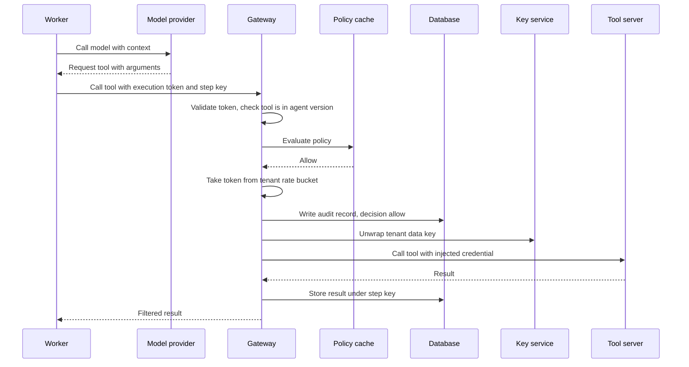
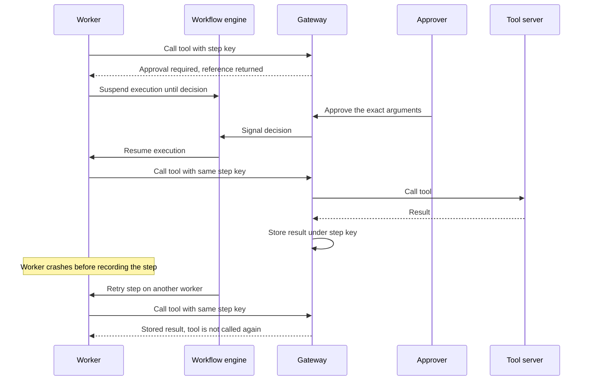

## Problem Statement

An AI agent is useful in proportion to the tools it can call: search a knowledge base, open a ticket, run a query, issue a refund. The Model Context Protocol (MCP) gives those tools a common shape, but it does not say who may call which tool, with whose credentials, at what rate, or at what cost.

The task is a shared platform on which many tenants define agents and connect tools. Three things must hold at once. Tenants are isolated: one tenant’s agents, data, credentials and spending are invisible to every other tenant. Tool calls are governed: before a tool runs, the call must prove which tenant, which execution and which agent version it belongs to, and that a policy allows it. And the platform itself is shared: the same processes, database and gateway serve everyone, because one deployment per tenant does not scale operationally.

The difficulty is that the caller is a language model. Its requests are shaped by untrusted input, so the platform cannot rely on the agent behaving well. Every control has to sit outside the agent.

## Requirements

**Functional**

- Tenants register agents as immutable versions: instructions, model, and the set of tools the version may use.
- Tenants connect tool servers and store the credentials those servers need.
- Start an execution of an agent, follow its progress, cancel it, and read its step-by-step history.
- Every tool call receives a policy decision: allow, deny, or require human approval.
- Enforce per-tenant rate limits, concurrency limits and spending budgets.
- Record every tool call and every policy decision in an audit trail the tenant can query.
- Accept external MCP clients under the same policy as the platform’s own agents.

**Non-functional**

- **Isolation by construction.** A missing filter in application code must not expose another tenant’s rows.
- **Durable executions.** An agent loop, or a wait for approval that lasts hours, survives process restarts and deployments.
- **Exactly-once effects for tool calls.** A retried step must not repeat a side effect such as sending an email twice.
- **Fail closed.** If policy, quota or audit cannot be evaluated or written, the call does not run.
- **Low overhead.** The governance path adds at most a few tens of milliseconds to a tool call.
- **Fairness.** One tenant’s burst cannot exhaust capacity shared with others.

## Capacity Estimation

**The figures below are illustrative assumptions chosen to exercise the design, not measurements from a real system.**

| Assumption | Value |
| --- | --- |
| Tenants | 2,000 |
| Executions per day | 1 million |
| Model calls per execution | 10 |
| Tool calls per execution | 8 |
| Average execution duration | 60 seconds |
| Peak-to-average ratio | 5 |
| Step record size, retention | about 2 KB, 30 days |
| Audit record size, retention | about 1 KB, 365 days |

From these:

- **Tool calls:** 1 million × 8 = 8 million per day. 8,000,000 / 86,400 ≈ 93 per second on average, about 460 per second at peak.
- **Concurrent executions:** 1,000,000 / 86,400 ≈ 11.6 starts per second; × 60 seconds ≈ 700 running on average, about 3,500 at peak.
- **Step history:** 18 steps per execution × 1 million = 18 million records per day; × 2 KB = 36 GB per day; × 30 days ≈ 1.1 TB.
- **Audit trail:** 8 million × 1 KB = 8 GB per day; × 365 days ≈ 2.9 TB.

Three conclusions follow. First, a few hundred tool calls per second is a small load, so the gateway can afford to do real work on every call; the constraint is latency, which means the policy decision must be made from memory and not by a query per call. Second, executions are long-lived and mostly waiting on models and tools, so they need durable state, not a pool of blocked threads. Third, history and audit dominate storage and must be partitioned by time. The average also hides the real risk: 2,000 tenants do not share load evenly, so the limits that matter are per tenant, not global.

## High-level Architecture

<InteractiveDiagram id="mcp-platform" />

The design separates three planes, and the separation is the main security property.

The **control plane** is a management API. It authenticates callers, resolves the tenant, validates requests, checks the budget and starts executions. It holds no tool credentials and never calls a tool.

The **execution plane** is a set of stateless workers driven by a durable workflow engine. A worker runs the agent loop: call the model, record the step, and when the model asks for a tool, ask the gateway. The engine holds the state of every execution, so any worker can be stopped at any time and another continues from the last recorded step.

The **tool plane** is the gateway. It is the only component with a network route to tool servers and the only one that can obtain a tool credential. Internal workers and external MCP clients reach tools through the same entry point and the same policy. Because the gateway is the single egress, every control that matters is enforced in one place: identity of the call, policy, quota, credential injection, result filtering and audit.

A relational database is the source of truth for tenants, agents, executions, usage and audit, with tenant isolation enforced by the database itself. A key management service protects the keys that encrypt stored credentials.

## Low-level Design

**Tenant isolation in the database.** All tenants share one schema, and every tenant-owned table carries a `tenant_id`. Row-Level Security turns the tenant filter from a convention into a rule the database enforces:

```sql
ALTER TABLE executions ENABLE ROW LEVEL SECURITY;
ALTER TABLE executions FORCE ROW LEVEL SECURITY;

CREATE POLICY tenant_isolation ON executions
  USING      (tenant_id = current_setting('app.tenant_id', true)::uuid)
  WITH CHECK (tenant_id = current_setting('app.tenant_id', true)::uuid);
```

The application connects as a role that does not own the tables and cannot bypass policies. Each transaction begins with `SET LOCAL app.tenant_id`, taken from the authenticated identity. `SET LOCAL` ends with the transaction, so a pooled connection cannot carry one tenant’s context into another tenant’s request. If the setting is absent, `current_setting` returns null, the comparison is not true, and the query returns no rows: a forgotten context fails closed.

**Identity of a tool call.** When an execution starts, the platform issues an execution token: short-lived, signed, and bound to the tenant, the execution, the agent version and the set of tools that version declares. The worker presents it on every gateway call. The gateway trusts the token, not anything in the request body, so a prompt-injected agent cannot claim another tenant or a tool outside its version.

**The policy decision.** The gateway evaluates each call against the tenant’s policies. The input is the tenant, the principal that started the execution, the agent version, the tool, and the arguments. The output is one of three decisions: allow, deny, or require approval. With no matching rule the answer is deny. Policies are compiled into an in-memory structure keyed by tenant and policy version; a change notification invalidates the entry, and a short maximum age bounds staleness if a notification is lost.

**Approval.** A call that requires approval suspends the execution as a durable wait. The approval is bound to a hash of the exact tool name and arguments, and it expires. If the agent changes the arguments after approval, the hash no longer matches and the decision is void.

**Exactly-once effects.** The workflow engine delivers steps at least once: a worker can crash after the tool ran and before the result was recorded. Each tool call therefore carries an idempotency key derived from the execution identifier and the step number, which is the same on every retry. The gateway records the outcome under that key and returns the stored result for a repeat instead of calling the tool again. The key is also forwarded to the tool server, for tools able to deduplicate on their own side.

**Credentials.** Tool credentials are stored under envelope encryption: each tenant has a data key, wrapped by a key held in the key management service. Only the gateway’s identity is permitted to unwrap. The gateway decrypts the credential in memory, attaches it to the outbound call, and discards it. The agent, the worker and the model never see it.

**Quotas and budgets.** Rate limits are token buckets per tenant and per tool, held in a shared in-memory store so that all gateway replicas see the same count. Concurrency is capped per tenant at execution start. Budgets work by reservation: before a model call, the worker reserves an estimated cost against the tenant’s budget; after the call, it settles the actual usage into an append-only usage ledger and releases the difference. A reservation that would exceed the budget is refused before any money is spent.

## Component Responsibilities

| Component | Owns | Must never |
| --- | --- | --- |
| Management API | Authentication, tenant resolution, validation, budget check, starting executions | Hold tool credentials or call a tool |
| Workflow engine | Durable state of each execution, timers, retries, approval waits | Be treated as the business record of what happened |
| Worker | The agent loop, model calls, recording steps and usage | Reach a tool server directly, or trust model output as authorization |
| Gateway | Token validation, policy decision, quotas, credential injection, result filtering, audit | Run a call whose decision or audit record could not be written |
| Policy store | Versioned policies per tenant | Default to allow when no rule matches |
| Database | Tenants, agent versions, executions, usage, audit, and enforcement of tenant isolation | Be accessed by a role that bypasses Row-Level Security on the request path |
| Key management service | The key-encryption keys | Release an unwrapped key to anything except the gateway |
| Tool servers | The integration with one external system | Decide tenant policy, or accept calls that did not come from the gateway |

## API Contracts

The study keeps contracts at the level of operations and guarantees.

| Operation | Caller | Guarantee |
| --- | --- | --- |
| Publish agent version | Tenant administrator | Versions are immutable; an execution always runs the version it started with. |
| Connect tool server | Tenant administrator | The credential is write-only: it can be replaced or deleted, never read back. |
| Start execution | Tenant user or CI | Idempotent on a caller-supplied key; returns an execution identifier immediately; refused if the budget or concurrency limit is exhausted. |
| Get execution and steps | Tenant user | Returns only the caller’s tenant; steps are ordered and append-only. |
| Cancel execution | Tenant user | Idempotent; no further tool calls start after cancellation is recorded. |
| Call tool | Worker or external MCP client | Requires a valid token; returns the tool result, a denial with a reason code, or a pending-approval reference; idempotent on the step key. |
| Decide approval | Tenant approver | Applies to the exact arguments shown; a second decision on the same request is rejected. |
| Query audit | Tenant auditor | Read-only; records cannot be altered or deleted through any operation. |

Errors distinguish four cases the caller must treat differently: not authenticated, denied by policy, limited by quota (with a retry hint), and tool failure. A denial is a final answer for that call; the agent is told so, and the worker does not retry it.

## Database Schema

Every tenant-owned table has the same shape of key: `tenant_id` first, then the entity. This matches how the data is read, keeps one tenant’s rows physically close, and makes a later move to partitioning or sharding by tenant a change of storage, not of model.

| Table | Key | Notes |
| --- | --- | --- |
| Tenants | tenant | Plan, limits, budget period. The only table without a tenant policy. |
| Agent versions | tenant, agent, version | Immutable after publication; lists the tools the version may use. |
| Tool connections | tenant, connection | Endpoint, encrypted credential, wrapped data-key reference. |
| Policies | tenant, policy version | Rules and the default decision; one version is active. |
| Executions | tenant, execution | Status, agent version, initiating principal, idempotency key unique per tenant. |
| Steps | tenant, execution, step number | Model and tool steps; partitioned by time. |
| Tool call results | tenant, idempotency key | Outcome of each call, used to answer retries. |
| Usage ledger | tenant, entry | Append-only reservations and settlements; the budget is a sum over it. |
| Audit log | tenant, time, entry | Append-only; partitioned by time; each entry carries the hash of the previous one. |

The indexes that matter are few: executions by tenant and status for the console, steps by execution in order, and the usage ledger by tenant and budget period so that the budget check reads one small range. Audit and steps are written far more than they are read, so they carry only their key.

## Sequence Diagrams

A tool call that policy allows:



A call that requires approval, followed by a worker crash:



## Failure Scenarios

| Failure | Behaviour |
| --- | --- |
| Tool server hangs | The gateway enforces a deadline per call and a circuit breaker per connection. The agent receives a tool error it can reason about; the breaker stops further calls from queuing behind a dead server. |
| Worker crashes mid-step | The engine retries the step on another worker. The step key makes the tool call return its stored result. |
| Timeout with unknown outcome | The gateway cannot tell whether the tool acted. The retry carries the same key to the tool server; for tools that cannot deduplicate, the step is marked uncertain and surfaced for a decision instead of being repeated. |
| Policy store unreachable | The gateway serves from its cached policies until the maximum age, then denies. It never falls back to allow. |
| Audit write fails | The call does not run. An unaudited tool call is treated as worse than a failed one. |
| Key service unreachable | Calls that need a credential fail; a short-lived in-memory cache of unwrapped data keys absorbs brief interruptions. |
| Identity provider unreachable | New sign-ins fail. Running executions continue, because execution tokens are verified locally against cached signing keys. |
| One tenant floods the platform | Its rate bucket and concurrency cap reject the excess with a retry hint. Other tenants’ buckets are unaffected. |
| Budget exhausted mid-execution | The next reservation is refused; the execution stops in a resumable state and the tenant is notified. |
| Model produces a runaway loop | A cap on steps per execution and the budget reservation both end it. |

## Security Considerations

There are four trust boundaries: between tenants; between the agent and the platform; between the platform and tool servers; and between external MCP clients and the gateway.

- **Tenant boundary.** Tenant identity comes only from verified credentials. Row-Level Security enforces it in the database; the gateway enforces it for tools and credentials; caches and rate-limit keys are always prefixed by tenant.
- **Agent boundary.** Model output is untrusted input. It can propose a tool call, but authorization comes from the token and the policy, and neither can be influenced by the conversation. Tool results are also untrusted: they may carry injected instructions, so they are returned as data, size-limited, and filtered for secrets before they reach the model.
- **Least privilege per version.** An agent version can call only the tools it declares. Changing the tool set means publishing a new version, which leaves an audit record.
- **Credential handling.** Credentials are write-only through the API, encrypted at rest under per-tenant keys, decrypted only inside the gateway, and never logged.
- **Network.** Workers have no route to tool servers; network policy allows only the gateway. Outbound tool endpoints are validated so a tenant cannot point a connection at an internal address.
- **External clients.** They authenticate with tenant-scoped credentials and receive the same decisions as internal agents. There is no second, weaker path.
- **Audit.** Records are append-only and hash-chained, so removal or alteration is detectable. They capture who started the execution, which version ran, what was asked, what was decided and why.
- **Human approval.** High-impact tools default to requiring approval, and the approver sees the exact arguments that will run.

## Scalability Strategy

- **API, workers and gateway** are stateless and scale horizontally. Workers scale on the backlog of the workflow engine’s task queues; the gateway scales on call rate.
- **Fairness before throughput.** Task queues are weighted per tenant so a tenant with ten thousand queued executions does not delay a tenant with one. Limits are part of the tenant’s plan, not global constants.
- **The database** is the first bottleneck, on writes to steps and audit. Step one is time partitioning, so retention is a dropped partition. Step two is moving the largest tenants to their own partitions or databases; because every key starts with `tenant_id`, this does not change the model.
- **The policy path** stays in memory. Its cost grows with the number of rules per tenant, not with the number of tenants.
- **Model providers** are the limit the platform does not control. Per-provider concurrency limits and queues keep provider throttling from turning into retries that multiply load.

## Trade-offs

- **A shared schema with Row-Level Security over a database per tenant.** One schema to migrate and one pool to operate, at the cost of weaker physical isolation and noisy-neighbour risk in the database. A tenant with strict residency or isolation requirements would get a dedicated database, which the key design allows.
- **A single gateway over direct tool access.** Every call pays an extra hop and the gateway becomes a critical dependency that must be highly available. In exchange, policy, quota, credentials and audit exist in exactly one place and cannot be skipped.
- **Fail closed over availability.** When policy or audit is unavailable, tools stop. For a platform that acts on real systems, a refused call is recoverable and an ungoverned one is not.
- **Cached policy over a query per call.** A revoked permission can remain effective until the cache entry is invalidated or ages out. The window is bounded and short, and it buys a decision that costs microseconds.
- **Durable workflows over a simple queue of jobs.** The engine is a substantial component to operate and constrains how agent code is written. Without it, long approvals and mid-loop crashes would need the same guarantees rebuilt by hand.
- **Exactly-once effects by idempotency over distributed transactions.** The guarantee is only as strong as the tool’s own handling of the key. Where a tool cannot deduplicate, the design chooses to stop and ask over risking a repeated side effect.
