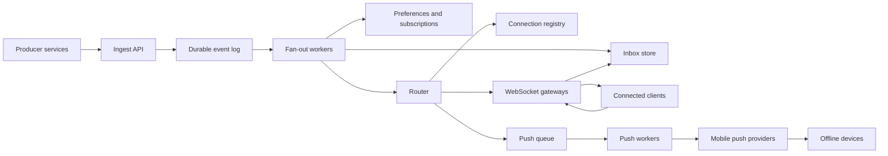
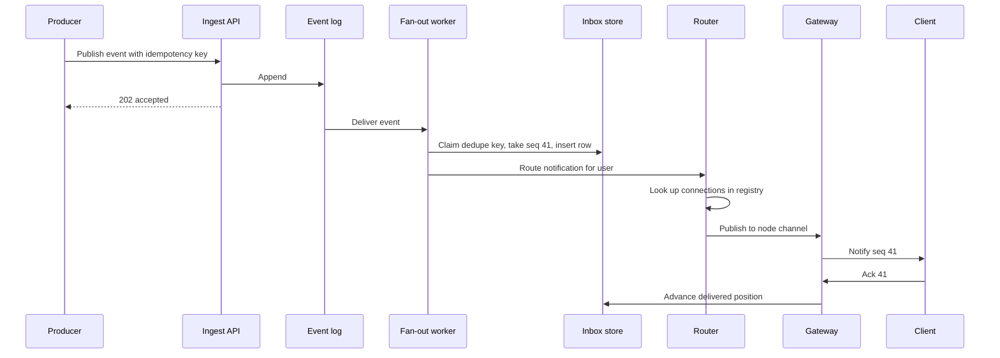
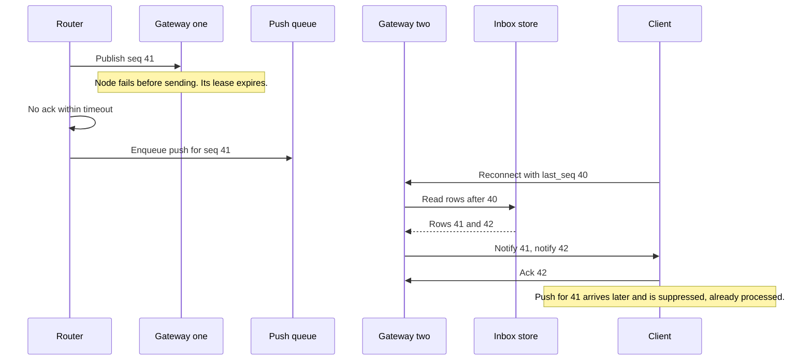

## Problem Statement

Events happen all over a product — an order ships, someone replies, a payment fails, an announcement goes out — and the people concerned should learn about them within a second or two, on whatever device they are using, or on their lock screen if they are using none.

The task is a shared notification system. Services publish events; the system works out who should be told, records the notification, and delivers it over a live connection when one exists and through a mobile push provider when it does not.

The difficulty is in the guarantees. Connections drop constantly and silently. A user may have three devices, or none online. A producer may publish the same event twice. One event may concern one person or ten million. Through all of this a user should see each notification once, in a sensible order, and should not lose one because a server restarted at the wrong moment.

## Requirements

**Functional**

- Accept events from producer services, addressed to a user, a list of users, or a topic with subscribers.
- Deliver to every connected device of each recipient in real time.
- Fall back to mobile push when the recipient has no live connection or does not acknowledge in time.
- Keep an inbox per user that a client can page through and synchronise from after being offline.
- Track delivered and read state, and expose an unread count.
- Respect per-user preferences: muted categories, quiet hours, channel choices.

**Non-functional**

- **At-least-once delivery, exactly-once display.** The system may send a notification more than once; the client shows it once.
- **Per-user ordering.** A user’s devices see that user’s notifications in one consistent order.
- **No loss after acceptance.** Once the ingest API acknowledges an event, a crash anywhere downstream does not lose it.
- **Latency.** For a connected recipient, under one second from acceptance to the device at the 99th percentile for direct notifications.
- **Isolation between classes.** A marketing broadcast must not delay a security alert.
- **Elastic connections.** Losing a connection server loses no data, only connections, which re-establish themselves.

## Capacity Estimation

**The figures below are illustrative assumptions chosen to exercise the design, not measurements from a real system.**

| Assumption | Value |
| --- | --- |
| Registered users | 50 million |
| Peak concurrent connections | 2 million |
| Notifications per day | 200 million |
| Peak-to-average ratio | 5 |
| Connections per gateway node | 50,000 |
| Heartbeat interval | 30 seconds |
| Average connection lifetime | 10 minutes |
| Stored notification size, retention | about 500 bytes, 30 days |

From these:

- **Notification rate:** 200,000,000 / 86,400 ≈ 2,315 per second on average, about 11,600 per second at peak.
- **Gateway nodes:** 2,000,000 / 50,000 = 40 at full occupancy; with 50% headroom for deployments and the loss of a zone, 60.
- **Heartbeats:** 2,000,000 / 30 ≈ 66,700 per second.
- **Connection churn:** 2,000,000 / 600 ≈ 3,300 new connections per second in steady state; the loss of one node adds 50,000 reconnections at once.
- **Inbox storage:** 200 million × 500 bytes = 100 GB per day; × 30 days = 3 TB.
- **Connected share:** 2 million of 50 million is 4% of users connected at the peak.

Three conclusions follow. Heartbeats outnumber notifications by almost six to one even at the notification peak, so liveness tracking must stay in gateway memory; writing each heartbeat to a shared store would cost more than the product’s actual traffic. Most recipients are offline at any moment, so the push and inbox path is the common case, not an exception path. And 3 TB written at up to 11,600 rows per second calls for an inbox sharded by user and partitioned by time, where retention is a dropped partition.

## High-level Architecture



The path has four stages, each with one job. The ingest API validates an event, deduplicates it and appends it to a durable log; that append is the moment the event is accepted. Fan-out workers consume the log, resolve the audience, apply preferences and write one row per recipient into the inbox store, assigning each row its place in that user’s sequence. The router looks up where each recipient is connected and forwards the notification to the right gateway, or to the push queue. Gateways hold the WebSocket connections and nothing else of value.

The inbox store is the source of truth for what a user should have seen. Live delivery is an optimisation on top of it: anything lost between the router and the device is recovered when the client next compares its position with the inbox.

## Low-level Design

**Producer deduplication.** Each event carries the producer’s own event identifier. The ingest API rejects repeats within a window, and the fan-out stage enforces the final guarantee: a unique key on `(user_id, dedupe_key)`, where the key is derived from the producer, the event identifier and the notification type. A log record processed twice after a worker crash cannot create a second inbox row.

**Per-user sequence.** Ordering and gap detection both rest on a contiguous sequence number per user, assigned in the transaction that writes the inbox row:

```sql
-- Step 1: claim the dedupe key. No row returned means a duplicate; stop here.
INSERT INTO inbox_dedupe (user_id, dedupe_key)
VALUES ($1, $2)
ON CONFLICT DO NOTHING
RETURNING dedupe_key;

-- Step 2: take the next sequence number. The row lock serialises writers for this user.
INSERT INTO user_counters (user_id, last_seq)
VALUES ($1, 1)
ON CONFLICT (user_id) DO UPDATE SET last_seq = user_counters.last_seq + 1
RETURNING last_seq;

-- Step 3: insert the inbox row with that sequence number, then commit.
```

Because the duplicate check comes first, a sequence number is never consumed by a duplicate, and the numbers have no gaps. The event log is partitioned by recipient, so in the normal case one worker handles one user’s events in order and the row lock is uncontended.

**Client protocol.** A client remembers the highest sequence number it has processed. After connecting it sends that number, and the gateway replies with everything after it from the inbox. Live frames carry their sequence number. A client applies three rules: a number at or below its position is a duplicate and is dropped; the next number is applied; a number that skips ahead means something was lost, and the client requests a sync from its position. Acknowledgements are cumulative — acknowledging 42 covers everything up to 42 — and are batched.

**Connection registry and presence.** When a connection is established, the gateway writes an entry mapping the user to the node, the connection and the device, in an in-memory data store shared by all routers. It removes the entry on disconnect. Entries are not refreshed per heartbeat. Instead each gateway node holds a lease that it renews every few seconds; an entry is valid only while its node’s lease is alive. When a node dies, its lease lapses and all 50,000 of its entries become invalid at once without anyone deleting them. Presence — whether a user is online — is the existence of at least one valid entry.

**Routing.** For each inbox row the router reads the user’s entries. For each valid entry it publishes the notification on that gateway node’s channel. This hop is deliberately at-most-once: it is fast, and anything dropped is repaired by the sequence check. If there are no entries, or no acknowledgement arrives within a short timeout, the router enqueues a push.

**Push fallback.** Push workers send through the mobile providers with the notification identifier as the collapse key. A push is a hint, not the record: when the app opens it synchronises from the inbox, and it suppresses a push whose sequence number it has already processed over the live connection.

**Fan-out strategy.** Audiences up to a threshold, for example 10,000 recipients, are fanned out on write: one inbox row each, in batches. Larger broadcasts are stored once in a broadcast table. Connected users receive them live because each gateway pushes the broadcast to its matching connections; everyone else picks them up on the next sync, when the client’s broadcast position is compared with the table. Ten million inbox rows are never written for one announcement.

**Connection management.** Gateways detect dead peers with a ping every 30 seconds and close after two missed replies. Each connection has a bounded send buffer; a client that cannot keep up is disconnected and will sync when it returns, which is cheaper than buffering without limit. Before a deployment, a gateway tells its clients to reconnect after a random delay, spreading the reconnection over a minute or more. Clients reconnect with exponential backoff and jitter.

**Receipts.** Delivered and read are positions, not per-row flags: each device has a delivered position, and each user has a read position plus a small set of exceptions for items read out of order. The unread count is the difference between the latest sequence number and the read position, adjusted by the exceptions.

## Component Responsibilities

| Component | Owns | Must never |
| --- | --- | --- |
| Ingest API | Authentication of producers, validation, first-level deduplication, appending to the log | Acknowledge before the append is durable |
| Event log | Durable, ordered, replayable events partitioned by recipient | Be used as the user-facing inbox |
| Fan-out workers | Audience resolution, preferences, inbox writes, sequence assignment | Push to devices directly |
| Inbox store | The record of what each user should see, and all positions | Be bypassed by a delivery that has no inbox row |
| Router | Choosing live delivery or push for each recipient | Treat a publish to a gateway as proof of delivery |
| Connection registry | Which user is connected to which node, node leases | Be the source of truth for anything durable |
| WebSocket gateways | Connections, heartbeats, per-connection buffers, sync on connect | Hold undelivered notifications as their only copy |
| Push workers | Provider calls, token hygiene, retries | Send content the user’s preferences exclude |
| Client | Its position, duplicate suppression, gap detection | Assume a live frame is the complete history |

## API Contracts

A producer publishes an event:

```http
POST /v1/events
Idempotency-Key: orders:shipment:88213:shipped
Content-Type: application/json

{
  "type": "order.shipped",
  "priority": "normal",
  "recipients": { "user_ids": ["u_1029"] },
  "payload": { "order_id": "88213", "title": "Your order has shipped" }
}
```

```http
HTTP/1.1 202 Accepted

{ "event_id": "evt_01JB7M" }
```

`202` means the event is durably accepted, not delivered. Repeating the request with the same key returns the same `event_id`.

On the WebSocket, the client opens with its position and the server replies with missed items, then live frames:

```json
{ "op": "hello", "device_id": "d_77", "last_seq": 40 }
```

```json
{ "op": "notify", "seq": 41, "id": "ntf_01JB7N", "type": "order.shipped",
  "payload": { "order_id": "88213", "title": "Your order has shipped" } }
```

```json
{ "op": "ack", "seq": 41 }
```

The remaining operations are small: `sync` with a position, `read` with a position or a list of identifiers, and a server `reconnect` frame carrying a delay. The same inbox is available over HTTP for clients without a socket: `GET /v1/inbox?after_seq=40` and `POST /v1/inbox/read`.

## Database Schema

```sql
CREATE TABLE inbox (
  user_id          uuid        NOT NULL,
  seq              bigint      NOT NULL,
  notification_id  uuid        NOT NULL,
  type             text        NOT NULL,
  priority         smallint    NOT NULL DEFAULT 1,
  payload          jsonb       NOT NULL,
  created_at       timestamptz NOT NULL DEFAULT now(),
  PRIMARY KEY (user_id, seq, created_at)
) PARTITION BY RANGE (created_at);

CREATE TABLE inbox_dedupe (
  user_id     uuid        NOT NULL,
  dedupe_key  text        NOT NULL,
  created_at  timestamptz NOT NULL DEFAULT now(),
  PRIMARY KEY (user_id, dedupe_key)
);

CREATE TABLE user_counters (
  user_id        uuid PRIMARY KEY,
  last_seq       bigint NOT NULL,
  read_seq       bigint NOT NULL DEFAULT 0,
  read_extra     bigint[] NOT NULL DEFAULT '{}',   -- items read out of order
  broadcast_seq  bigint NOT NULL DEFAULT 0
);

CREATE TABLE devices (
  user_id        uuid        NOT NULL,
  device_id      text        NOT NULL,
  push_token     text,
  platform       text,
  delivered_seq  bigint      NOT NULL DEFAULT 0,
  last_seen_at   timestamptz,
  PRIMARY KEY (user_id, device_id)
);

CREATE TABLE broadcasts (
  seq         bigserial PRIMARY KEY,
  topic       text        NOT NULL,
  payload     jsonb       NOT NULL,
  created_at  timestamptz NOT NULL DEFAULT now()
);

CREATE INDEX broadcasts_topic ON broadcasts (topic, seq);
```

All tables keyed by `user_id` are sharded by a hash of it, so one user’s inbox, counters and devices sit on one shard and the sequence assignment is a local transaction. The inbox primary key serves the only query that matters, “rows for this user after this sequence number”, as a single range scan; the partition column is included because a primary key on a partitioned table must contain it. Inbox partitions are weekly and dropped after 30 days, and `inbox_dedupe` is pruned on the same schedule. The schema is written in SQL for precision; the access pattern — partition by user, cluster by sequence — maps directly onto a wide-column store if write volume outgrows a relational one.

## Sequence Diagrams

Delivery to a connected user:



A gateway fails while notifications are in flight:



## Failure Scenarios

| Failure | Behaviour |
| --- | --- |
| Producer publishes the same event twice | The idempotency key returns the original event; if both reach fan-out, the dedupe key admits one inbox row. |
| Fan-out worker crashes mid-batch | The log redelivers from the last committed offset. Rows already written are skipped by the dedupe key; no sequence numbers are wasted. |
| Gateway node crashes | Its lease lapses and its registry entries stop being used. Clients reconnect elsewhere with backoff and sync from their position. Unacknowledged items go to push. |
| Frame lost between router and gateway | The next frame the client receives skips a number; the client requests a sync. If no further frame comes, the acknowledgement timeout sends a push. |
| Client connection is half-open | Two missed heartbeats close it. Until then the acknowledgement timeout covers the gap with a push. |
| Connection registry unavailable | The router cannot locate connections and sends everything to push; gateways still serve syncs from the inbox. Delivery degrades from live to delayed, not to lost. |
| Push provider is slow or rejecting | The push queue absorbs the backlog with retries and backoff. Invalid tokens reported by the provider are removed from the device table. |
| Mass reconnection after a node or network failure | Jittered backoff on clients, connection-rate limits on gateways, and sync reads limited per page keep the inbox store from being flooded. |
| Broadcast to millions | Stored once; live pushes are paced per gateway; it runs in the bulk priority class and cannot occupy the workers that serve direct notifications. |
| Inbox shard fails over | Fan-out for that shard’s users pauses and the log retains their events; processing resumes from the committed offset. |

## Security Considerations

- **Producer authentication.** Internal services authenticate with workload identity and are authorised per notification type; a service cannot publish types it does not own.
- **Connection authentication.** A client connects with a short-lived token obtained over the normal authenticated API. The gateway binds the connection to the user in the token and re-validates on expiry, closing connections whose tokens are not renewed.
- **Authorisation of reads.** The user identifier for sync and read operations always comes from the connection’s token, never from a frame.
- **Topic subscriptions are decided server-side.** A client cannot subscribe itself to an arbitrary topic by naming it.
- **Payload minimisation.** Push payloads pass through third-party providers and appear on lock screens. Sensitive categories send a generic push and let the app fetch the content over its authenticated connection.
- **Transport and origin.** TLS on every hop; the WebSocket handshake checks the origin; frames are size-limited and rate-limited per connection.
- **Abuse limits.** Per-producer quotas and per-recipient caps stop a faulty or compromised service from flooding users.
- **Device tokens** are treated as personal data: stored per device, removed on sign-out, and never logged.

## Scalability Strategy

- **Gateways** scale horizontally with connection count. They are stateful only in the connections they hold, so adding nodes is safe and removing them is a controlled drain.
- **Fan-out workers** scale with the number of log partitions. Partitioning by recipient preserves per-user order while allowing parallelism across users.
- **Priority classes** have separate log topics and worker pools: critical, normal and bulk. Capacity is reserved for the critical class.
- **The inbox store** is sharded by user. Writes are the bottleneck; batching inbox inserts per shard and using positions for receipts instead of per-row updates keep the write rate close to one row per notification.
- **The connection registry** holds about 2 million small entries and sees a few thousand writes per second, well within a small in-memory cluster, because heartbeats never reach it.
- **Routing** uses one channel per gateway node, so a notification is sent to exactly the nodes that hold the recipient’s connections, not broadcast to all 60.
- **Regions.** Users connect to the nearest region; the registry is regional, and a notification for a user connected elsewhere is forwarded once between regional routers.

## Trade-offs

- **A durable inbox with client sync over a guaranteed message bus to the device.** Every notification costs a database write even when live delivery would have succeeded. In return, the unreliable hops can stay simple and fast, and reconnection is the single recovery mechanism.
- **At-least-once with client deduplication over exactly-once delivery.** Clients must track a position and tolerate repeats. Exactly-once across a mobile network and a third-party push provider is not available at any price.
- **Per-user ordering over global ordering.** Two users may see the same two broadcasts in different relative positions to their own notifications. A global order would need a global sequencer and would buy nothing users can perceive.
- **Node leases over per-connection presence refresh.** Presence can be wrong for a few seconds after a node dies, and a single half-open connection is noticed only by its own heartbeat. The alternative costs tens of thousands of writes per second to track state that is almost always unchanged.
- **Fan-out on write for small audiences, on read for broadcasts.** Two code paths and a threshold to tune. Using write fan-out alone makes an announcement cost millions of rows; using read fan-out alone makes every sync a join across many sources.
- **Push after an acknowledgement timeout over push always.** A connected user whose acknowledgement is slow may get both a live notification and a push that the app must suppress. Sending push every time would be simpler and would double-notify the most active users.
